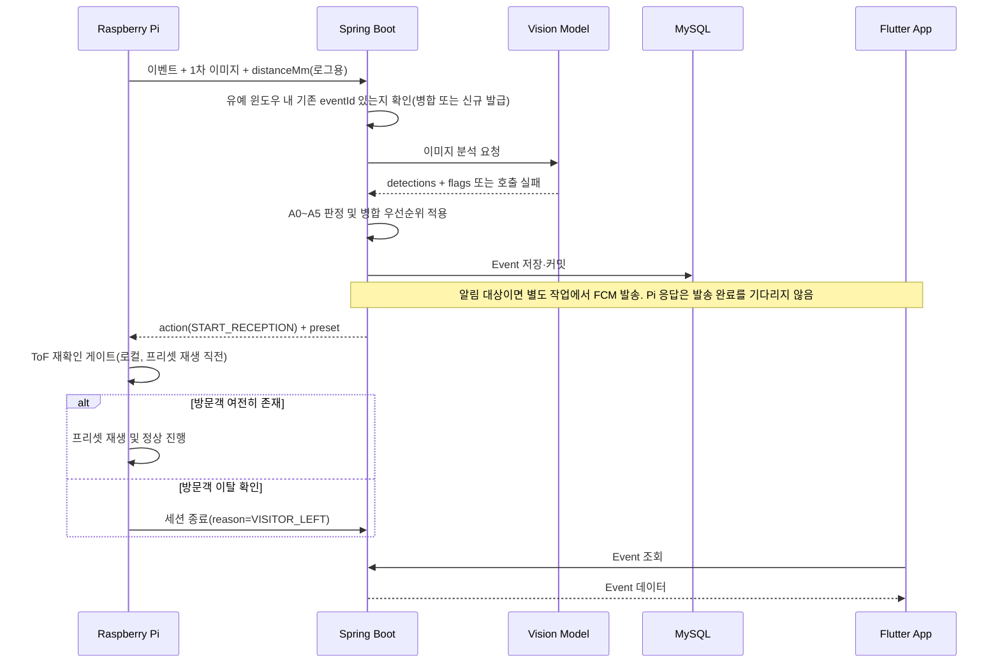
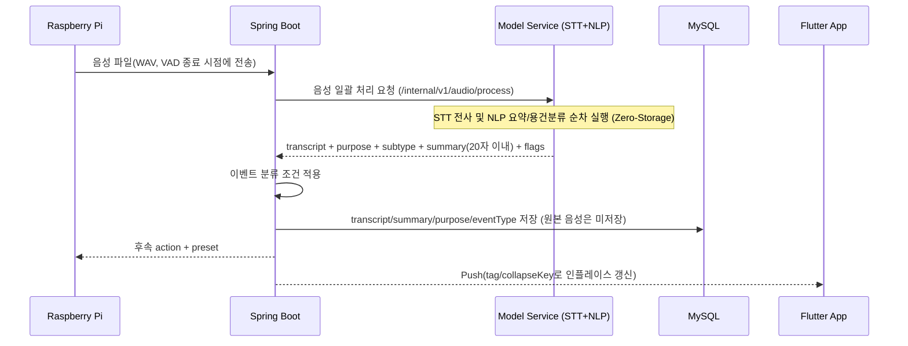

# DataCat 무인현관 API 명세서

> **Version**: v1.5  
> **Date**: 2026-10-21\
> **Scope**: Raspberry Pi ↔ Spring Boot ↔ 모델 서비스 ↔ Flutter App  
> **Status**: 팀 합의용 확정본. `TBD` 항목은 이벤트 분류 기획 또는 실측 과정에서 확정한다.  
> **v1.5 변경**: 모델 서비스 출력을 이벤트 분류 기획(feature/app-design `상황분류_종류와_조건.md`)에 맞춤 — `purpose` 9개 값(7.6), 배송 세부 유형 `subtype`, 처리 상태 `flags`, Vision `animal` 라벨과 `LOW_VISIBILITY` 표시.  
> **v1.4 변경**: 모델 서비스(7장) 응답 규칙 확정 — `label` 값(`person`/`package`)과 package 범위, 발화 없음 응답, 요약 문체·검증, 음성 30초 처리, 상태 확인 API(7.5), 모델 서비스 오류 코드(12장), 포트 8000 제안(16장).  
> **v1.3 변경**: ToF 재확인 게이트를 Spring(서버, 지연된 값 재사용)에서 Pi(현관기기, 실시간 로컬 판단)로 이동. 6.4 세션 종료 API의 트리거 조건을 이 로직에 맞춰 구체화. `EventStatus`를 실제 관측되는 상태만 남기도록 축소. 12장 오류 코드에서 미구현 인증(401) 제거. 4.1 모델 서비스 주소를 예시 표기임을 명확히 함. 13.1/13.2 시퀀스 다이어그램을 Pi-로컬 ToF 재확인 반영해 수정.

### Spring 구현 현황 — 팀플 7주차, 2026-10-21

이 문서는 구현된 API와 이후 구현할 계약을 함께 포함한다. 아래 표는 `feature/push-notification`의 현재 Spring 구현 범위다.

| 항목 | 현재 상태 |
|---|---|
| 사진 접수·Vision 호출·사진 저장·30초 방문 병합 (6.1) | 구현 |
| 사진 판정 A0~A5·앱 표시 필드 6개 (6.1, 9장) | 구현 |
| 프리셋 3종 조회 (10.1) | 구현. Pi의 실제 재생 연동은 별도 시험 대상 |
| 푸시 토큰 등록·DB 커밋 후 비동기 FCM 발송 (11장) | 구현. 실제 Android 앱의 알림 수신·상세 이동 확인 |
| 문 앞 잔류 물품의 반복 알림 방지 (판정표 A-1) | 상태 저장용 코드·서비스 테스트 작성. 6.1 호출 흐름 연결은 미완료 |
| 2차 사진·음성·세션 종료 (6.2~6.4) | Spring API 구현 예정 |
| 실제 Pi·실제 Vision 모델과의 통합 시험 | Pi 담당이 이전 feature/image-upload로 별도 시험. 현재 푸시 브랜치 반영 후 재시험 예정 |
| Spring·MySQL·모델의 전체 Docker 실행 구성 | Pi 담당 환경에서 기존 브랜치 실행 확인. 현재 푸시 브랜치 반영·재현 확인은 후속 작업 |

---

## 1. 문서 목적

이 문서는 DataCat 무인현관 프로젝트에서 각 담당 파트가 **어떤 데이터를 어떤 형식으로 주고받는지** 정의한다.

핵심 구조는 다음과 같다.

```text
Raspberry Pi
    ↓
Spring Boot
    ├─→ 이미지 인식 모델
    ├─→ STT 모델
    ├─→ 자연어 처리 모델
    ├─→ MySQL
    └─→ Flutter App / Push
```

Spring Boot는 단순 저장 서버가 아니라 **전체 흐름을 중개하고 상태를 관리하는 중앙 서버**다.

모델끼리는 직접 통신하지 않는다.

```text
Pi → Spring → STT → Spring → NLP → Spring  (또는 Spring → 통합 Audio Process → Spring)
Pi → Spring → Vision → Spring
```

모델 구현체는 개발 중 변경될 수 있으므로 API 이름에는 `YOLO`, `Whisper`, `Qwen` 같은 특정 모델명을 넣지 않고 **기능 기준**으로 정의한다.

---

## 2. 담당 범위

| 담당 | 주요 역할 |
|---|---|
| Raspberry Pi | ToF/버튼 이벤트 감지, 사진 촬영, 음성 녹음, Spring으로 전송, Spring 응답에 따라 프리셋/LED/스피커 등 실행 |
| Spring Boot | API 제공, `eventId` 생성, 이벤트 상태 관리, 모델 API 순차 호출, 이벤트 분류 조건문 구현, DB 저장, 프리셋 결정, 앱 API, Push, 예외 처리 |
| 모델 담당 | 이미지 인식, STT, 자연어 처리(요약/용건 분석). 서버가 전달한 입력을 모델에 넣고 정해진 형식의 결과를 Spring에 반환 |
| 앱 + 이벤트 분류 담당 | Flutter 앱 구현, 상황 분류 종류와 조건 기획, 초인종 3D 모델링 |

> **중요:** 이벤트 분류 담당은 **분류 종류와 조건을 기획**하고, 실제 조건문/판정 코드는 Spring Boot에 구현한다.

---

## 3. 실행 및 배포 구조

테스트와 최종 시연은 **한 PC에서 실행**하는 것을 기본으로 한다.

```text
[한 PC]
 ├─ Spring Boot
 ├─ Model Service
 │   ├─ Vision
 │   ├─ STT
 │   └─ NLP
 └─ MySQL
```

Spring Boot는 Docker 컨테이너로 배포한다. 팀원은 GitHub 저장소를 내려받아 자신의 PC에서 서버를 실행해 각 파트와 연동 테스트한다.

모델 담당은 GPU를 사용할 수 있으나 특정 GPU 모델(RTX 3090 등)에 API 명세가 종속되지 않는다.

> **분산 개발 환경 지원**: 평소 개발 중에는 팀원 각자 자신의 PC에서 전체 스택(Spring + Model + MySQL)을 띄워 테스트한다. 단일 물리 Pi가 그때그때 다른 팀원의 서버를 바라볼 수 있도록, Pi 단말은 `.env` 파일 기본값 또는 실행 시 CLI 인자(`--server-url=...`)로 접속 대상 서버 URL을 교체할 수 있게 구현한다. 통합 테스트·리허설 시에만 한 곳(Pi 거치 관리자의 서버)으로 고정한다.

---

## 4. 공통 규칙

### 4.1 Base URL

외부 API(Pi/App → Spring):

```text
https://api.{도메인}/api/v1
```

> Cloudflare Tunnel을 통한 공인 HTTPS 접근을 기본으로 한다. 로컬 개발 시에는 팀원 PC의 사설 주소(`http://{host}:{port}/api/v1`)를 `.env`로 대체할 수 있다.

Spring → 모델 서비스 내부 API:

```text
http://{model-service-host}:{port}/internal/v1
```

> 예시 표기이며, 실제 호스트명/포트/Docker 서비스 이름은 Docker Compose 및 실행 환경에서 확정한다(16장 TBD 참고).

### 4.2 Content-Type

JSON 요청/응답:

```http
Content-Type: application/json
```

이미지/음성 파일 업로드:

```http
Content-Type: multipart/form-data
```

### 4.3 시간 형식

ISO-8601 사용.

```text
2026-09-20T22:30:00+09:00
```

### 4.4 ID

- `eventId`: Spring Boot가 발급하는 방문 이벤트 식별자
- `deviceId`: Raspberry Pi 장치 식별자

예시:

```text
eventId: 101
deviceId: door-01
```

---

## 5. 공통 상태값

### 5.1 TriggerType

| 값 | 의미 |
|---|---|
| `TOF` | ToF 센서 감지로 시작 |
| `BUTTON` | 호출벨 입력으로 시작 |

### 5.2 EventStatus

| 값 | 의미 |
|---|---|
| `WAITING_AUDIO` | 방문객 음성 입력 대기 |
| `COMPLETED` | 정상 종료 |
| `FAILED` | 처리 실패 |

> 전체 파이프라인은 Pi의 요청-응답 한 번 안에서 동기적으로 처리되며 별도의 폴링(polling) 수단이 없다. `CREATED`, `VISION_ANALYZING`, `SPEECH_ANALYZING`, `CLASSIFYING` 같은 중간 상태는 어떤 API 응답에서도 관측될 수 없으므로 v1.3에서 제거했다. 위 3개 값만 실제로 응답에 등장한다.

### 5.3 DeviceAction

| 값 | Pi 동작 |
|---|---|
| `START_RECEPTION` | 프리셋 안내 후 음성 입력 시작 |
| `SILENT_STANDBY` | 출력 없이 세션 처리/종료 |
| `PLAY_PRESET` | 지정된 프리셋 재생 |
| `END_SESSION` | 세션 종료 후 초기 감시 상태 복귀 |
| `ERROR` | 로컬 오류 안내 후 종료 |

> **마이크 개방 시퀀스 제약**: `START_RECEPTION`을 받은 Pi는 반드시 프리셋 음성 출력이 끝난 뒤에만 마이크를 연다. 예고 없이 마이크를 여는 것은 금지한다 — 도청 관련 법적 리스크를 막기 위한 필수 제약이다.

> **ToF 재확인 게이트(Pi 로컬 처리)**: `START_RECEPTION`을 받은 Pi는 프리셋 음성을 재생하기 **직전** 자신의 ToF 센서를 다시 한번(로컬, 즉시) 읽어 사람이 여전히 있는지 확인한다. 1차 촬영과 서버 왕복 사이의 지연 동안 방문객(주로 배달 기사)이 이미 이탈했을 수 있기 때문이다. 이 재확인은 서버로 데이터를 보내 판정받지 않고 Pi가 전적으로 로컬에서 즉시 판단한다 — ToF는 Pi에 붙은 센서라 네트워크 왕복 없이 확인 가능하고, 지연 없는 최신값을 쓸 수 있기 때문이다.
> - ToF가 여전히 근접 범위를 감지하면 그대로 프리셋을 재생하고 정상 진행한다.
> - ToF가 기준선(빈 상태)으로 복귀했으면 프리셋을 재생하지 않고, `POST /api/v1/device/events/{eventId}/end`를 `reason: VISITOR_LEFT`로 호출해 세션을 무응답으로 종료한다(6.4 참고).

---

# 6. Raspberry Pi → Spring API

## 6.1 이벤트 생성 + 1차 이미지 전송

방문 이벤트 발생 직후 Pi가 1차 이미지를 Spring으로 전송한다.

### Endpoint

```http
POST /api/v1/device/events
```

### Request

`multipart/form-data`

| 필드 | 타입 | 필수 | 설명 |
|---|---|---:|---|
| `metadata` | JSON (`application/json`) | O | 이벤트 메타데이터 |
| `image` | File (`image/jpeg`) | O | 1차 판정용 이미지 |

`metadata` 예시:

> 요청 전체는 `multipart/form-data`이며, `metadata` 파트의 Content-Type은 반드시 `application/json`으로 지정한다. 일반 텍스트 파트(`text/plain`)로 전송하면 Spring은 415 `UNSUPPORTED_MEDIA_TYPE`을 반환한다. `image` 파트는 파일 이름과 `image/jpeg` Content-Type을 포함해야 한다.

```json
{
  "deviceId": "door-01",
  "triggerType": "TOF",
  "distanceMm": 1850,
  "capturedAt": "2026-09-20T22:30:00+09:00"
}
```

> `distanceMm`: 촬영 시점 ToF 거리값(mm). 이벤트 기록·로그용 정보이며, 방문객 이탈 재확인은 Pi가 로컬에서 별도로 수행한다(5.3 참고). Spring의 판정에는 사용하지 않는다.

### 센서·버튼 동시 입력 처리

#### 서버의 방문 병합

- 같은 deviceId의 마지막 성공 사진 요청의 서버 처리 시작 시각을 기준으로, 30초 이내 요청은 기존 방문으로 병합한다.
- TOF와 BUTTON처럼 입력 종류가 달라도 같은 장치이면 병합 대상이다.
- 성공 요청마다 병합 기준 시각을 갱신한다.
- 신규 방문은 HTTP 201, 기존 방문 병합은 HTTP 200을 반환한다.
- 병합 시 기존 eventId와 최초 triggerType을 유지한다.

#### Pi 입력 처리 협의 방향

2026-10-15 Pi·서버 담당자가 확인한 방향이며, 실제 장치 연결 후 동작을 검증한다.

- 센서와 버튼 입력이 동시에 발생하면 먼저 들어온 입력 하나로 접수를 시작하고, 나머지 중복 시작 입력은 무시한다.
- 서버 전송·안내 음성 재생·녹음이 진행 중일 때는 새 접수를 동시에 시작하지 않는다.
- 서버의 30초 방문 병합과 Pi의 입력 차단 기간은 별도로 관리한다.

#### 장치 시험 후 확정할 사항 — TBD

- 동시 입력으로 묶는 시간 범위와 버튼 중복 신호 제거 기준
- 접수 진행 중 추가 버튼 입력을 무시할지, 한 번 보류할지
- 접수 완료·오류 발생 후 다시 입력을 받을 수 있는 상태로 돌아가는 조건과 시점

### Spring 처리 순서

```text
1. 요청 검증
2. 최근 세션이 유예 윈도우(30초) 내에 존재하는지 확인
   → 존재하면 새 eventId를 발급하지 않고 기존 eventId를 재사용·병합
   → 없으면 Event 생성 및 신규 eventId 발급
3. 1차 이미지 저장
4. Vision API 호출
5. 정상 응답이면 A1~A5 판정, 모델 호출/응답 실패면 A0 판정
6. 신규/병합 판정 규칙을 적용하고 사진·분류 정보를 DB에 저장·커밋
7. 알림 대상이면 별도 작업 큐에 FCM 발송 요청
8. Pi가 수행할 action 반환 (FCM 발송 완료는 기다리지 않음)
```

### 사진 판정 — 판정표 A 반영

아래 조건을 위에서부터 검사해 처음 일치하는 줄을 사용한다. `person`·`package`의 존재 및 개수는 검증된 `detections`의 해당 라벨 개수다. 별도 신뢰도 임계값은 현재 추가하지 않는다. `distanceMm`은 기록용이다.

| 규칙 | 조건 | status / action | eventType | mainCategory | needsReview |
|---|---|---|---|---|---|
| A0 | 모델 연결·읽기 타임아웃·HTTP 오류·응답 형식 오류 | WAITING_AUDIO / START_RECEPTION | null | null | true |
| A1 | 사람 있음 | WAITING_AUDIO / START_RECEPTION | null | null | LOW_VISIBILITY일 때 true |
| A2 | 사람 없음 + BUTTON | WAITING_AUDIO / START_RECEPTION | null | null | LOW_VISIBILITY일 때 true |
| A3 | 사람 없음 + TOF + 물품 있음 | COMPLETED / SILENT_STANDBY | UNATTENDED_DELIVERY | 물품만 있음 | false |
| A4 | 사람·물품 없음 + TOF + LOW_VISIBILITY | COMPLETED / SILENT_STANDBY | CAMERA_BLOCKED | 안전 확인 필요 | true |
| A5 | 그 외. 사람·물품 없음 또는 동물만 감지 | COMPLETED / SILENT_STANDBY | NO_VISITOR | 기타·판단 불가 | false |

- A0~A2의 `responsePolicy`는 `일반 접수`, A3~A5는 `무응답`이다.
- `processingStatus`는 기본 `정상`, A0는 `이미지 판단 실패`, A1에서 사람이 2명 이상이면 `복수 방문자`다.
- `reason`은 서버가 판정 근거 한 줄을 만든다. A1/A2에서 `LOW_VISIBILITY`이면 `카메라 가림 상태에서 호출`로 기록한다.
- 음성 분석 전에는 A0~A2의 `eventType`, `mainCategory`, `subCategory`, `purpose`, `transcript`, `summary`를 비워 둔다. 앱은 `WAITING_AUDIO`를 기준으로 접수 중임을 표시한다.
- 모델 장애가 A0로 처리되고 저장에 성공하면 신규 201 또는 병합 200을 반환한다. 파일 읽기·DB 저장 등 다른 서버 오류는 A0로 숨기지 않는다.

### 병합 시 판정과 알림

- 사진·거리값·Vision 결과·마지막 성공 요청 시각은 갱신한다. 세션 사진의 물품 최대 개수도 기록한다.
- 기존 사진 판정이 없으면 새 판정을 적용한다.
- 기존 판정이 있으면 새 A0는 덮어쓰지 않는다. 나머지는 A0~A5 순서에서 새 판정이 더 앞설 때만 분류·상태·종료 시각을 갱신한다.
- 같거나 낮은 우선순위이면 기존 분류·상태·종료 시각을 유지한다. 같은 규칙 안의 세부 값 변경도 현재는 분류 갱신으로 취급하지 않는다.
- 신규 또는 분류가 변경된 A0~A4만 푸시 대상이다. A5와 분류가 유지된 병합은 발송하지 않는다.
- 예를 들어 A3 이후 A1은 음성 대기로 바뀌고 같은 방문 태그로 알림을 갱신한다. A1 이후 A3는 기존 음성 대기 판정을 유지한다.

### 문 앞 잔류 물품 — 연결 작업 남음

판정표 A-1의 목표는 같은 물품이 계속 보이면 기존 물품 이벤트를 재사용하고, 실제 감지 개수가 늘었을 때만 새 이벤트·알림을 만드는 것이다.
`DevicePackageState`와 `PackageReceptionService` 및 서비스 테스트는 작성했으나, 현재 6.1은 이 서비스를 호출하지 않는다.
따라서 **30초 병합 창을 벗어난 같은 물품의 반복 이벤트·알림 방지는 아직 보장하지 않는다.**

30초 일반 방문 병합과 물품 추가 시 신규 이벤트 생성의 적용 순서, 진행 중인 사람 응대와 물품 상태의 연결을 정리한 뒤 호출 흐름·파일 정리·통합 테스트에 반영한다. A5에서 물품 상태를 비우는 연결과 응대 종료 시 최대 물품 수 저장도 후속 작업이다.

> 사람 감지 시 `START_RECEPTION`을 반환하지만, 이 시점 이후 방문객이 실제로 자리에 있는지에 대한 최종 확인은 Pi가 로컬 ToF로 수행한다(5.3 참고). Spring은 지연된 값으로 재판정하지 않는다.

### Response 예시 — 사람 응대 필요

```json
{
  "eventId": 101,
  "status": "WAITING_AUDIO",
  "action": "START_RECEPTION",
  "preset": {
    "presetId": 1,
    "text": "마이크에 말씀해 주세요."
  }
}
```

### Response 예시 — 무응답 처리

```json
{
  "eventId": 102,
  "status": "COMPLETED",
  "action": "SILENT_STANDBY"
}
```

> 어떤 Vision 결과에서 `START_RECEPTION` 또는 `SILENT_STANDBY`로 분기할지는 이벤트 분류 기획에 따라 Spring 조건문으로 구현한다.

---

## 6.2 2차 기록용 스냅샷 전송

사람 응대 분기에서 프리셋 출력 후 촬영한 기록용 스냅샷을 전송한다.

### Endpoint

```http
POST /api/v1/device/events/{eventId}/snapshot
```

### Request

`multipart/form-data`

| 필드 | 타입 | 필수 |
|---|---|---:|
| `image` | File (`image/jpeg`) | O |

### Response

```json
{
  "eventId": 101,
  "saved": true,
  "snapshotUrl": "/api/v1/events/101/snapshot"
}
```

> 물건만 감지되어 2차 촬영을 하지 않는 경우에는 1차 촬영 이미지를 기록용 스냅샷으로 사용할 수 있다.

---

## 6.3 방문객 음성 전송

Pi가 방문객 발화를 녹음한 뒤 음성 파일을 Spring으로 전송한다.

> **녹음 종료 기준(VAD)**: Pi는 고정된 녹음 제한 시간을 두지 않고, VAD(음성 활동 감지)가 발화 후 700~1,000ms의 침묵을 감지하면 자동으로 녹음을 종료하고 즉시 전송한다.

### Endpoint

```http
POST /api/v1/device/events/{eventId}/audio
```

### Request

`multipart/form-data`

| 필드 | 타입 | 필수 | 설명 |
|---|---|---:|---|
| `audio` | File (`audio/wav`, PCM 16-bit, 16kHz, Mono) | O | 방문객 음성 파일. WAV/PCM 16kHz Mono는 Whisper 권장 입력 규격 |

> **Zero-Storage 원칙**: 음성 파일은 STT 전사가 완료되는 즉시 메모리 버퍼와 임시 파일에서 영구 삭제한다. 영구 DB에는 전사문·요약문 등 텍스트만 보관하고 원본 음성은 보관하지 않는다.

### Spring 처리 순서

```text
1. Pi → Spring : 음성 파일
2. Spring → STT/NLP 모델 서비스 : 음성 파일 전송 (7.4 통합 엔드포인트 권장)
3. 모델 서비스 : STT 전사 및 요약/용건 분석 일괄 수행
4. Spring : transcript, summary, purpose 수신
5. Spring : 이벤트 분류 조건 적용
6. Spring : Event/DB 갱신 (원본 음성은 비저장)
7. Spring : Pi에 후속 action 반환
8. Spring : 필요 시 앱 Push 발송 (인플레이스 태그 적용)
```

### Response 예시

```json
{
  "eventId": 101,
  "status": "COMPLETED",
  "action": "PLAY_PRESET",
  "preset": {
    "presetId": 2,
    "text": "접수되었습니다."
  }
}
```

> STT 원문, 요약, 용건 분석 결과는 서버/앱용 데이터다. Pi가 반드시 받을 필요는 없다.

---

## 6.4 세션 종료 알림

ToF로 방문객 이탈을 감지했거나 Pi가 세션 종료 사실을 서버에 알려야 할 때 사용한다.

> Pi는 5.3의 ToF 재확인 게이트에서 방문객이 이미 이탈한 것으로 판단되면(프리셋 재생 직전), 프리셋을 재생하지 않고 이 API를 `reason: VISITOR_LEFT`로 즉시 호출해 세션을 무응답으로 종료한다. 이것이 `VISITOR_LEFT`의 표준 트리거 조건이다.

### Endpoint

```http
POST /api/v1/device/events/{eventId}/end
```

### Request

```json
{
  "reason": "VISITOR_LEFT",
  "endedAt": "2026-09-20T22:30:30+09:00"
}
```

`reason` 값:

| 값 | 트리거 조건 |
|---|---|
| `VISITOR_LEFT` | Pi의 ToF 재확인 게이트(5.3)가 프리셋 재생 직전 방문객 이탈을 감지했을 때 |
| `TIMEOUT` | 마이크 개방 후 방문객 발화 없이 VAD 대기 시간이 초과되었을 때 |
| `DEVICE_CANCELLED` | *(예약, 현재 미사용)* — Pi 단말이 로컬 사유(전원 차단, 하드웨어 오류 등)로 세션을 강제 종료해야 할 경우를 위해 남겨둔 값. 현재 펌웨어 로직에는 이를 발생시키는 조건이 없으며, Phase 3 이후 트리거 조건이 정의되면 사용한다. |

### Response

```json
{
  "eventId": 101,
  "status": "COMPLETED",
  "action": "END_SESSION"
}
```

> 서버 타이머에 의해 세션이 종료되는 경우에는 Pi가 이 API를 호출하지 않아도 된다.

---

# 7. Spring → 모델 서비스 내부 API

모델 서비스는 Spring Boot에서만 호출한다.

모델끼리는 직접 호출하지 않는다.

```text
Spring → Vision → Spring
Spring → Audio Process (STT + NLP 통합) → Spring
```

---

## 7.1 이미지 인식

### Endpoint

```http
POST /internal/v1/vision/detect
```

### Request

`multipart/form-data`

| 필드 | 타입 | 필수 |
|---|---|---:|
| `image` | File (`image/jpeg`) | O |

### Response

```json
{
  "detections": [
    {
      "label": "person",
      "confidence": 0.94
    }
  ],
  "flags": []
}
```

### 필드 설명

| 필드 | 타입 | 설명 |
|---|---|---|
| `detections` | Array | 이미지에서 인식된 항목 목록 |
| `label` | String | 인식된 항목. 허용 값: `person`, `package`, `animal`. `package`는 택배 박스, 비닐 택배봉투, 배달 음식 봉지·용기, 보냉백, 꽃다발, 케이크·선물 상자, 봉투, 전단지를 모두 포함한다. 사람이 들고 있는 물건도 `package`로 나올 수 있다(구분하지 않음). `animal`은 개·고양이·새 |
| `confidence` | Number | 모델 신뢰도, 0.0 ~ 1.0 |
| `flags` | Array | 이미지 상태. `LOW_VISIBILITY`: 화면에 질감이 거의 없음(렌즈를 손·테이프·덮개로 가림). 어두운 복도라도 질감이 있으면 붙지 않고, `person`이 감지되면 붙지 않는다. "카메라 가림"(기획: 안전 확인 필요) 최종 판단은 Spring이 ToF 근접 감지와 함께 한다 |

> `YOLO`는 현재 후보 모델이지만 구현체가 바뀌어도 이 API 계약은 유지한다.

> **새 값 대비**: Spring은 모르는 `label`·`flags` 값을 받으면 무시하고 계속 처리한다. 값은 이 명세에 먼저 추가한 뒤 쓴다.

> **동물만 감지**: `animal`만 있고 `person`이 없으면 사람 방문으로 응대하지 않는다(이벤트 분류 기획 공통 조건). 물품이 있으면 물품만 있음, 없으면 종료.

> bounding box가 서버 판정에 필요해질 경우 `bbox` 필드를 선택적으로 추가할 수 있다. 현재 MVP에서는 필수 아님.

> **Spring 판정**: 현재 6.1의 A0~A5 조건을 적용한다. 사람 감지 외에 버튼 입력·물품·`LOW_VISIBILITY`·모델 장애를 함께 처리한다. 실제 응대 직전 방문객이 남아 있는지는 Pi가 로컬 ToF로 재확인한다(5.3). 모델 내부 오류는 12장에 정의하되, 사진 접수의 모델 호출 실패는 Spring에서 A0로 처리한다.

---

## 7.2 STT 전사 (단위 테스트용)

### Endpoint

```http
POST /internal/v1/speech/transcribe
```

### Request

`multipart/form-data`

| 필드 | 타입 | 필수 |
|---|---|---:|
| `audio` | File (`audio/wav`, PCM 16-bit, 16kHz, Mono) | O |

### Response

```json
{
  "transcript": "택배 왔습니다. 문 앞에 놓고 갈게요."
}
```

### 필드 설명

| 필드 | 타입 | 필수 | 설명 |
|---|---|---:|---|
| `transcript` | String | 음성을 텍스트로 변환한 전사 결과 |

> Whisper 등 어떤 STT 모델을 쓰더라도 Spring은 동일한 응답 형식을 받는다.

> **음성 길이**: 앞 30초만 전사한다. 더 긴 음성을 모두 처리하면 Pi 타임아웃(3~5초)을 넘기기 때문이다. 업로드는 16MB까지이며, 넘으면 400 `INVALID_REQUEST`.

> **Zero-Storage 원칙**: 모델 서비스도 전사 완료 즉시 수신한 음성 파일을 삭제하며, 별도로 보관하지 않는다.

---

## 7.3 자연어 처리 — 요약 / 용건 분석 (단위 테스트용)

Spring이 STT에서 받은 `transcript`를 다시 NLP API에 전달한다.

### Endpoint

```http
POST /internal/v1/language/analyze
```

### Request

```json
{
  "transcript": "택배 왔습니다. 문 앞에 놓고 갈게요."
}
```

### Response

```json
{
  "summary": "택배 문 앞 보관",
  "purpose": "DELIVERY",
  "subtype": "PARCEL",
  "flags": []
}
```

### 필드 설명

| 필드 | 타입 | 필수 | 설명 |
|---|---|---:|---|
| `summary` | String | 방문객 발화 요약. **공백 포함 최대 20자 이내**, 명사형(예: `택배 문 앞 보관`, 이벤트 분류 담당 확인 대기). 모델 서비스도 같은 규칙(`substring(0, 19) + "…"`)으로 자르고, Spring Boot도 수신 시 방어적으로 절단한다. 요약에는 방문객이 말한 낱말만 쓴다("보관"·"방문"·"문의" 같은 일반 낱말은 예외). 말하지 않은 낱말(예: 말하지 않은 "문 앞")이 있으면 전사문을 요약으로 대신 보내고 `SUMMARY_FROM_TRANSCRIPT`를 붙인다 |
| `purpose` | String | 용건. 허용 값은 7.6의 9개 |
| `subtype` | String \| null | `purpose`가 `DELIVERY`일 때만 배송 세부 유형(7.6), 그 외에는 `null` |
| `flags` | Array | 결과를 어떻게 만들었는지. `NO_SPEECH`(발화 없음), `SUMMARY_FROM_TRANSCRIPT`(요약이 말한 내용과 달라 전사문을 요약으로 사용 — 기획의 "요약 실패"), `RULES_FALLBACK`(언어 모델 실패·미로딩, 또는 답을 읽을 수 없어 키워드 규칙이 판단). 하나라도 있으면 Spring이 "사용자 확인 필요"로 표시하는 것을 권장 |

> `Qwen` 계열 sLM은 현재 후보 모델이며 다른 모델로 변경될 수 있다. Spring은 모델 이름이 아니라 위 API 계약에만 의존한다.

> `purpose` 값은 이벤트 분류 기획의 발화 기반 분류 9개다(7.6). v1.4의 후보 값은 `INSPECTION` → `SERVICE_VISIT`, `VISIT` → `PERSONAL_VISIT`, `ETC` → `UNKNOWN`으로 바뀌고 `PICKUP`·`PUBLIC_EMERGENCY`·`SOLICITATION`·`WRONG_VISIT`·`SAFETY_REVIEW`가 추가된다.

---

## 7.4 음성 일괄 처리 (권장 — STT+용건분류 통합 엔드포인트)

Spring ↔ Python이 매 단계마다 왕복하지 않도록, 같은 서버 내부에서 STT와 용건분류를 순차 처리해 최종 결과만 한 번에 반환하는 엔드포인트를 둔다. 7.2/7.3의 개별 엔드포인트는 단위 테스트용으로 유지하되, 실제 런타임에서는 이 통합 엔드포인트 사용을 권장한다.

### Endpoint

```http
POST /internal/v1/audio/process
```

### Request

`multipart/form-data`

| 필드 | 타입 | 필수 |
|---|---|---:|
| `audio` | File (`audio/wav`, PCM 16-bit, 16kHz, Mono) | O |

### Response

```json
{
  "transcript": "택배 문 앞에 두고 갑니다.",
  "purpose": "DELIVERY",
  "subtype": "PARCEL",
  "summary": "택배 문 앞 보관",
  "flags": []
}
```

> 내부적으로 STT → 용건분류를 순차 처리하며, 중간 결과를 Spring으로 돌려보내지 않는다. `transcript`/`purpose`/`subtype`/`summary`/`flags` 각 필드의 제약은 7.2, 7.3과 동일하다. Zero-Storage 원칙도 동일하게 적용한다.

> **발화가 없을 때**: 전사 결과가 비어 있으면(무음·잡음만 녹음된 경우) `{"transcript": "", "purpose": "UNKNOWN", "subtype": null, "summary": "", "flags": ["NO_SPEECH"]}`를 반환한다. 표시 문구는 Spring·앱이 `transcript`가 비었는지 보고 정한다.

> **`purpose` 사용 주의**: 방문객이 말로 모델을 유도해 값을 바꿀 수 있다. 허용 값은 항상 지켜지지만, 출입·보안 판단에는 쓰지 않고 알림 분류·기록 용도로만 쓴다.

---

## 7.5 모델 서비스 상태 확인

### Endpoint

```http
GET /health
```

서비스 루트 경로다(`/internal/v1` 아래가 아님).

### Response

```json
{
  "status": "ok",
  "profile": "lite"
}
```

| `status` | 의미 |
|---|---|
| `loading` | 모델을 불러오는 중. 추론 요청은 503 `MODEL_NOT_READY` |
| `ok` | 모든 모델 준비 완료 |
| `degraded` | 일부 모델만 실패. `failed` 목록이 함께 온다(예: `["language"]`). 언어 모델이 빠지면 요약·용건은 키워드 규칙으로 대신한다 |
| `error` | 모든 모델 로딩 실패. 추론 요청은 503 |

`profile`은 `lite`(GPU 8GB) 또는 `full`(시연 PC). Docker healthcheck와 Spring 기동 순서 확인(`depends_on: condition: service_healthy`)에 사용한다.

---

## 7.6 용건(`purpose`)과 배송 세부 유형(`subtype`) 값

이벤트 분류 기획(feature/app-design `상황분류_종류와_조건.md`)의 분류 중 **발화로 판단하는 것**이다. "물품만 있음"은 말이 없는 상황이라 여기에 없고, Spring 조건문이 Vision 결과(`person` 없음 + `package` 있음)를 확인해 정한다. 목록 순서가 우선순위다(여러 분류가 동시에 맞으면 위의 것). 모델 서비스의 `model-service/app/language/purposes.json`이 이 표의 원본이다.

> **기획서 우선순위와 다른 점 (이벤트 분류 담당 확인, 2026-10-08 회의)**: 기획서 "최종 우선순위"는 잘못 방문을 8번째에 두지만, 여기서는 수거 다음(4번째)에 둔다. 기획서 배송 충돌 조건("주소를 잘못 찾았다고 말하면 잘못 방문")을 따르면 잘못 방문이 배송보다 먼저여야 하기 때문이다. 기획서 순서에 별도 기준이 없음을 확인하고 이 순서를 유지하기로 했다. 나머지 순서는 기획서와 같다.

| 우선 | `purpose` | 기획 분류 | 판단 기준 |
|---:|---|---|---|
| 1 | `PUBLIC_EMERGENCY` | 공공과 긴급 방문 | 경찰·소방·구급대·공공기관(구청, 주민센터, 법원) 직원이 신원과 용건을 밝히거나, 화재·연기·가스 누출·응급환자·구조·대피 상황을 명확히 말함. 긴급 단어만 있고 실제 위험 설명이 없으면 해당하지 않음 |
| 2 | `SAFETY_REVIEW` | 안전 확인 필요 | 욕설·협박·강제 진입·파손을 명확히 언급함. 문을 부수거나 강제로 열겠다고 함 |
| 3 | `PICKUP` | 수거 | 반품·교환·회수·수거 목적. 세탁물, 렌탈 제품, 정수기 필터, 공병, 음식 용기, 보냉가방, 폐가전, 폐기물 수거, 잘못 배송한 물품을 다시 가져감. 물건을 가져가는 것이다 — 물건을 돌려주거나 가져다주는 것은 수거가 아니다 |
| 4 | `WRONG_VISIT` | 잘못 방문 | 주소·동·호수·수령인 착오를 명확하게 말함, 벨을 잘못 누름, 다른 집이나 이전 거주자를 찾음. 배송 중이어도 주소를 잘못 찾았다고 말하면 이것 |
| 5 | `DELIVERY` | 배송 | 물건을 가져다줌: 택배, 우편·등기, 음식 배달, 장보기·생활물품, 퀵, 대형 상품, 꽃·선물 전달. 물품이 있다는 이유만으로 배송이 되지는 않고, 배송 목적을 말해야 함. 물건을 문 앞·경비실·관리실에 두었거나 맡겼다는 말도 배송 |
| 6 | `SERVICE_VISIT` | 작업과 관리 방문 | 관리사무소·경비실·시설관리, 가스·전기·수도 검침과 안전점검, 수리·설치(보일러, 도어록, 에어컨, 인터넷, 가전, 정수기), 방역·소독, 청소·가사 서비스, 이사·짐 운반, 부동산 집 보기, 도배·장판·누수 공사. 예약·설치·수리 표현이 명확하면 영업보다 우선 |
| 7 | `PERSONAL_VISIT` | 개인 방문 | 집에 사는 사람과 개인적으로 아는 사이(가족, 친척, 친구, 지인, 동료, 이웃)의 방문, 약속·초대·모임, 특정 입주자를 만나러 옴, 아는 사람이 빌린 물건을 돌려주거나 무엇을 가져다주러 옴. 누가 있는지만 묻고 목적을 말하지 않아도 이것 |
| 8 | `SOLICITATION` | 영업과 홍보 방문 | 상품 판매, 가입 권유, 통신사 변경, 렌탈 영업, 전단지·행사·매장 홍보, 종교 권유, 설문조사·인터뷰, 후원·기부·모금, 정치·선거 운동. 모르는 사람이 종교나 믿음 이야기를 나누자고 하는 것도 여기에 해당 |
| 9 | `UNKNOWN` | 기타·판단 불가 | 어느 분류에도 맞지 않거나 근거가 부족함: 알아들을 수 없음, 목적을 말하지 않음, 길을 물음, 여러 목적이 섞여 주된 목적이 불명확함 |

`purpose`가 `DELIVERY`일 때의 `subtype`:

| `subtype` | 기획 세부 유형 | 대표 표현 |
|---|---|---|
| `FOOD` | 음식 배달 | 음식, 치킨, 피자, 커피, 도시락, 배민 |
| `MAIL` | 우편·등기 | 우편, 우체국, 등기, 내용증명, 서명 |
| `GROCERY` | 장보기·생활물품 | 마트, 생필품, 식료품, 새벽 배송, 장보기, 로켓프레시 |
| `QUICK` | 퀵 배송 | 퀵, 당일 배송, 오토바이 |
| `LARGE` | 대형 상품 (가구·가전처럼 크고 무거운 물건) | 가구, 냉장고, 세탁기, 침대, 소파, 대형 |
| `GIFT` | 선물 배송 | 꽃, 선물, 케이크 |
| `PARCEL` | 택배 | 택배, 소포, 송장, 쿠팡, 대한통운, 한진 |
| `OTHER` | 배송 기타 (물품 종류를 말하지 않음) | — |

> 앱은 이벤트 응답의 `mainCategory`(코드 또는 한글), `subCategory`를 우선 표시한다. Spring은 `purpose` 코드를 `mainCategory`로, `subtype`을 위 표의 한글 이름으로 바꿔 `subCategory`에 넣을 수 있다.

> **측정(2026-10-04, GPU 8GB lite, 평가 문장 100개)**: 용건 정확도 98%(잡음 섞인 음성부터 처리해도 98%), 긴급·위협 재현율 100%, 배송 세부 유형 83%, 음성 처리 전체 p95 1.49초. 평가 오답을 보고 규칙을 보강했으므로 낙관적인 수치다. 튜닝에 쓰지 않은 시험 문장 64개(기획서 표현·앱 목업 발화)에서는 용건 98%, 긴급·위협 재현율 90%(위협 4건 중 1건을 불명으로 분류), 배송 세부 유형 86%다. 언어 모델이 실패해 키워드 규칙만 쓸 때는 용건 83%, 긴급·위협 78%로 낮다(`RULES_FALLBACK`가 붙음).

---

# 8. 용건 분석과 최종 이벤트 분류의 차이

두 값은 구분한다.

### purpose

자연어 모델이 **방문객이 무슨 용건으로 왔는지** 분석한 결과.

예시:

```text
DELIVERY
SERVICE_VISIT
PERSONAL_VISIT
(전체 9개는 7.6)
```

### eventType

Spring이 **Vision 결과 + ToF/버튼 상태 + purpose + 이벤트 분류 담당이 기획한 조건**을 종합해 최종 결정한 상황 분류.

```text
Vision 결과
+ 센서/트리거 정보
+ purpose
+ 이벤트 분류 조건
        ↓
Spring 조건문
        ↓
eventType
```

현재 사진 판정에 적용한 값과 이후 음성·종료 단계에서 사용할 값을 구분한다. 앱 표시 값 6개는 9.4를 따른다.

| 값 | 의미 | Spring 구현 |
|---|---|---|
| null | 사진만으로 용건 미확정. A0~A2는 음성 대기 | 구현 |
| `UNATTENDED_DELIVERY` | 사진에 사람 없이 물품이 감지됨 | A3 구현. 이탈 후 물품 판정은 후속 단계 |
| `CAMERA_BLOCKED` | 사람·물품 없이 사진 확인이 어려움 | A4 구현 |
| `NO_VISITOR` | 사람·물품 없음 또는 동물만 감지 | A5 구현 |
| `VISITOR_ACCEPTED` | 음성으로 용건 접수 완료 | 음성 API 구현 시 반영 |
| `VISITOR_TIMEOUT` | 음성 없이 방문 종료 | 종료 API 구현 시 반영 |

---

# 9. Flutter App → Spring API

## 9.1 이벤트 목록 조회

### Endpoint

```http
GET /api/v1/events?page=0&size=20
```

### Response

```json
{
  "content": [
    {
      "eventId": 101,
      "deviceId": "door-01",
      "eventType": "UNATTENDED_DELIVERY",
      "purpose": null,
      "summary": null,
      "status": "COMPLETED",
      "occurredAt": "2026-09-20T22:30:00+09:00",
      "snapshotUrl": "/api/v1/events/101/snapshot",
      "mainCategory": "물품만 있음",
      "subCategory": null,
      "responsePolicy": "무응답",
      "processingStatus": "정상",
      "reason": "사람은 감지되지 않았고 물품이 감지되었습니다.",
      "needsReview": false
    }
  ],
  "page": 0,
  "size": 20,
  "totalElements": 1
}
```

`page`는 0부터 시작하며 기본 0, `size`는 기본 20이다. `page >= 0`, `1 <= size <= 100`을 허용한다.
정렬은 `occurredAt` 내림차순, 같은 시각이면 `eventId` 내림차순이다. 응답 200, 잘못된 페이지 값·숫자 형식은 400이다. 요청 본문은 없다.

---

## 9.2 이벤트 상세 조회

### Endpoint

```http
GET /api/v1/events/{eventId}
```

### Response

```json
{
  "eventId": 101,
  "deviceId": "door-01",
  "triggerType": "TOF",
  "eventType": "UNATTENDED_DELIVERY",
  "purpose": null,
  "transcript": null,
  "summary": null,
  "status": "COMPLETED",
  "snapshotUrl": "/api/v1/events/101/snapshot",
  "occurredAt": "2026-09-20T22:30:00+09:00",
  "endedAt": "2026-09-20T22:30:30+09:00",
  "mainCategory": "물품만 있음",
  "subCategory": null,
  "responsePolicy": "무응답",
  "processingStatus": "정상",
  "reason": "사람은 감지되지 않았고 물품이 감지되었습니다.",
  "needsReview": false
}
```

`eventId`는 1 이상의 정수다. 요청 본문·쿼리 파라미터는 없으며 성공 200, 잘못된 ID는 400, 없는 이벤트는 404다.

---

## 9.3 이벤트 스냅샷 조회

### Endpoint

```http
GET /api/v1/events/{eventId}/snapshot
```

### Response

```http
Content-Type: image/jpeg
```

성공 200의 본문은 JPEG 파일 데이터이며 JSON이 아니다. `Cache-Control: no-store`를 사용한다.
이벤트 또는 저장된 사진이 없으면 404 JSON 오류를 반환한다.

---

## 9.4 앱 표시용 분류 필드

목록의 각 `content` 항목과 상세 응답에 동일한 6개 필드를 포함한다. 기존 `eventType`, `purpose`, `status`는 유지한다.
판정표 6장의 한글 표시 값을 사용하며, 아직 판정하지 않은 값이나 기존 데이터에는 null이 올 수 있다.

| 필드 | 타입 | 의미 및 현재 응답 |
|---|---|---|
| `mainCategory` | String 또는 null | 앱의 주 분류. 사진 단계는 `물품만 있음`, `안전 확인 필요`, `기타·판단 불가`. A0~A2는 null |
| `subCategory` | String 또는 null | 배송 등의 세부 분류. 현재 사진 단계는 null. 음성 연동 시 판정표 C의 변환 적용 |
| `responsePolicy` | String 또는 null | 응대 방식. 현재 `일반 접수` 또는 `무응답`. `긴급 알림`·`장애 안내`는 후속 정책 범위 |
| `processingStatus` | String 또는 null | 판정 처리 상태. 현재 `정상`, `복수 방문자`, `이미지 판단 실패` |
| `reason` | String 또는 null | Spring이 만드는 판정 근거 한 줄 |
| `needsReview` | Boolean | 사용자 확인 필요 여부. 현재 A0·해당 카메라 가림 판정은 true |

`status`는 `WAITING_AUDIO`·`COMPLETED` 같은 진행 단계이며, `processingStatus`는 판정 과정에서 생긴 상황이다. 서로 대체하지 않는다.
예를 들어 A0는 `status=WAITING_AUDIO`, `processingStatus=이미지 판단 실패`, `needsReview=true`다.
기존 DB 기록의 `needsReview`가 null이면 현재 API는 false를 반환한다. 이 기본값이 기존 기록의 재판정 완료를 뜻하지는 않는다.
`WAITING_AUDIO`의 앱 안내·푸시 문구는 음성 입력을 기다린다는 뜻이며, 음성 처리 완료나 실제 녹음 실행을 보증하지 않는다.

---

# 10. 프리셋 API

실시간 대화 대신 **프리셋 기반 응대**를 사용한다.

## 10.1 프리셋 목록 조회

```http
GET /api/v1/presets
```

### Response

```json
[
  {
    "presetId": 1,
    "type": "GREETING",
    "text": "마이크에 말씀해 주세요."
  },
  {
    "presetId": 2,
    "type": "COMPLETION",
    "text": "접수되었습니다."
  },
  {
    "presetId": 3,
    "type": "FALLBACK",
    "text": "일시적인 오류로 접수할 수 없습니다. 잠시 후 다시 시도해 주세요."
  }
]
```
인사·접수 완료·오류 안내 3종을 제공한다.
오류 안내의 presetId 3과 FALLBACK 타입은 기존 앱 목업과 맞춘다.
Pi는 서버 연결 실패 시에도 오류 안내를 재생할 수 있도록 해당 고정 음원을 로컬에 보관한다.

---

## 10.2 프리셋 수정 — Phase 3으로 이동 (Phase 1/2 범위 아님)

> **보류 사유**: 현관기기에는 런타임 TTS 엔진이 없다. `presetId`는 고정 음원 파일에 매핑되어 있어, 앱에서 `text`를 수정해도 Pi가 실제로 재생하는 음성은 바뀌지 않는다 — "문구는 바뀌는데 소리는 안 바뀌는" API가 되어 혼란을 준다. Phase 1/2에서는 프리셋을 하드웨어·Spring Boot에 고정 음원/문구로 상주시키고, 동적 수정 API는 TTS 엔진 도입이 검토되는 Phase 3(상용화 확장 과제)로 이동한다.

```http
PUT /api/v1/presets/{presetId}
```

*(Phase 3 검토 시 아래 계약을 유지)*

### Request

```json
{
  "text": "마이크에 용건을 말씀해 주세요."
}
```

### Response

```json
{
  "presetId": 1,
  "type": "GREETING",
  "text": "마이크에 용건을 말씀해 주세요."
}
```

---

# 11. Push 알림

FCM 푸시 알림은 1단계 MVP에 포함한다.

**발송 기준 — 2026-10-15 앱·서버 담당 협의**

- 1단계 MVP에서는 사진 분석 결과를 DB에 저장한 직후 방문 알림 발송을 요청한다.
- 2단계 MVP에서는 음성 분석 결과를 DB에 반영한 뒤 같은 방문의 알림 내용을 갱신한다.
- FCM 발송은 DB 저장이 커밋된 이후 별도 비동기 작업으로 실행한다. Pi에 대한 HTTP 응답은 FCM 발송 완료를 기다리지 않는다.
- 같은 방문은 `event_{eventId}` 태그를 고정하여 기존 알림 표시를 갱신한다. Android에서는 `android.notification.tag`에 지정한다.
- FCM `data.eventId`는 문자열로 전달한다. 앱은 해당 값으로 방문 상세 API를 호출한다.
- 토큰 등록과 나머지 메시지 형식은 앱 브랜치의 [PUSH.md](https://github.com/centreject/DataCat/blob/feature/app-design/datacat-stack/PUSH.md)를 따른다.

발송 시점은 이번 협의 내용을 기준으로 한다. PUSH.md에 남아 있는 기존 "방문 처리 종료 후 발송" 설명은 이번 합의에 맞춰 갱신할 대상이다.

FCM 메시지는 PUSH.md의 `message.notification`, `message.data`, `message.android` 구조를 따른다. 현재 예시는 11.2에 정리한다.

현재 Spring은 Android 토큰 등록과 사진 판정 후 FCM 발송을 구현했다. 음성·종료 결과에 따른 알림 갱신은 해당 API 구현 시 연결한다.

### 현재 발송 조건과 실패 처리

- 신규 판정 또는 병합으로 분류가 변경된 A0~A4는 발송 대상이다. A5와 분류가 유지된 병합은 발송하지 않는다(6.1).
- 같은 물품의 반복 알림 억제는 판정표 A-1 연결 후 적용한다. 현재는 30초 방문 병합 범위 밖의 반복 알림을 억제하지 못한다.
- 방문 저장이 커밋된 뒤 알림 문구·eventId를 복사해 작업 큐에 넣는다. 작업 실행 전에 Event 값이 바뀌어도 이미 등록한 메시지는 바뀌지 않는다.
- 작업 스레드 1개, 대기 큐 100개로 실행한다. 큐가 가득 차거나 발송·토큰 조회가 실패하면 로그를 남기며, 그 실패로 사진 접수 응답을 실패시키지 않는다.
- 현재 등록된 Android 토큰 전체로 발송한다. 사용자별·기기별 수신 대상 분리는 구현하지 않았다.
- FCM 응답이 `UNREGISTERED`인 토큰만 삭제한다. 다른 오류는 기록하고 다음 토큰을 처리한다.
- 재시도·영구 발송 큐는 없다. 서버 종료·큐 초과 등으로 알림이 누락될 수 있으며 방문 기록은 DB 조회로 확인한다.
- `FCM_ENABLED=false`가 기본이며 이때 발송만 생략한다. 토큰 등록·사진 접수·조회 API는 사용할 수 있다.

Pi 응답은 Vision 분석과 방문 DB 저장을 기다리지만, FCM의 네트워크 응답을 기다리지는 않는다. 사진 접수 자체의 순차 처리(`synchronized`)는 그대로다.

## 11.1 Push Token 등록

앱이 Firebase에서 받은 자신의 등록 토큰을 Spring에 저장한다. 앱 시작·토큰 변경·접속 서버 변경 시 앱이 호출한다.

```http
POST /api/v1/push-tokens
Content-Type: application/json
```

Path Parameter·Query Parameter는 없다.

### Request

```json
{
  "deviceToken": "FCM_DEVICE_TOKEN",
  "platform": "ANDROID"
}
```

- `deviceToken`: 필수, 공백만인 값 불가, 최대 512자. 앱의 FCM 등록 토큰 원문을 전달한다.
- `platform`: 현재 정확히 `ANDROID`만 허용한다. iOS 등록은 현재 범위에 포함하지 않는다.
- 동일한 토큰을 다시 보내면 새 행을 만들지 않고 등록 시각을 갱신한다. 토큰 대소문자는 구별한다.

### Response

신규 등록과 동일 토큰 재등록 모두 **201 Created**, 응답 본문 없음이다. 빈 본문을 JSON으로 파싱하지 않는다.
형식 검사는 FCM 발송 가능성을 검증하는 절차가 아니므로, 201만으로 휴대폰 수신 성공을 판단하지 않는다.

| HTTP 상태 | 상황 |
|---|---|
| 201 | 신규 등록 또는 재등록 성공 |
| 400 | 토큰 누락·공백·길이 초과, ANDROID 외 platform, 잘못된 JSON |
| 415 | application/json이 아닌 요청 |
| 500 | DB 저장 등 서버 오류 |

실패 예시: 빈 토큰을 보내면 400 JSON을 반환한다.

```json
{
  "code": "INVALID_REQUEST",
  "message": "deviceToken은 비어 있을 수 없습니다."
}
```

## 11.2 FCM 메시지

이 절은 Spring이 Firebase Admin SDK로 만드는 메시지이며 Pi·앱이 호출하는 별도 Spring REST API가 아니다.
다음 JSON은 FCM HTTP v1 형식으로 표현한 동등한 예시다. 현재 구현은 SDK의 `Message`를 구성해 전송한다.

```json
{
  "message": {
    "token": "FCM_DEVICE_TOKEN",
    "notification": {
      "title": "방문객이 왔어요",
      "body": "용건을 듣고 있어요"
    },
    "data": {
      "type": "VISIT_EVENT",
      "eventId": "101",
      "tag": "event_101"
    },
    "android": {
      "priority": "high",
      "collapse_key": "event_101",
      "notification": {
        "tag": "event_101"
      }
    }
  }
}
```

`data`의 값은 모두 문자열이다. 같은 방문의 태그·collapse key는 항상 `event_{eventId}`다.
동일 태그로 현재 표시 중인 알림의 교체를 요청하며, 새 eventId는 다른 알림이다. 토큰·태그만으로 정확히 한 번 전달이나 최신 메시지의 전달 순서를 보장하지 않는다.

현재 문구 생성 규칙:

| 조건 | 제목 | 본문 |
|---|---|---|
| WAITING_AUDIO | 방문객이 왔어요 | 용건을 듣고 있어요 |
| 완료 + 긴급 알림 정책 또는 안전 확인·공공 긴급 분류 | 긴급 · 세부 분류 또는 주 분류 | summary, 없으면 reason, 없으면 기본 안내 |
| 완료 + 물품만 있음 | 물품 도착 (세부 분류가 있으면 덧붙임) | 같은 우선순위로 본문 선택 |
| 그 외 완료 | 새 방문 · 주 분류 | 같은 우선순위로 본문 선택 |

`needsReview=true`이면 본문 뒤에 ` (확인 필요)`를 붙인다. 기본 안내는 `방문 기록을 확인해 주세요.`다.

앱은 알림을 눌렀을 때 `data.eventId`로 다음 상세 API를 호출하고 DB에 저장된 최신 내용을 표시한다.

```http
GET /api/v1/events/101
```

---

# 12. 오류 응답 규칙

모든 JSON 오류 응답은 아래 형식을 사용한다.

```json
{
  "code": "INVALID_REQUEST",
  "message": "image 파트가 필요합니다."
}
```

| HTTP Status | 의미 |
|---:|---|
| `200` | 정상 처리 |
| `201` | 리소스 생성 성공 |
| `400` | 잘못된 요청 |
| `401` | 인증 실패 — *Phase 3 예약, 현재 미구현(인증 체계 자체가 없음)* |
| `404` | Event/Device 등 리소스 없음 |
| `409` | 현재 Event 상태에서 수행할 수 없는 요청 |
| `500` | Spring 내부 오류 |
| `503` | 모델 서비스 또는 외부 의존 서비스 사용 불가 |

### Spring 외부 API 오류 코드

Pi·앱이 Spring API를 호출할 때 사용하는 오류 코드다.

| HTTP Status | `code` | 의미 |
|---:|---|---|
| `400` | `INVALID_REQUEST` | 메타데이터 오류, 필수 파트 누락, 유효하지 않은 JPEG, 업로드 크기 초과 |
| `404` | `NOT_FOUND` | 이벤트, 사진 또는 요청 경로 없음 |
| `405` | `METHOD_NOT_ALLOWED` | 허용되지 않는 HTTP 메서드 |
| `409` | `EVENT_STATE_CONFLICT` | 이벤트 상태 충돌용 예약 코드. 현재 사진 접수 흐름에서는 발생시키지 않음 |
| `415` | `UNSUPPORTED_MEDIA_TYPE` | 지원하지 않는 요청 또는 multipart 파트 Content-Type |
| `500` | `INTERNAL_SERVER_ERROR` | 파일·DB 저장 실패 또는 예상하지 못한 서버 오류 |
| `503` | `MODEL_SERVICE_UNAVAILABLE` | ModelClient의 모델 호출 실패 표시. 현재 6.1에서는 이를 A0로 변환하며, 사진 요청에 그대로 반환하지 않음 |

VisionModelClient는 모델 호출 실패를 503 상태의 예외로 통합하지만, 현재 사진 접수 서비스는 이 예외를 A0로 처리한다.
사진·DB 저장에 성공하면 신규 201 또는 병합 200이다. 기존 판정이 있는 병합에서 A0가 발생하면 기존 분류를 유지한다(6.1).
FCM 비동기 발송 오류는 Pi·앱 HTTP 오류로 전달하지 않는다.
아래 모델 서비스 오류 코드는 모델 내부 API의 응답이며, Spring이 그대로 Pi·앱에 전달하는 코드는 아니다.

모델 서비스(7장) 오류 코드:

| HTTP Status | `code` | 의미 |
|---:|---|---|
| `400` | `INVALID_IMAGE` | JPEG가 아니거나 깨졌거나 해상도가 너무 큼(40MP 초과) |
| `400` | `INVALID_AUDIO` | WAV 형식 불일치. 메시지에 받은 형식과 필요한 형식(PCM 16-bit, mono, 16000Hz)을 함께 적는다 |
| `400` | `INVALID_REQUEST` | 필드 누락·형식 오류, 업로드 16MB 초과 |
| `404` | `NOT_FOUND` | 없는 경로 |
| `405` | `METHOD_NOT_ALLOWED` | 허용되지 않는 메서드 |
| `500` | `INFERENCE_FAILED` | 모델 추론 중 오류 |
| `503` | `MODEL_NOT_READY` | 모델 로딩 중이거나 해당 모델 로딩 실패 |

**서버 응답 대기 타임아웃**: 초기 권장 **3~5초**. 10초 이상은 방문객이 기기를 고장으로 오인해 이탈할 수 있으므로 상한으로 두지 않는다. 2.4GHz Wi-Fi·Cloudflare Tunnel 왕복 지연 실측 후 조정하되, 오탐(false timeout)이 잦으면 상향 조정한다.

Pi는 네트워크 실패 또는 서버 타임아웃 시 아래 3대 수칙에 따라 로컬 Fallback을 수행한다.

1. **마이크 즉시 차단** — 이 시점까지 마이크가 열려 있었다면 즉시 닫는다.
2. **임시 버퍼 즉시 파기** — 메모리·디스크의 이미지/오디오 임시 파일을 즉시 삭제한다. 별도의 오프라인 재전송 큐는 두지 않는다(Zero-Storage 원칙과 동일한 맥락).
3. **고정 안내 1회 출력 후 복귀** — 사전 저장된 오류 문구("일시적인 오류로 접수할 수 없습니다. 잠시 후 다시 시도해 주세요")를 1회 출력한 뒤 세션을 종료하고 초기 감시 상태로 복귀한다.

---

# 13. 전체 시퀀스

## 13.1 이미지 처리



## 13.2 음성 처리

다음은 이후 구현할 음성·종료 연동 계약이다. 현재 Spring의 구현 완료 범위는 문서 상단 표를 따른다.



---

# 14. 이벤트 데이터 모델 초안

Spring 내부 Event 엔티티 초안.

```text
Event
- id
- deviceId
- triggerType
- distanceMm       // 촬영 시점 ToF 거리값(mm), 로그·기록용 (이탈 판정은 Pi 로컬에서 수행, 5.3 참고)
- status
- eventType        // 현재 사진 판정 값은 8장, 음성·종료 판정은 후속 구현
- purpose          // 용건 (7.6의 9개 값)
- subtype          // 배송 세부 유형 (DELIVERY일 때만)
- flags            // 모델 처리 상태 (NO_SPEECH 등, 7.3)
- transcript       // STT 원문
- summary          // NLP 요약
- snapshotPath
- createdAt
- updatedAt
- endedAt
```

현재 Spring Event 구현은 발생 시각을 `occurredAt`에 저장한다. 위 제안의 `createdAt`, `updatedAt`, `subtype`, `flags` 컬럼을 모두 구현한 것은 아니다.
현재 추가 저장 값은 다음과 같다.

| 위치 | 필드 | 사용 목적 |
|---|---|---|
| Event | mainCategory, subCategory, responsePolicy, processingStatus, reason, needsReview | 앱 표시 필드 6개 (9.4) |
| Event | imageRuleId | A0~A5 병합 판정 우선순위 |
| Event | lastImageReceivedAt | 30초 방문 병합 기준 |
| Event | maxPackageCount | 세션 사진의 최대 물품 감지 수. 이후 종료 판정·물품 상태 연결에 사용 |
| push_token | tokenId, deviceToken, platform, createdAt, updatedAt | 푸시 등록. tokenId는 원문 토큰의 SHA-256, 실제 발송에는 원문 사용 |
| device_package_states | deviceId, packageCount, packageEventId, firstSeenAt, lastSeenAt | 물품 상태 저장용 코드·테스트 작성. 현재 6.1에서 갱신하지 않음 |

> DB 컬럼명과 JPA 타입은 실제 구현 시 변경할 수 있다. API 계약과 DB 스키마는 동일한 개념을 사용하되 1:1로 같을 필요는 없다.

---

# 15. 구현 우선순위

## Phase 1 — 이미지 흐름 먼저 연결
FCM 푸시 알림을 포함한다. 사진 분석 결과 저장 후 알림 발송과 앱 상세 화면 이동까지 검증한다.

```text
Pi
→ Spring
→ Vision
→ Spring
→ MySQL
→ App
```

우선 구현 API:

```http
POST /api/v1/device/events
POST /internal/v1/vision/detect
GET  /api/v1/events
GET  /api/v1/events/{eventId}
GET  /api/v1/events/{eventId}/snapshot
POST /api/v1/push-tokens
```

## Phase 2 — 음성 흐름 추가

```text
Pi
→ Spring
→ Model Service (STT + NLP 통합)
→ Spring
→ MySQL / App
```

추가 구현 API:

```http
POST /api/v1/device/events/{eventId}/snapshot
POST /api/v1/device/events/{eventId}/audio
POST /internal/v1/audio/process   (권장 — 7.4, STT+용건분류 통합)
POST /internal/v1/speech/transcribe  (단위 테스트용)
POST /internal/v1/language/analyze   (단위 테스트용)
POST /api/v1/device/events/{eventId}/end
```

## Phase 3 — 서비스 기능 보강

- 프리셋 관리
- 기기 인증
- 사용자 인증
- 공통 예외 처리
- Docker 배포 안정화

---

# 16. 현재 미확정(TBD) 항목

아래 항목은 임의로 확정하지 않고 팀 논의 후 업데이트한다.

1. ~~`purpose` 값~~ — 기획서 기반 9개로 확정(7.6). 우선순위 차이 한 곳도 이벤트 분류 담당 확인 완료(2026-10-08)
2. 사진 판정 A0~A5와 앱 표시 필드는 판정표에 맞춰 구현(6.1, 9.4). 음성·종료 판정은 구현 시 판정표 B/C를 반영하며 추가 정책 변경은 협의
3. 프리셋 3종은 10.1 반영 완료. 이후 추가 상황별 프리셋 연결은 해당 기능 구현 시 협의
4. 모델 서비스 실제 포트 및 Docker 서비스 이름 — 포트 `8000` 제안(모델 서비스 Dockerfile 기본값), 서비스 이름은 compose 확정 시
5. 기기 인증 방식 및 키 발급 방법
6. FCM 사용과 1단계 포함은 확정. 발송 시점·비동기 발송·동일 방문 태그 갱신은 11장의 2026-10-15 협의를 따른다.
7. Vision 응답에 bounding box가 필요한지 여부
8. 세션 유예 윈도우(30초)·ToF 복귀 안정화 시간(3~5초)의 정확한 값 — 시제품 실측 후 확정
9. 물품 상태 판정 A-1과 일반 30초 방문 병합의 적용 순서 — 물품 추가 시 신규 이벤트 생성과 진행 중 응대 방문 재사용이 충돌하는 경우를 정리한 뒤 6.1에 연결
10. FCM 발송 재시도·영구 큐·사용자별 수신 대상 분리 — 현재 구현 범위 밖

---

# 17. API 변경 원칙

모델 자체는 변경될 수 있지만 Spring과 모델 서비스 사이의 API 계약은 최대한 유지한다.

예:

```text
STT 모델 A → STT 모델 B
```

로 변경되더라도:

```http
POST /internal/v1/speech/transcribe
```

및

```json
{
  "transcript": "..."
}
```

형식은 유지한다.

API 형식 자체를 변경해야 하는 경우에는 이 문서를 먼저 수정하고 팀원에게 공유한다.

---

# 18. GitHub 권장 위치

```text
repository/
├─ README.md
├─ docs/
│  └─ API.md
├─ src/
├─ Dockerfile
└─ docker-compose.yml
```

권장 Commit Message:

```text
docs: add initial API specification
```

---

## 변경 이력

| Version | Date | 내용 |
|---|---|---|
| `v1.0` | 2026-09-20 | 최초 API 명세서 |
| `v1.1` | 2026-09-21 | 세션 유예 윈도우 병합, ToF 재확인 게이트, 마이크 개방 시퀀스, VAD 종료 기준, 파일 포맷(JPEG/WAV) 명시, Zero-Storage 원칙, FCM 인플레이스 태그, 확정 수치(타임아웃 3~5초·요약 20자) 반영, STT+용건분류 통합 엔드포인트(7.4) 추가, 프리셋 수정 API Phase 3 이동, Base URL을 HTTPS로 변경 |
| `v1.2` | 2026-09-21 | 13.2 음성 처리 시퀀스 다이어그램 단일화(Model Service 일괄 처리 반영), 8장 용건 예시 용어 통일(`MAINTENANCE` → `INSPECTION`), 14장 Event 엔티티에 `distanceMm` 필드 추가, Phase 2 아키텍처 표기 보완 |
| `v1.3` | 2026-09-27 | **ToF 재확인 게이트를 Spring→Pi로 이동**(6.1 `distanceMm`은 로그용으로 격하, Spring 처리 순서에서 재확인 단계 제거, 5.3에 Pi 로컬 게이트 블록 추가), 6.4 `reason` 값에 트리거 조건 표로 명시(`VISITOR_LEFT`=Pi 게이트 발동, `DEVICE_CANCELLED`=예약/미사용), `EventStatus`를 실제 관측 가능한 3개 값(`WAITING_AUDIO`/`COMPLETED`/`FAILED`)으로 축소, 12장 `401` 오류 코드에 Phase 3 예약·미구현 주석 추가, 4.1 모델 서비스 Base URL을 예시 플레이스홀더로 변경, 7.1 판별 가이드에서 Spring의 `distanceMm` 재판정 언급 제거, 13.1 시퀀스 다이어그램을 Pi-로컬 ToF 게이트 반영해 수정 |
| `v1.4` | 2026-09-27 | **모델 서비스 응답 규칙 확정**: 7.1 `label`을 `person`/`package`로 확정하고 package 범위 명시, 7.2 음성 앞 30초만 전사·업로드 16MB, 7.3 요약 명사형·말하지 않은 내용 금지(전사문으로 대체), 7.4 발화 없음 응답과 `purpose` 사용 주의, 7.5 `GET /health` 신설(`loading`/`ok`/`degraded`/`error`), 12장 모델 서비스 오류 코드 표, 16장 포트 8000 제안 |
| `v1.5` | 2026-10-04 | **모델 출력을 이벤트 분류 기획에 맞춤**: 7.1 `animal` 라벨·`package` 범위 확장·`flags`(`LOW_VISIBILITY`), 7.3·7.4 `purpose` 9개 값과 `subtype`(배송 세부 유형)·`flags`(`NO_SPEECH`/`SUMMARY_FROM_TRANSCRIPT`/`RULES_FALLBACK`), 발화 없음은 `UNKNOWN`, 7.6 신설(값 표, 앱 `mainCategory` 연결), 8장 예시 갱신, 13.2·14장 필드 반영, R3 리뷰 반영(우선순위 차이 명시, `LOW_VISIBILITY` 정의, 요약 규칙, 새 값 무시 안내) |
| `v1.5` 구현 반영 | 2026-10-21 | 팀플 7주차: 사진 판정 A0~A5·병합 우선순위, 모델 실패 A0 처리, 앱 표시 필드 6개, Android 토큰 등록(201 빈 본문)·DB 커밋 후 비동기 FCM 발송 반영. 물품 상태 코드의 접수 흐름 연결과 음성·종료 API는 미완료로 구분 |
