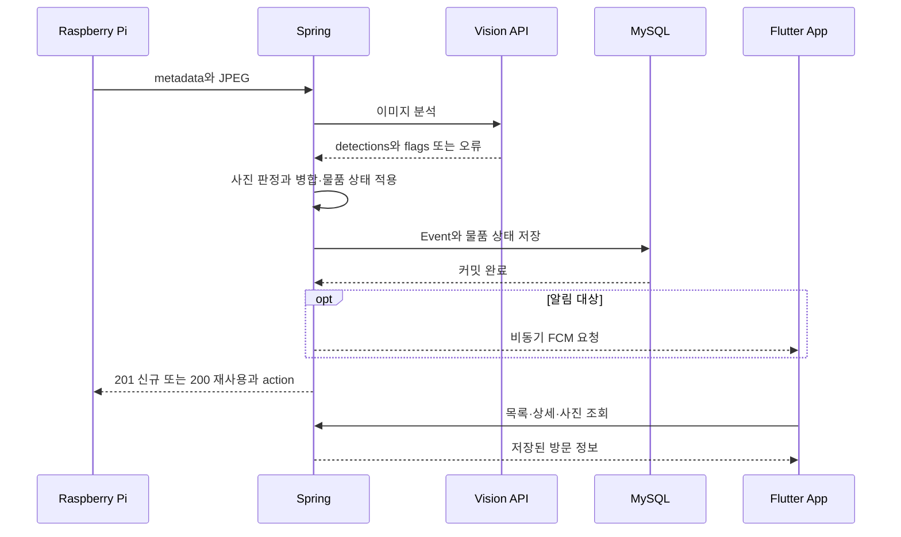
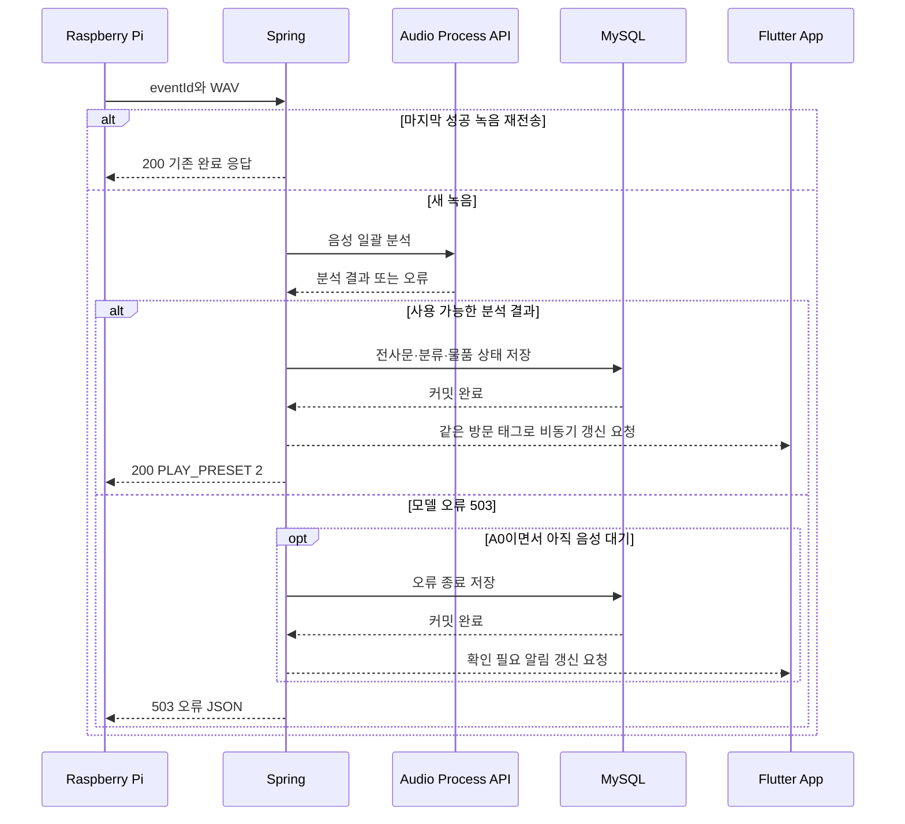

# DataCat 무인현관 API 명세서

> **Version**: v1.5  
> **Date**: 2026-10-25\
> **Scope**: Raspberry Pi ↔ Spring Boot ↔ 모델 서비스 ↔ Flutter App  
> **Status**: 팀 합의용 확정본. `TBD` 항목은 이벤트 분류 기획 또는 실측 과정에서 확정한다.  
> **v1.5 변경**: 모델 서비스 출력을 이벤트 분류 기획(feature/app-design `상황분류_종류와_조건.md`)에 맞춤 — `purpose` 9개 값(7.6), 배송 세부 유형 `subtype`, 처리 상태 `flags`, Vision `animal` 라벨과 `LOW_VISIBILITY` 표시.  
> **v1.4 변경**: 모델 서비스(7장) 응답 규칙 확정 — `label` 값(`person`/`package`)과 package 범위, 발화 없음 응답, 요약 문체·검증, 음성 30초 처리, 상태 확인 API(7.5), 모델 서비스 오류 코드(12장), 포트 8000 제안(16장).  
> **v1.3 변경**: ToF 재확인 게이트를 Spring(서버, 지연된 값 재사용)에서 Pi(현관기기, 실시간 로컬 판단)로 이동. 6.4 세션 종료 API의 트리거 조건을 이 로직에 맞춰 구체화. `EventStatus`를 실제 관측되는 상태만 남기도록 축소. 12장 오류 코드에서 미구현 인증(401) 제거. 4.1 모델 서비스 주소를 예시 표기임을 명확히 함. 13.1/13.2 시퀀스 다이어그램을 Pi-로컬 ToF 재확인 반영해 수정.

### Spring 구현 현황 — 팀플 8주차, 2026-10-25

이 문서는 현재 구현과 이후 구현할 계약을 함께 포함한다. 아래 표의 구분을 따른다.
분류 정책은 앱 담당의 `판정표.md`(10-23 수정, feature/app-design `e70b731`)를 기준으로 한다.

| 항목 | 현재 상태 |
|---|---|
| 사진 접수·Vision 호출·저장·30초 방문 병합 (6.1) | 구현 |
| 사진 A0~A5·물품 존재 상태 A-1·앱 표시 필드 6개 | 구현. 물품 재감지·미감지·재도착을 로컬 MySQL에서 확인 |
| 음성 접수·모델 일괄 호출·판정표 C·같은 방문 갱신 (6.3) | 구현. 성공·재전송·장애·복구를 로컬에서 확인 |
| JSON 세션 종료·판정표 B·재요청 보호 (6.4) | 구현. 늦은 종료 요청과 종료 후 음성 거절 확인 |
| 이미지 A0와 음성 503의 오류 종료 | 구현. 세부 오류 안내 값은 6.3의 구현 제안으로 구분 |
| 프리셋 3종 조회 (10.1) | 구현. 실제 Pi 음원 재생은 별도 통합 시험 대상 |
| Android 토큰 등록·커밋 후 비동기 FCM (11장) | 구현. 10-25 수정 APK로 접수 중·배송 결과 알림 수신 및 22번 방문 상세·사진 확인 |
| 2차 사진 업로드 (6.2), 종료 요청의 선택 사진 | 미구현. 현재 종료 요청은 JSON |
| 현재 코드의 실제 Pi·실제 모델·전체 Docker 구성 재시험 | 팀원과 통합 확인 대기 |

자동 테스트 145개가 통과했다. Windows의 `gradlew.bat test` 성공과 PowerShell·로컬 MySQL 시험 결과는
[8주차 검증 기록](server/docs/week8-verification.md)에 구분해 기록한다.

---

## 1. 문서 목적

이 문서는 DataCat 무인현관 프로젝트에서 각 담당 파트가 **어떤 데이터를 어떤 형식으로 주고받는지** 정의한다.

현재 런타임의 데이터 흐름은 다음과 같다.

- 이미지: Pi → Spring → Vision API → Spring → MySQL·Pi 응답·앱 조회/푸시.
- 음성: Pi → Spring → 통합 Audio Process API(STT·용건 분석) → Spring → MySQL·Pi 응답·앱 조회/푸시.
- Spring은 방문 상태와 모델 호출·분류·저장·장치 응답·알림을 조정한다.
- 외부 모델 서비스끼리 직접 HTTP 요청을 주고받지 않는다. 통합 음성 서비스 내부의 처리 순서는 7.4를 따른다.
- 7.2/7.3 개별 기능 API는 단위 시험용으로 유지한다.

모델 구현체는 개발 중 변경될 수 있으므로 API 이름에는 `YOLO`, `Whisper`, `Qwen` 같은 특정 모델명을 넣지 않고 **기능 기준**으로 정의한다.

---

## 2. 담당 범위

| 담당 | 주요 역할 |
|---|---|
| Raspberry Pi | ToF/버튼 이벤트 감지, 사진 촬영, 음성 녹음, Spring으로 전송, Spring 응답에 따라 프리셋/LED/스피커 등 실행 |
| Spring Boot | API 제공, `eventId` 생성, 이벤트 상태 관리, 모델 API 순차 호출, 이벤트 분류 조건문 구현, DB 저장, 프리셋 결정, 앱 API, Push, 예외 처리 |
| 모델 담당 | 이미지 인식, STT, 자연어 처리(요약/용건 분석). 서버가 전달한 입력을 모델에 넣고 정해진 형식의 결과를 Spring에 반환 |
| 앱 + 이벤트 분류 담당 | Flutter 앱 구현, 상황 분류 종류와 조건 기획, 초인종 3D 모델링 |

> **중요:** 이벤트 분류 담당은 **분류 종류와 조건을 기획**하고, 실제 조건문/판정 코드는 Spring Boot에 구현한다.

---

## 3. 실행 및 배포 구조

테스트와 최종 시연은 **한 PC에서 실행**하는 것을 기본으로 한다.

한 PC에 Spring Boot, 모델 서비스(Vision·STT·NLP), MySQL을 실행한다.

Spring Boot는 Docker 컨테이너로 배포한다. 팀원은 GitHub 저장소를 내려받아 자신의 PC에서 서버를 실행해 각 파트와 연동 테스트한다.

모델 담당은 GPU를 사용할 수 있으나 특정 GPU 모델(RTX 3090 등)에 API 명세가 종속되지 않는다.

> **분산 개발 환경 지원**: 평소 개발 중에는 팀원 각자 자신의 PC에서 전체 스택(Spring + Model + MySQL)을 띄워 테스트한다. 단일 물리 Pi가 그때그때 다른 팀원의 서버를 바라볼 수 있도록, Pi 단말은 `.env` 파일 기본값 또는 실행 시 CLI 인자(`--server-url=...`)로 접속 대상 서버 URL을 교체할 수 있게 구현한다. 통합 테스트·리허설 시에만 한 곳(Pi 거치 관리자의 서버)으로 고정한다.

---

## 4. 공통 규칙

### 4.1 Base URL

외부 API(Pi/App → Spring):

```text
https://api.{도메인}/api/v1
```

> Cloudflare Tunnel을 통한 공인 HTTPS 접근을 기본으로 한다. 로컬 개발 시에는 팀원 PC의 사설 주소(`http://{host}:{port}/api/v1`)를 `.env`로 대체할 수 있다.

Spring → 모델 서비스 내부 API:

```text
http://{model-service-host}:{port}/internal/v1
```

> 예시 표기다. MODEL_SERVICE_URL에는 서비스 루트(기본 http://localhost:8000)를 지정하며 /internal/v1은 붙이지 않는다. 컨테이너에서는 Compose의 실제 서비스 이름을 사용한다(16장 참고).
> Flutter 앱의 서버 설정에도 http://{PC_IP}:8080 같은 루트 주소를 입력한다. 앱이 /api/v1을 붙인다. PC의 localhost와 휴대폰의 localhost는 서로 다른 대상이다.

### 4.2 Content-Type

JSON 요청/응답:

```http
Content-Type: application/json
```

이미지/음성 파일 업로드:

```http
Content-Type: multipart/form-data
```

### 4.3 시간 형식

요청은 시간대 정보가 있는 ISO-8601을 사용한다. 목록·상세의 occurredAt/endedAt은 현재 +09:00으로 반환한다. DB에는 Instant를 사용하므로 DB 도구의 표시 시간대와 API 시간이 다르게 보일 수 있다.

```text
2026-09-20T22:30:00+09:00
```

### 4.4 ID

- `eventId`: Spring Boot가 발급하는 방문 이벤트 식별자
- `deviceId`: Raspberry Pi 장치 식별자

예시:

```text
eventId: 101
deviceId: door-01
```

---

## 5. 공통 상태값

### 5.1 TriggerType

| 값 | 의미 |
|---|---|
| `TOF` | ToF 센서 감지로 시작 |
| `BUTTON` | 호출벨 입력으로 시작 |

### 5.2 EventStatus

| 값 | 의미 |
|---|---|
| `WAITING_AUDIO` | 방문객 음성 입력 대기 |
| `COMPLETED` | 접수 처리 종료. 분석 성공뿐 아니라 무응답·오류 종료를 포함 |
| `FAILED` | 처리 실패용 상태. 현재 파일·DB 예외를 자동으로 FAILED 행으로 기록하지는 않음 |

> 사진·음성·종료는 각각 별도 HTTP 요청이며 각 요청의 처리는 동기식이다. DB에는 WAITING_AUDIO와 최종 상태를 저장하고 분석 중간 단계는 별도 상태로 저장하지 않는다. 앱 목록·상세 조회는 사용할 수 있으며 모델 진행률 API는 없다.

### 5.3 DeviceAction

| 값 | Pi 동작 |
|---|---|
| `START_RECEPTION` | 프리셋 안내 후 음성 입력 시작 |
| `SILENT_STANDBY` | 출력 없이 세션 처리/종료 |
| `PLAY_PRESET` | 지정된 프리셋 재생 |
| `END_SESSION` | 세션 종료 후 초기 감시 상태 복귀 |
| `ERROR` | 장치 오류 안내용 예약 action. 현재 Spring 오류는 code/message JSON과 HTTP 오류 상태로 반환 |

> **마이크 개방 순서**: START_RECEPTION을 받은 Pi는 프리셋 안내 음원 재생이 끝난 뒤 녹음을 시작한다.

> **ToF 재확인 게이트(Pi 로컬 처리)**: `START_RECEPTION`을 받은 Pi는 프리셋 음성을 재생하기 **직전** 자신의 ToF 센서를 다시 한번(로컬, 즉시) 읽어 사람이 여전히 있는지 확인한다. 1차 촬영과 서버 왕복 사이의 지연 동안 방문객(주로 배달 기사)이 이미 이탈했을 수 있기 때문이다. 이 재확인은 서버로 데이터를 보내 판정받지 않고 Pi가 전적으로 로컬에서 즉시 판단한다 — ToF는 Pi에 붙은 센서라 네트워크 왕복 없이 확인 가능하고, 지연 없는 최신값을 쓸 수 있기 때문이다.
> - ToF가 여전히 근접 범위를 감지하면 그대로 프리셋을 재생하고 정상 진행한다.
> - ToF가 기준선(빈 상태)으로 복귀했으면 프리셋을 재생하지 않고, `POST /api/v1/device/events/{eventId}/end`를 `reason: VISITOR_LEFT`로 호출해 세션을 무응답으로 종료한다(6.4 참고).

---

# 6. Raspberry Pi → Spring API

## 6.1 이벤트 생성 + 1차 이미지 전송

방문 이벤트 발생 직후 Pi가 1차 이미지를 Spring으로 전송한다.

### Endpoint

```http
POST /api/v1/device/events
```

### Request

`multipart/form-data`

| 필드 | 타입 | 필수 | 설명 |
|---|---|---:|---|
| `metadata` | JSON (`application/json`) | O | 이벤트 메타데이터 |
| `image` | File (`image/jpeg`) | O | 1차 판정용 이미지 |

`metadata` 예시:

> 요청 전체는 `multipart/form-data`이며, `metadata` 파트의 Content-Type은 반드시 `application/json`으로 지정한다. 일반 텍스트 파트(`text/plain`)로 전송하면 Spring은 415 `UNSUPPORTED_MEDIA_TYPE`을 반환한다. `image` 파트는 파일 이름과 `image/jpeg` Content-Type을 포함해야 한다.

```json
{
  "deviceId": "door-01",
  "triggerType": "TOF",
  "distanceMm": 1850,
  "capturedAt": "2026-09-20T22:30:00+09:00"
}
```

> `distanceMm`: 촬영 시점 ToF 거리값(mm). 이벤트 기록·로그용 정보이며, 방문객 이탈 재확인은 Pi가 로컬에서 별도로 수행한다(5.3 참고). Spring의 판정에는 사용하지 않는다.

### 센서·버튼 동시 입력 처리

#### 서버의 방문 병합

- 같은 deviceId의 마지막 성공 사진 요청의 서버 처리 시작 시각부터 30초 이내면 기존 방문을 병합 대상으로 찾는다.
- 기존 방문을 재사용할 때 eventId·최초 occurredAt·최초 triggerType을 유지한다.
- 진행 중인 음성 접수에 들어온 물품 사진도 같은 세션에 모으며 음성 대기를 임의로 끝내지 않는다.
- 물품만 남은 완료 기록 뒤 새 사람·벨 접수는 새 응대 방문을 만든다.
- 독립된 A3 물품 접수는 아래 A-1을 적용한다. 같은 물품 상태는 30초가 지나도 기존 packageEventId를 반환한다.
- 신규 방문은 201, 기존 방문 재사용은 200이다. 물품 재사용에서는 Event의 사진·발생 시각을 바꾸지 않고 상태의 lastSeenAt만 갱신한다.

#### Pi 입력 처리 협의 방향

2026-10-15 Pi·서버 담당자가 확인한 방향이며, 실제 장치 연결 후 동작을 검증한다.

- 센서와 버튼 입력이 동시에 발생하면 먼저 들어온 입력 하나로 접수를 시작하고, 나머지 중복 시작 입력은 무시한다.
- 서버 전송·안내 음성 재생·녹음이 진행 중일 때는 새 접수를 동시에 시작하지 않는다.
- 서버의 30초 방문 병합과 Pi의 입력 차단 기간은 별도로 관리한다.

#### 장치 시험 후 확정할 사항 — TBD

- 동시 입력으로 묶는 시간 범위와 버튼 중복 신호 제거 기준
- 접수 진행 중 추가 버튼 입력을 무시할지, 한 번 보류할지
- 접수 완료·오류 발생 후 다시 입력을 받을 수 있는 상태로 돌아가는 조건과 시점

### Spring 처리 순서

1. 메타데이터와 JPEG를 검증하고 새 파일을 저장한다.
2. Vision API를 호출한다. 이 호출 중 DB 트랜잭션을 열지 않는다.
3. 정상 응답이면 A1~A5, 모델 연결·응답 실패이면 A0로 판정한다.
4. 별도 저장 서비스의 트랜잭션에서 30초 병합·A-1 물품 상태·사진 분류를 적용하고 DB에 함께 저장한다.
5. 저장 실패 시 DB 변경을 롤백하고 새 사진을 정리한다.
6. 커밋 뒤 이전 사진 또는 물품 재사용으로 쓰지 않은 새 사진을 정리한다.
7. 알림 대상이면 비동기 발송 작업을 요청하고 Pi에 응답한다. FCM 완료는 기다리지 않는다.

### 사진 판정 — 판정표 A 반영

아래 조건을 위에서부터 검사해 처음 일치하는 줄을 사용한다. `person`·`package`의 존재 및 개수는 검증된 `detections`의 해당 라벨 개수다. 별도 신뢰도 임계값은 현재 추가하지 않는다. `distanceMm`은 기록용이다.

| 규칙 | 조건 | status / action | eventType | mainCategory | needsReview |
|---|---|---|---|---|---|
| A0 | 모델 연결·읽기 타임아웃·HTTP 오류·응답 형식 오류 | WAITING_AUDIO / START_RECEPTION | null | null | true |
| A1 | 사람 있음 | WAITING_AUDIO / START_RECEPTION | null | null | LOW_VISIBILITY일 때 true |
| A2 | 사람 없음 + BUTTON | WAITING_AUDIO / START_RECEPTION | null | null | LOW_VISIBILITY일 때 true |
| A3 | 사람 없음 + TOF + 물품 있음 | COMPLETED / SILENT_STANDBY | UNATTENDED_DELIVERY | 물품만 있음 | false |
| A4 | 사람·물품 없음 + TOF + LOW_VISIBILITY | COMPLETED / SILENT_STANDBY | CAMERA_BLOCKED | 안전 확인 필요 | true |
| A5 | 그 외. 사람·물품 없음 또는 동물만 감지 | COMPLETED / SILENT_STANDBY | NO_VISITOR | 기타·판단 불가 | false |

- A0~A2의 `responsePolicy`는 `일반 접수`, A3~A5는 `무응답`이다.
- `processingStatus`는 기본 `정상`, A0는 `이미지 판단 실패`, A1에서 사람이 2명 이상이면 `복수 방문자`다.
- `reason`은 서버가 판정 근거 한 줄을 만든다. A1/A2에서 `LOW_VISIBILITY`이면 `카메라 가림 상태에서 호출`로 기록한다.
- 음성 분석 전에는 A0~A2의 `eventType`, `mainCategory`, `subCategory`, `purpose`, `transcript`, `summary`를 비워 둔다. 앱은 `WAITING_AUDIO`를 기준으로 접수 중임을 표시한다.
- 모델 장애가 A0로 처리되고 저장에 성공하면 신규 201 또는 병합 200을 반환한다. 파일 읽기·DB 저장 등 다른 서버 오류는 A0로 숨기지 않는다.

### 병합 시 판정과 알림

- 일반 사진 병합은 사진·거리값·Vision 결과·마지막 사진 수신 시각을 갱신한다.
- 세션 사진에 물품이 한 번이라도 있었으면 packageSeen=true를 유지한다.
- 기존 판정이 없으면 새 판정을 적용한다. 새 A0는 기존 판정을 덮어쓰지 않는다.
- 그 외에는 A0~A5 순서에서 새 판정이 앞설 때만 분류·상태·종료 시각을 바꾼다.
- 같거나 낮은 규칙은 기존 분류를 유지한다. 동일 규칙의 세부 변화도 현재는 추가 알림으로 보지 않는다.
- A3 물품 재사용과 A5 오탐은 푸시하지 않는다. 진행 중인 A0~A2에 A3가 와도 기존 음성 대기를 유지한다.
- 물품만 남은 완료 기록 뒤 A0~A2 응대가 시작되면 새 방문을 만들고 새 방문 알림을 요청한다.

### 문 앞 잔류 물품 — 판정표 A-1, 10-23 수정 기준

물품 개수 비교로 새 도착을 판단하지 않는다. 한 개 이상 감지됐는지의 있음/없음만 사용한다.
기기별 packagePresent·packageEventId·firstSeenAt·lastSeenAt·missCount를 저장한다.

| 조건 | 처리 | HTTP / 푸시 |
|---|---|---|
| A3, 물품 상태 없음 | 새 방문 생성 및 물품 상태 저장 | 201 / 새 알림 |
| A3, 물품 상태 있음 | 기존 packageEventId 반환, lastSeenAt 갱신, missCount=0 | 200 / 추가 알림 없음 |
| A5 첫 미감지 | missCount=1, 물품 상태 유지 | 방문 기록은 기존 병합 규칙 / 알림 없음 |
| A5 두 번째 연속 미감지 | 물품 상태만 해제. 과거 Event와 사진은 유지 | 알림 없음 |
| 물품 재감지 | 유지 중인 상태의 missCount를 0으로 되돌림 | 같은 물품은 재알림하지 않음 |
| A0 또는 물품이 안 보이는 A1/A2/A4 | 물품 부재로 세거나 상태를 비우지 않음 | 사진 판정표 적용 |
| 물품이 포함된 응대 세션의 음성 완료·종료 | packageSeen을 보고 이 세션으로 물품 상태 기록 | 세션 결과의 기존 알림 갱신 |

A3 재사용에서 사용하지 않는 새 파일은 정리하고 기존 사진은 유지한다.
물품 상태가 비워진 뒤 다시 A3가 오면 새 방문을 만든다. 시간 경과만으로 재알림하지 않는다.
촬영·재전송 ID는 아직 도입하지 않아 현재는 유효한 A5 요청 두 건을 미감지 두 건으로 센다.
동일 촬영의 재전송 구분은 16장 TBD다.
자세한 저장·롤백·기존 DB 호환 규칙은 [물품 상태 구현 문서](server/docs/package-state-integration.md)를 따른다.

> 사람 감지 시 `START_RECEPTION`을 반환하지만, 이 시점 이후 방문객이 실제로 자리에 있는지에 대한 최종 확인은 Pi가 로컬 ToF로 수행한다(5.3 참고). Spring은 지연된 값으로 재판정하지 않는다.

### Response 예시 — 사람 응대 필요

```json
{
  "eventId": 101,
  "status": "WAITING_AUDIO",
  "action": "START_RECEPTION",
  "preset": {
    "presetId": 1,
    "text": "마이크에 말씀해 주세요."
  }
}
```

### Response 예시 — 무응답 처리

```json
{
  "eventId": 102,
  "status": "COMPLETED",
  "action": "SILENT_STANDBY"
}
```

> 어떤 Vision 결과에서 `START_RECEPTION` 또는 `SILENT_STANDBY`로 분기할지는 이벤트 분류 기획에 따라 Spring 조건문으로 구현한다.

---

## 6.2 2차 기록용 스냅샷 전송

**현재 Spring 미구현.** 아래는 이후 구현할 계약이며 지금 호출해 성공 응답을 받을 수 있는 API가 아니다.
사람 응대 분기에서 프리셋 출력 후 촬영한 기록용 스냅샷을 전송하는 용도다.

### Endpoint

```http
POST /api/v1/device/events/{eventId}/snapshot
```

### Request

`multipart/form-data`

| 필드 | 타입 | 필수 |
|---|---|---:|
| `image` | File (`image/jpeg`) | O |

### Response

```json
{
  "eventId": 101,
  "saved": true,
  "snapshotUrl": "/api/v1/events/101/snapshot"
}
```

> 물건만 감지되어 2차 촬영을 하지 않는 경우에는 1차 촬영 이미지를 기록용 스냅샷으로 사용할 수 있다.

---

## 6.3 방문객 음성 전송

Pi가 안내 뒤 녹음한 음성을 보내는 API다. Spring이 모델 결과를 같은 Event에 저장하고 Pi에 후속 음원 재생 명령을 반환한다.

| 항목 | 계약 |
|---|---|
| 호출 주체 | Raspberry Pi. 개발 시험에서는 curl.exe로 대체 가능 |
| Method / URL | POST /api/v1/device/events/{eventId}/audio |
| Content-Type | multipart/form-data |
| Path Parameter | eventId: 1 이상의 정수, 사진 접수에서 받은 번호 |
| Query Parameter | 없음 |
| multipart | audio: 비어 있지 않은 WAV 파일. 파트 Content-Type audio/wav, 파일 이름 포함 |
| 파일 형식·크기 | PCM 16-bit, 16kHz, mono. 최대 16MB, 전체 요청 최대 17MB |
| 성공 | 200 application/json |

Pi의 VAD 종료 기준은 700~1,000ms 침묵을 시작값으로 사용하며 장치 실측 대상이다.
모델은 음성 앞 30초를 사용한다. 이는 Spring의 전체 HTTP 시간 제한을 뜻하지 않는다.
Spring은 파일 크기를 확인하고 모델에 전달하며 WAV 내부 형식 검증은 모델 서비스가 수행한다.

### 처리 순서

1. eventId·파일·현재 방문 상태를 검사하고 녹음의 SHA-256을 구한다.
2. 마지막 성공 녹음과 같으면 모델·결과 저장·푸시를 다시 실행하지 않고 기존 완료 응답을 반환한다.
3. 새 녹음은 /internal/v1/audio/process에 전달한다. HTTP 호출 중 DB 트랜잭션을 열지 않는다.
4. 모델 응답의 필수 값·purpose 9종·배송 subtype·flags 형식을 검사하고 요약을 최대 20자로 맞춘다.
5. 판정표 C에 따라 전사문·용건·요약·앱 표시 값을 같은 Event에 저장하고 COMPLETED로 끝낸다.
6. 물품이 있던 세션이면 물품 상태도 같은 트랜잭션으로 기록한다.
7. 커밋 뒤 같은 event_{eventId} 태그로 비동기 푸시 갱신을 요청하고 Pi에 프리셋 2번을 반환한다.

원본 음성은 영구 DB·별도 영구 파일에 저장하지 않는다. multipart 임시 파일은 요청 종료 시 프레임워크가 정리한다.
전사문·요약·용건과 마지막 성공 녹음의 해시만 저장한다. 모든 메모리 복사본의 즉시 소거를 보장하는 의미는 아니다.

### 성공 응답

```json
{
  "eventId": 101,
  "status": "COMPLETED",
  "action": "PLAY_PRESET",
  "preset": {
    "presetId": 2,
    "text": "접수되었습니다."
  }
}
```

Pi가 실제로 로컬 음원을 재생해야 한다. 이 JSON 자체가 음성 데이터는 아니다.
전사문·요약·용건·분류는 앱의 목록·상세 API로 조회한다.

### 재전송과 추가 음성 — 현재 구현 제안

| 상태 | 처리 |
|---|---|
| WAITING_AUDIO | 첫 음성 접수 가능. 사진 후 30초를 넘겼다는 이유만으로 첫 음성을 거절하지 않음 |
| 음성 완료 후 마지막 성공 녹음과 동일 | 파일 이름과 무관하게 해시로 확인. 200 기존 응답, 재분석·추가 푸시 없음 |
| 음성 완료 후 다른 녹음 | 마지막 성공 사진의 서버 처리 시작 시각부터 30초 이내인 경우 같은 방문 재분석 |
| /end·사진 판정·분석 동시 실패로 완료됐거나 FAILED | 409. 음성으로 다시 열지 않음 |
| 정상 사진 뒤 음성 모델 503 | 성공 해시를 저장하지 않고 대기 유지. 복구 후 재시도 가능 |

다른 녹음의 유예 시간·기준과 촬영/녹음 ID 계약은 팀 확인 대상이다.
현재 해시는 마지막 성공 녹음 한 건만 구분한다. 새 녹음으로 갱신한 뒤 옛 녹음이 다시 오면 과거 재전송으로 구분할 수 없다.

### 음성 판정 C

모델 purpose는 방문객 용건이며 eventType은 Spring의 최종 판정이다.
정상 음성 응답과 NO_SPEECH 응답은 아래 변환을 적용하고 eventType=VISITOR_ACCEPTED로 저장한다.

| purpose | mainCategory | responsePolicy | 기본 needsReview |
|---|---|---|---|
| PUBLIC_EMERGENCY | 공공·긴급 방문 | 긴급 알림 | false |
| SAFETY_REVIEW | 안전 확인 필요 | 긴급 알림 | true |
| PICKUP | 수거 | 일반 접수 | false |
| WRONG_VISIT | 잘못 방문 | 일반 접수 | false |
| DELIVERY | 배송 | 일반 접수 | false |
| SERVICE_VISIT | 작업 방문 | 일반 접수 | true |
| PERSONAL_VISIT | 개인 방문 | 일반 접수 | false |
| SOLICITATION | 영업·홍보 방문 | 일반 접수 | false |
| UNKNOWN | 기타·판단 불가 | 일반 접수 | false |

DELIVERY일 때 subtype을 택배, 음식 배달, 우편·등기, 장보기·생활물품, 퀵 배송, 대형 상품, 선물 배송, 배송 기타로 변환한다.
구체적 코드 대응은 7.6을 따른다. 그 외 용건은 subCategory=null이다.

- 사진 단계의 needsReview=true는 음성 결과로 해제하지 않는다.
- processingStatus 우선순위는 사진의 이미지 판단 실패 → NO_SPEECH의 무응답 → 알려진 fallback의 정상 → 사진의 복수 방문자 → 정상이다.
- SUMMARY_FROM_TRANSCRIPT 또는 RULES_FALLBACK이면 needsReview=true다. 모르는 추가 flag는 별도 판정 조건으로 사용하지 않는다.
- reason은 `용건: 배송(택배)`처럼 서버가 만든다. 원본 flags 배열은 현재 별도 DB 컬럼에 저장하지 않는다.

### 이미지·음성 분석 동시 실패

사진 판정 A0로 시작해 아직 음성 성공이 없는 방문에서 음성 처리가 503이면, 판정표 A0의 방향대로 기타·판단 불가로 종료한다.
HTTP 응답은 503을 유지하며 성공 프리셋 2번을 반환하지 않는다. 이미 성공한 음성 결과는 오류로 덮어쓰지 않는다.

아래 세부 조합은 **구현 제안이며 팀 확인 대상**이다.

| 필드 | 제안 구현 값 |
|---|---|
| status / eventType | COMPLETED / 기존 B2의 VISITOR_TIMEOUT |
| mainCategory | 기타·판단 불가 |
| responsePolicy | 장애 안내 |
| processingStatus | 이미지 판단 실패 |
| reason / needsReview | 이미지·음성 분석 실패 / true |
| transcript·purpose·summary·audioHash | 새 값 저장 안 함 |

오류 원인은 reason으로 구분한다. HTTP 503은 분석 실패를, COMPLETED는 접수 종료를 뜻한다.
이 오류 종료 뒤 추가 음성을 409로 거절하는 정책도 현재 제안에 포함한다.
Pi의 503 수신 후 실제 오류 음원 재생은 통합 시험 대기다.
[오류 처리 상세](server/docs/model-failure-handling.md)를 따른다.

### 실패 응답과 상태

| HTTP | code | 예시 |
|---|---|---|
| 400 | INVALID_REQUEST | 잘못된 eventId, audio 누락·빈 파일·크기·WAV 형식 오류 |
| 404 | NOT_FOUND | 방문 없음 |
| 409 | EVENT_STATE_CONFLICT | 현재 상태에서 음성 접수 불가 |
| 415 | UNSUPPORTED_MEDIA_TYPE | 전체 요청 형식이 multipart가 아님 |
| 500 | INTERNAL_SERVER_ERROR | 파일 읽기·DB 작업 실패 |
| 503 | MODEL_SERVICE_UNAVAILABLE | 모델 연결·추론·응답 사용 불가 |

```json
{
  "code": "MODEL_SERVICE_UNAVAILABLE",
  "message": "음성 분석 서비스에 연결하거나 응답을 받을 수 없습니다."
}
```

DB 저장 실패는 결과를 롤백하고 성공 해시·푸시를 남기지 않는다.
모델 접속 대기는 2초, 응답 읽기 대기는 현재 5초다. 전체 HTTP의 5초 상한은 아니다.
최신 모델 서비스가 제시한 대기 한도·처리 시간과 실제 Pi 통신을 함께 측정해 조정할 대상이다.

---

## 6.4 세션 종료 알림

Pi가 방문객 이탈 또는 무발화 대기 종료를 알려, 음성이 없는 접수를 끝내는 API다.

| 항목 | 현재 계약 |
|---|---|
| 호출 주체 | Raspberry Pi |
| Method / URL | POST /api/v1/device/events/{eventId}/end |
| Content-Type | application/json |
| Path Parameter | eventId: 1 이상의 정수 |
| Query Parameter | 없음 |
| Body | reason, endedAt 필수 |
| 성공 | 200 application/json |

### 요청

```json
{
  "reason": "VISITOR_LEFT",
  "endedAt": "2026-10-25T01:00:20+09:00"
}
```

| reason | 의미 |
|---|---|
| VISITOR_LEFT | Pi의 ToF 재확인에서 방문객 이탈을 확인 |
| TIMEOUT | 발화 없이 Pi의 대기 시간이 초과 |
| DEVICE_CANCELLED | 예약 값. 현재 서버는 400으로 거절 |

endedAt은 시간대가 있는 ISO-8601이며 occurredAt보다 빠르면 400이다.
현재 서버 자체의 방문 만료 타이머는 구현하지 않았다.

### 처리 순서

1. 요청 필드·방문·종료 시각을 확인한다.
2. 이미 COMPLETED이면 분류·종료 시각을 덮어쓰지 않고 200을 반환한다. 유효하지 않은 요청은 먼저 거절한다.
3. WAITING_AUDIO 방문은 아래 표 B로 분류하고 Pi가 보낸 endedAt으로 종료한다. 그 외 상태는 409다.
4. 세션 중 packageSeen=true이면 물품 상태도 같은 트랜잭션으로 저장한다.
5. 커밋 뒤 같은 방문 태그로 비동기 푸시 갱신을 요청한다. 재요청은 다시 발송하지 않는다.

| 세션 사진의 물품 | eventType | mainCategory | responsePolicy / processingStatus |
|---|---|---|---|
| 한 번이라도 있음 | UNATTENDED_DELIVERY | 물품만 있음 | 무응답 / 무응답 |
| 없음 | VISITOR_TIMEOUT | 기타·판단 불가 | 무응답 / 무응답 |

reason은 VISITOR_LEFT이면 `안내 전 이탈`, TIMEOUT이면 `발화 없이 시간 초과`다.
사진 단계 needsReview는 유지한다. 이미 음성으로 완료된 방문의 늦은 /end는 음성 결과를 보존한다.

### 성공 응답

```json
{
  "eventId": 101,
  "status": "COMPLETED",
  "action": "END_SESSION"
}
```

### 실패

- 400 INVALID_REQUEST: reason·endedAt 누락/형식 오류, 미지원 사유, 종료 시각 역전.
- 404 NOT_FOUND: 방문 없음.
- 409 EVENT_STATE_CONFLICT: FAILED 등 종료할 수 없는 상태.
- 415 UNSUPPORTED_MEDIA_TYPE: 현재 JSON이 아닌 요청 형식.
- 500 INTERNAL_SERVER_ERROR: DB 작업 실패. 방문·물품 상태 변경은 함께 롤백하고 푸시하지 않는다.

```json
{
  "code": "INVALID_REQUEST",
  "message": "reason은 VISITOR_LEFT 또는 TIMEOUT이어야 합니다."
}
```

### 선택 종료 사진 — 미구현

판정표 B에는 종료 때 사진을 선택적으로 첨부하는 방향이 있다.
현재 Pi와 연결한 계약은 JSON이며 multipart 종료 요청은 지원하지 않는다.
사진 파트·촬영 시각·세션 사진 분석 연결 계약은 팀과 조정한 뒤 추가한다. 기존 JSON 호출을 미리 multipart로 바꾸지 않는다.

---

# 7. Spring → 모델 서비스 내부 API

모델 서비스는 Spring Boot에서만 호출한다.

모델끼리는 직접 호출하지 않는다.

```text
Spring → Vision → Spring
Spring → Audio Process (STT + NLP 통합) → Spring
```

---

## 7.1 이미지 인식

### Endpoint

```http
POST /internal/v1/vision/detect
```

### Request

`multipart/form-data`

| 필드 | 타입 | 필수 |
|---|---|---:|
| `image` | File (`image/jpeg`) | O |

### Response

```json
{
  "detections": [
    {
      "label": "person",
      "confidence": 0.94
    }
  ],
  "flags": []
}
```

### 필드 설명

| 필드 | 타입 | 설명 |
|---|---|---|
| `detections` | Array | 이미지에서 인식된 항목 목록 |
| `label` | String | 인식된 항목. 허용 값: `person`, `package`, `animal`. `package`는 택배 박스, 비닐 택배봉투, 배달 음식 봉지·용기, 보냉백, 꽃다발, 케이크·선물 상자, 봉투, 전단지를 모두 포함한다. 사람이 들고 있는 물건도 `package`로 나올 수 있다(구분하지 않음). `animal`은 개·고양이·새 |
| `confidence` | Number | 모델 신뢰도, 0.0 ~ 1.0 |
| `flags` | Array | 이미지 상태. `LOW_VISIBILITY`: 화면에 질감이 거의 없음(렌즈를 손·테이프·덮개로 가림). 어두운 복도라도 질감이 있으면 붙지 않고, `person`이 감지되면 붙지 않는다. "카메라 가림"(기획: 안전 확인 필요) 최종 판단은 Spring이 ToF 근접 감지와 함께 한다 |

> `YOLO`는 현재 후보 모델이지만 구현체가 바뀌어도 이 API 계약은 유지한다.

> **새 값 대비**: Spring은 모르는 `label`·`flags` 값을 받으면 무시하고 계속 처리한다. 값은 이 명세에 먼저 추가한 뒤 쓴다.

> **동물만 감지**: `animal`만 있고 `person`이 없으면 사람 방문으로 응대하지 않는다(이벤트 분류 기획 공통 조건). 물품이 있으면 물품만 있음, 없으면 종료.

> bounding box가 서버 판정에 필요해질 경우 `bbox` 필드를 선택적으로 추가할 수 있다. 현재 MVP에서는 필수 아님.

> **Spring 판정**: 현재 6.1의 A0~A5 조건을 적용한다. 사람 감지 외에 버튼 입력·물품·`LOW_VISIBILITY`·모델 장애를 함께 처리한다. 실제 응대 직전 방문객이 남아 있는지는 Pi가 로컬 ToF로 재확인한다(5.3). 모델 내부 오류는 12장에 정의하되, 사진 접수의 모델 호출 실패는 Spring에서 A0로 처리한다.

---

## 7.2 STT 전사 (단위 테스트용)

### Endpoint

```http
POST /internal/v1/speech/transcribe
```

### Request

`multipart/form-data`

| 필드 | 타입 | 필수 |
|---|---|---:|
| `audio` | File (`audio/wav`, PCM 16-bit, 16kHz, Mono) | O |

### Response

```json
{
  "transcript": "택배 왔습니다. 문 앞에 놓고 갈게요."
}
```

### 필드 설명

| 필드 | 타입 | 필수 | 설명 |
|---|---|---:|---|
| `transcript` | String | 음성을 텍스트로 변환한 전사 결과 |

> Whisper 등 어떤 STT 모델을 쓰더라도 Spring은 동일한 응답 형식을 받는다.

> **음성 길이**: 앞 30초만 전사한다. 더 긴 음성을 모두 처리하면 Pi 타임아웃(3~5초)을 넘기기 때문이다. 업로드는 16MB까지이며, 넘으면 400 `INVALID_REQUEST`.

> **Zero-Storage 원칙**: 모델 서비스도 전사 완료 즉시 수신한 음성 파일을 삭제하며, 별도로 보관하지 않는다.

---

## 7.3 자연어 처리 — 요약 / 용건 분석 (단위 테스트용)

Spring이 STT에서 받은 `transcript`를 다시 NLP API에 전달한다.

### Endpoint

```http
POST /internal/v1/language/analyze
```

### Request

```json
{
  "transcript": "택배 왔습니다. 문 앞에 놓고 갈게요."
}
```

### Response

```json
{
  "summary": "택배 문 앞 보관",
  "purpose": "DELIVERY",
  "subtype": "PARCEL",
  "flags": []
}
```

### 필드 설명

| 필드 | 타입 | 필수 | 설명 |
|---|---|---:|---|
| `summary` | String | 방문객 발화 요약. **공백 포함 최대 20자 이내**, 명사형(예: `택배 문 앞 보관`, 이벤트 분류 담당 확인 대기). 모델 서비스도 같은 규칙(`substring(0, 19) + "…"`)으로 자르고, Spring Boot도 수신 시 방어적으로 절단한다. 요약에는 방문객이 말한 낱말만 쓴다("보관"·"방문"·"문의" 같은 일반 낱말은 예외). 말하지 않은 낱말(예: 말하지 않은 "문 앞")이 있으면 전사문을 요약으로 대신 보내고 `SUMMARY_FROM_TRANSCRIPT`를 붙인다 |
| `purpose` | String | 용건. 허용 값은 7.6의 9개 |
| `subtype` | String \| null | `purpose`가 `DELIVERY`일 때만 배송 세부 유형(7.6), 그 외에는 `null` |
| `flags` | Array | 결과를 어떻게 만들었는지. `NO_SPEECH`(발화 없음), `SUMMARY_FROM_TRANSCRIPT`(요약이 말한 내용과 달라 전사문을 요약으로 사용 — 기획의 "요약 실패"), `RULES_FALLBACK`(언어 모델 실패·미로딩, 또는 답을 읽을 수 없어 키워드 규칙이 판단). 하나라도 있으면 Spring이 "사용자 확인 필요"로 표시하는 것을 권장 |

> `Qwen` 계열 sLM은 현재 후보 모델이며 다른 모델로 변경될 수 있다. Spring은 모델 이름이 아니라 위 API 계약에만 의존한다.

> `purpose` 값은 이벤트 분류 기획의 발화 기반 분류 9개다(7.6). v1.4의 후보 값은 `INSPECTION` → `SERVICE_VISIT`, `VISIT` → `PERSONAL_VISIT`, `ETC` → `UNKNOWN`으로 바뀌고 `PICKUP`·`PUBLIC_EMERGENCY`·`SOLICITATION`·`WRONG_VISIT`·`SAFETY_REVIEW`가 추가된다.

---

## 7.4 음성 일괄 처리 (권장 — STT+용건분류 통합 엔드포인트)

Spring ↔ Python이 매 단계마다 왕복하지 않도록, 같은 서버 내부에서 STT와 용건분류를 순차 처리해 최종 결과만 한 번에 반환하는 엔드포인트를 둔다. 7.2/7.3의 개별 엔드포인트는 단위 테스트용으로 유지하되, 실제 런타임에서는 이 통합 엔드포인트 사용을 권장한다.

### Endpoint

```http
POST /internal/v1/audio/process
```

### Request

`multipart/form-data`

| 필드 | 타입 | 필수 |
|---|---|---:|
| `audio` | File (`audio/wav`, PCM 16-bit, 16kHz, Mono) | O |

### Response

```json
{
  "transcript": "택배 문 앞에 두고 갑니다.",
  "purpose": "DELIVERY",
  "subtype": "PARCEL",
  "summary": "택배 문 앞 보관",
  "flags": []
}
```

> 내부적으로 STT → 용건분류를 순차 처리하며, 중간 결과를 Spring으로 돌려보내지 않는다. `transcript`/`purpose`/`subtype`/`summary`/`flags` 각 필드의 제약은 7.2, 7.3과 동일하다. Zero-Storage 원칙도 동일하게 적용한다.

> **발화가 없을 때**: 전사 결과가 비어 있으면(무음·잡음만 녹음된 경우) `{"transcript": "", "purpose": "UNKNOWN", "subtype": null, "summary": "", "flags": ["NO_SPEECH"]}`를 반환한다. 표시 문구는 Spring·앱이 `transcript`가 비었는지 보고 정한다.

> **`purpose` 사용 주의**: 방문객이 말로 모델을 유도해 값을 바꿀 수 있다. 허용 값은 항상 지켜지지만, 출입·보안 판단에는 쓰지 않고 알림 분류·기록 용도로만 쓴다.

---

## 7.5 모델 서비스 상태 확인

### Endpoint

```http
GET /health
```

서비스 루트 경로다(`/internal/v1` 아래가 아님).

### Response

```json
{
  "status": "ok",
  "profile": "lite"
}
```

| `status` | 의미 |
|---|---|
| `loading` | 모델을 불러오는 중. 추론 요청은 503 `MODEL_NOT_READY` |
| `ok` | 모든 모델 준비 완료 |
| `degraded` | 일부 모델만 실패. `failed` 목록이 함께 온다(예: `["language"]`). 언어 모델이 빠지면 요약·용건은 키워드 규칙으로 대신한다. 추론 하나가 60초를 넘겨 멈춘 것으로 보이면 `stuck` 목록이 온다(이때 Docker healthcheck는 unhealthy) |
| `error` | 모든 모델 로딩 실패. 추론 요청은 503 |

추가 필드(2026-10-22, 판단에 쓰지 않아도 됨): `build`(이미지를 만든 커밋), `models`(모델별 이름·버전), `package_model`(`fine-tuned` 또는 학습 가중치를 못 받았을 때 `zero-shot`).

`profile`은 `lite`(GPU 8GB) 또는 `full`(시연 PC). Docker healthcheck와 Spring 기동 순서 확인(`depends_on: condition: service_healthy`)에 사용한다.

---

## 7.6 용건(`purpose`)과 배송 세부 유형(`subtype`) 값

이벤트 분류 기획(feature/app-design `상황분류_종류와_조건.md`)의 분류 중 **발화로 판단하는 것**이다. "물품만 있음"은 말이 없는 상황이라 여기에 없고, Spring 조건문이 Vision 결과(`person` 없음 + `package` 있음)를 확인해 정한다. 목록 순서가 우선순위다(여러 분류가 동시에 맞으면 위의 것). 모델 서비스의 `model-service/app/language/purposes.json`이 이 표의 원본이다.

> **기획서 우선순위와 다른 점 (이벤트 분류 담당 확인, 2026-10-08 회의)**: 기획서 "최종 우선순위"는 잘못 방문을 8번째에 두지만, 여기서는 수거 다음(4번째)에 둔다. 기획서 배송 충돌 조건("주소를 잘못 찾았다고 말하면 잘못 방문")을 따르면 잘못 방문이 배송보다 먼저여야 하기 때문이다. 기획서 순서에 별도 기준이 없음을 확인하고 이 순서를 유지하기로 했다. 나머지 순서는 기획서와 같다.

| 우선 | `purpose` | 기획 분류 | 판단 기준 |
|---:|---|---|---|
| 1 | `PUBLIC_EMERGENCY` | 공공과 긴급 방문 | 경찰·소방·구급대·공공기관(구청, 주민센터, 법원) 직원이 신원과 용건을 밝히거나, 화재·연기·가스 누출·응급환자·구조·대피 상황을 명확히 말함. 긴급 단어만 있고 실제 위험 설명이 없으면 해당하지 않음 |
| 2 | `SAFETY_REVIEW` | 안전 확인 필요 | 욕설·협박·강제 진입·파손을 명확히 언급함. 문을 부수거나 강제로 열겠다고 함 |
| 3 | `PICKUP` | 수거 | 반품·교환·회수·수거 목적. 세탁물, 렌탈 제품, 정수기 필터, 공병, 음식 용기, 보냉가방, 폐가전, 폐기물 수거, 잘못 배송한 물품을 다시 가져감. 물건을 가져가는 것이다 — 물건을 돌려주거나 가져다주는 것은 수거가 아니다 |
| 4 | `WRONG_VISIT` | 잘못 방문 | 주소·동·호수·수령인 착오를 명확하게 말함, 벨을 잘못 누름, 다른 집이나 이전 거주자를 찾음. 배송 중이어도 주소를 잘못 찾았다고 말하면 이것 |
| 5 | `DELIVERY` | 배송 | 물건을 가져다줌: 택배, 우편·등기, 음식 배달, 장보기·생활물품, 퀵, 대형 상품, 꽃·선물 전달. 물품이 있다는 이유만으로 배송이 되지는 않고, 배송 목적을 말해야 함. 물건을 문 앞·경비실·관리실에 두었거나 맡겼다는 말도 배송 |
| 6 | `SERVICE_VISIT` | 작업과 관리 방문 | 관리사무소·경비실·시설관리, 가스·전기·수도 검침과 안전점검, 수리·설치(보일러, 도어록, 에어컨, 인터넷, 가전, 정수기), 방역·소독, 청소·가사 서비스, 이사·짐 운반, 부동산 집 보기, 도배·장판·누수 공사. 예약·설치·수리 표현이 명확하면 영업보다 우선 |
| 7 | `PERSONAL_VISIT` | 개인 방문 | 집에 사는 사람과 개인적으로 아는 사이(가족, 친척, 친구, 지인, 동료, 이웃)의 방문, 약속·초대·모임, 특정 입주자를 만나러 옴, 아는 사람이 빌린 물건을 돌려주거나 무엇을 가져다주러 옴. 누가 있는지만 묻고 목적을 말하지 않아도 이것 |
| 8 | `SOLICITATION` | 영업과 홍보 방문 | 상품 판매, 가입 권유, 통신사 변경, 렌탈 영업, 전단지·행사·매장 홍보, 종교 권유, 설문조사·인터뷰, 후원·기부·모금, 정치·선거 운동. 모르는 사람이 종교나 믿음 이야기를 나누자고 하는 것도 여기에 해당 |
| 9 | `UNKNOWN` | 기타·판단 불가 | 어느 분류에도 맞지 않거나 근거가 부족함: 알아들을 수 없음, 목적을 말하지 않음, 길을 물음, 여러 목적이 섞여 주된 목적이 불명확함 |

`purpose`가 `DELIVERY`일 때의 `subtype`:

| `subtype` | 기획 세부 유형 | 대표 표현 |
|---|---|---|
| `FOOD` | 음식 배달 | 음식, 치킨, 피자, 커피, 도시락, 배민 |
| `MAIL` | 우편·등기 | 우편, 우체국, 등기, 내용증명, 서명 |
| `GROCERY` | 장보기·생활물품 | 마트, 생필품, 식료품, 새벽 배송, 장보기, 로켓프레시 |
| `QUICK` | 퀵 배송 | 퀵, 당일 배송, 오토바이 |
| `LARGE` | 대형 상품 (가구·가전처럼 크고 무거운 물건) | 가구, 냉장고, 세탁기, 침대, 소파, 대형 |
| `GIFT` | 선물 배송 | 꽃, 선물, 케이크 |
| `PARCEL` | 택배 | 택배, 소포, 송장, 쿠팡, 대한통운, 한진 |
| `OTHER` | 배송 기타 (물품 종류를 말하지 않음) | — |

> 앱은 이벤트 응답의 `mainCategory`(코드 또는 한글), `subCategory`를 우선 표시한다. Spring은 `purpose` 코드를 `mainCategory`로, `subtype`을 위 표의 한글 이름으로 바꿔 `subCategory`에 넣을 수 있다.

> **측정(2026-10-04, GPU 8GB lite, 평가 문장 100개)**: 용건 정확도 98%(잡음 섞인 음성부터 처리해도 98%), 긴급·위협 재현율 100%, 배송 세부 유형 83%, 음성 처리 전체 p95 1.49초. 평가 오답을 보고 규칙을 보강했으므로 낙관적인 수치다. 튜닝에 쓰지 않은 시험 문장 64개(기획서 표현·앱 목업 발화)에서는 용건 98%, 긴급·위협 재현율 90%(위협 4건 중 1건을 불명으로 분류), 배송 세부 유형 86%다. 언어 모델이 실패해 키워드 규칙만 쓸 때는 용건 83%, 긴급·위협 78%로 낮다(`RULES_FALLBACK`가 붙음).

---

# 8. 용건 분석과 최종 이벤트 분류의 차이

두 값은 구분한다.

### purpose

자연어 모델이 **방문객이 무슨 용건으로 왔는지** 분석한 결과.

예시:

```text
DELIVERY
SERVICE_VISIT
PERSONAL_VISIT
(전체 9개는 7.6)
```

### eventType

Spring이 **Vision 결과 + ToF/버튼 상태 + purpose + 이벤트 분류 담당이 기획한 조건**을 종합해 최종 결정한 상황 분류.

Spring은 모델 결과와 입력 종류를 판정표에 적용해 eventType을 정한다. distanceMm으로 방문객 이탈을 판정하지는 않는다.

현재 사진·음성·종료 판정에 적용한 값은 다음과 같다. 앱 표시 값 6개는 9.4를 따른다.

| 값 | 의미 | Spring 구현 |
|---|---|---|
| null | 사진만으로 용건 미확정. A0~A2는 음성 대기 | 구현 |
| `UNATTENDED_DELIVERY` | 사진에 사람 없이 물품이 감지됨 | A3·표 B의 물품 잔류 종료 구현 |
| `CAMERA_BLOCKED` | 사람·물품 없이 사진 확인이 어려움 | A4 구현 |
| `NO_VISITOR` | 사람·물품 없음 또는 동물만 감지 | A5 구현 |
| `VISITOR_ACCEPTED` | 음성 결과로 용건 접수 완료. NO_SPEECH도 표 C 적용 | 구현 |
| `VISITOR_TIMEOUT` | 물품 없이 음성 접수 종료. A0 동시 실패의 B2 재사용은 제안 | 종료 구현. 오류 제안은 6.3 참고 |

---

# 9. Flutter App → Spring API

## 9.1 이벤트 목록 조회

### Endpoint

```http
GET /api/v1/events?page=0&size=20
```

### Response

```json
{
  "content": [
    {
      "eventId": 101,
      "deviceId": "door-01",
      "eventType": "UNATTENDED_DELIVERY",
      "purpose": null,
      "summary": null,
      "status": "COMPLETED",
      "occurredAt": "2026-09-20T22:30:00+09:00",
      "snapshotUrl": "/api/v1/events/101/snapshot",
      "mainCategory": "물품만 있음",
      "subCategory": null,
      "responsePolicy": "무응답",
      "processingStatus": "정상",
      "reason": "사람은 감지되지 않았고 물품이 감지되었습니다.",
      "needsReview": false
    }
  ],
  "page": 0,
  "size": 20,
  "totalElements": 1
}
```

`page`는 0부터 시작하며 기본 0, `size`는 기본 20이다. `page >= 0`, `1 <= size <= 100`을 허용한다.
정렬은 `occurredAt` 내림차순, 같은 시각이면 `eventId` 내림차순이다. 응답 200, 잘못된 페이지 값·숫자 형식은 400이다. 요청 본문은 없다.

---

## 9.2 이벤트 상세 조회

### Endpoint

```http
GET /api/v1/events/{eventId}
```

### Response

```json
{
  "eventId": 101,
  "deviceId": "door-01",
  "triggerType": "TOF",
  "eventType": "UNATTENDED_DELIVERY",
  "purpose": null,
  "transcript": null,
  "summary": null,
  "status": "COMPLETED",
  "snapshotUrl": "/api/v1/events/101/snapshot",
  "occurredAt": "2026-09-20T22:30:00+09:00",
  "endedAt": "2026-09-20T22:30:30+09:00",
  "mainCategory": "물품만 있음",
  "subCategory": null,
  "responsePolicy": "무응답",
  "processingStatus": "정상",
  "reason": "사람은 감지되지 않았고 물품이 감지되었습니다.",
  "needsReview": false
}
```

`eventId`는 1 이상의 정수다. 요청 본문·쿼리 파라미터는 없으며 성공 200, 잘못된 ID는 400, 없는 이벤트는 404다.

---

## 9.3 이벤트 스냅샷 조회

### Endpoint

```http
GET /api/v1/events/{eventId}/snapshot
```

### Response

```http
Content-Type: image/jpeg
```

성공 200의 본문은 JPEG 파일 데이터이며 JSON이 아니다. `Cache-Control: no-store`를 사용한다.
이벤트 또는 저장된 사진이 없으면 404 JSON 오류를 반환한다.

---

## 9.4 앱 표시용 분류 필드

목록의 각 `content` 항목과 상세 응답에 동일한 6개 필드를 포함한다. 기존 `eventType`, `purpose`, `status`는 유지한다.
판정표의 한글 표시 값을 사용하며, 아직 판정하지 않은 값이나 기존 데이터에는 null이 올 수 있다.

| 필드 | 타입 | 의미 및 현재 응답 |
|---|---|---|
| `mainCategory` | String 또는 null | 앱의 주 분류. 사진 단계는 `물품만 있음`, `안전 확인 필요`, `기타·판단 불가`. A0~A2는 null |
| `subCategory` | String 또는 null | 배송 등의 세부 분류. 사진 단계는 null. 음성 완료 시 판정표 C의 배송 세부 유형 적용 |
| `responsePolicy` | String 또는 null | 응대 방식. 일반 접수·무응답·긴급 알림을 적용. 동시 실패의 장애 안내는 6.3의 구현 제안 |
| `processingStatus` | String 또는 null | 판정 처리 상태. 정상·복수 방문자·이미지 판단 실패·무응답을 적용 |
| `reason` | String 또는 null | Spring이 만드는 판정 근거 한 줄 |
| `needsReview` | Boolean | 사용자 확인 필요 여부. 사진 A0·해당 가림 판정, 음성의 안전 확인·작업 방문·알려진 fallback 등에서 true |

`status`는 `WAITING_AUDIO`·`COMPLETED` 같은 진행 단계이며, `processingStatus`는 판정 과정에서 생긴 상황이다. 서로 대체하지 않는다.
예를 들어 A0는 `status=WAITING_AUDIO`, `processingStatus=이미지 판단 실패`, `needsReview=true`다.
기존 DB 기록의 `needsReview`가 null이면 현재 API는 false를 반환한다. 이 기본값이 기존 기록의 재판정 완료를 뜻하지는 않는다.
`WAITING_AUDIO`의 앱 안내·푸시 문구는 음성 입력을 기다린다는 뜻이며, 음성 처리 완료나 실제 녹음 실행을 보증하지 않는다.

---

# 10. 프리셋 API

실시간 대화 대신 **프리셋 기반 응대**를 사용한다.

## 10.1 프리셋 목록 조회

```http
GET /api/v1/presets
```

### Response

```json
[
  {
    "presetId": 1,
    "type": "GREETING",
    "text": "마이크에 말씀해 주세요."
  },
  {
    "presetId": 2,
    "type": "COMPLETION",
    "text": "접수되었습니다."
  },
  {
    "presetId": 3,
    "type": "FALLBACK",
    "text": "일시적인 오류로 접수할 수 없습니다. 잠시 후 다시 시도해 주세요."
  }
]
```
인사·접수 완료·오류 안내 3종을 제공한다.
오류 안내의 presetId 3과 FALLBACK 타입은 기존 앱 목업과 맞춘다.
Pi는 서버 연결 실패 시에도 오류 안내를 재생할 수 있도록 해당 고정 음원을 로컬에 보관한다.

---

## 10.2 프리셋 수정 — Phase 3으로 이동 (Phase 1/2 범위 아님)

> **보류 사유**: 현관기기에는 런타임 TTS 엔진이 없다. `presetId`는 고정 음원 파일에 매핑되어 있어, 앱에서 `text`를 수정해도 Pi가 실제로 재생하는 음성은 바뀌지 않는다 — "문구는 바뀌는데 소리는 안 바뀌는" API가 되어 혼란을 준다. Phase 1/2에서는 프리셋을 하드웨어·Spring Boot에 고정 음원/문구로 상주시키고, 동적 수정 API는 TTS 엔진 도입이 검토되는 Phase 3(상용화 확장 과제)로 이동한다.

```http
PUT /api/v1/presets/{presetId}
```

*(Phase 3 검토 시 아래 계약을 유지)*

### Request

```json
{
  "text": "마이크에 용건을 말씀해 주세요."
}
```

### Response

```json
{
  "presetId": 1,
  "type": "GREETING",
  "text": "마이크에 용건을 말씀해 주세요."
}
```

---

# 11. Push 알림

FCM 푸시 알림은 1단계 MVP에 포함한다.

**발송 기준 — 2026-10-15 앱·서버 담당 협의**

- 1단계 MVP에서는 사진 분석 결과를 DB에 저장한 직후 방문 알림 발송을 요청한다.
- 2단계 MVP에서는 음성 분석 결과를 DB에 반영한 뒤 같은 방문의 알림 내용을 갱신한다.
- FCM 발송은 DB 저장이 커밋된 이후 별도 비동기 작업으로 실행한다. Pi에 대한 HTTP 응답은 FCM 발송 완료를 기다리지 않는다.
- 같은 방문은 `event_{eventId}` 태그를 고정하여 기존 알림 표시를 갱신한다. Android에서는 `android.notification.tag`에 지정한다.
- FCM `data.eventId`는 문자열로 전달한다. 앱은 해당 값으로 방문 상세 API를 호출한다.
- 토큰 등록과 나머지 메시지 형식은 앱 브랜치의 [PUSH.md](https://github.com/centreject/DataCat/blob/feature/app-design/datacat-stack/PUSH.md)를 따른다.

발송 시점은 이번 협의 내용을 기준으로 한다. 세부 상황은 최신 판정표의 발송 조건을 적용한다.

FCM 메시지는 PUSH.md의 `message.notification`, `message.data`, `message.android` 구조를 따른다. 현재 예시는 11.2에 정리한다.

현재 Spring은 Android 토큰 등록과 사진·음성·종료·동시 실패 종료 후 FCM 요청을 구현했다.
2026-10-25 수정 APK로 접수 중 알림과 정상 배송 결과 알림 수신을 확인했다.
새 방문 22번의 상세 화면에서 eventId·기기 ID·사진·전사문·배송/택배·요약이 요청과 일치함을 확인했다.
20번은 이미지·음성 분석 실패 알림이 휴대폰에 전달됨을 확인했다. 실제 Pi 음원 재생은 별도 통합 시험 대상이다.

### 현재 발송 조건과 실패 처리

- 신규 판정 또는 병합으로 분류가 변경된 A0~A4는 발송 대상이다. A5와 분류가 유지된 병합은 발송하지 않는다(6.1).
- A3 물품 상태 재사용은 30초 이후에도 추가 푸시를 보내지 않는다. 물품 개수 변화로 새 알림을 만들지 않는다(6.1).
- 음성·종료 결과가 새로 저장되면 같은 태그로 갱신한다. 동일 성공 녹음·이미 완료된 /end 재요청은 다시 보내지 않는다.
- A0 동시 실패의 종료가 커밋되면 확인 필요 알림을 갱신한다. 안내 값은 6.3의 구현 제안이다.
- 방문 저장이 커밋된 뒤 알림 문구·eventId를 복사해 작업 큐에 넣는다. 작업 실행 전에 Event 값이 바뀌어도 이미 등록한 메시지는 바뀌지 않는다.
- 작업 스레드 1개, 대기 큐 100개로 실행한다. 큐가 가득 차거나 발송·토큰 조회가 실패하면 로그를 남기며, 그 실패로 사진 접수 응답을 실패시키지 않는다.
- 현재 등록된 Android 토큰 전체로 발송한다. 사용자별·기기별 수신 대상 분리는 구현하지 않았다.
- FCM 응답이 `UNREGISTERED`인 토큰만 삭제한다. 다른 오류는 기록하고 다음 토큰을 처리한다.
- 재시도·영구 발송 큐는 없다. 서버 종료·큐 초과 등으로 알림이 누락될 수 있으며 방문 기록은 DB 조회로 확인한다.
- `FCM_ENABLED=false`가 기본이며 이때 발송만 생략한다. 토큰 등록·사진 접수·조회 API는 사용할 수 있다.

Pi 응답은 Vision 분석과 방문 DB 저장을 기다리지만, FCM의 네트워크 응답을 기다리지는 않는다. 사진 접수 자체의 순차 처리(`synchronized`)는 그대로다.

## 11.1 Push Token 등록

앱이 Firebase에서 받은 자신의 등록 토큰을 Spring에 저장한다. 앱 시작·토큰 변경·접속 서버 변경 시 앱이 호출한다.

```http
POST /api/v1/push-tokens
Content-Type: application/json
```

Path Parameter·Query Parameter는 없다.

### Request

```json
{
  "deviceToken": "FCM_DEVICE_TOKEN",
  "platform": "ANDROID"
}
```

- `deviceToken`: 필수, 공백만인 값 불가, 최대 512자. 앱의 FCM 등록 토큰 원문을 전달한다.
- `platform`: 현재 정확히 `ANDROID`만 허용한다. iOS 등록은 현재 범위에 포함하지 않는다.
- 동일한 토큰을 다시 보내면 새 행을 만들지 않고 updatedAt을 갱신한다. 최초 createdAt은 유지한다. 토큰 대소문자는 구별한다.

### Response

신규 등록과 동일 토큰 재등록 모두 **201 Created**, 응답 본문 없음이다. 빈 본문을 JSON으로 파싱하지 않는다.
형식 검사는 FCM 발송 가능성을 검증하는 절차가 아니므로, 201만으로 휴대폰 수신 성공을 판단하지 않는다.

| HTTP 상태 | 상황 |
|---|---|
| 201 | 신규 등록 또는 재등록 성공 |
| 400 | 토큰 누락·공백·길이 초과, ANDROID 외 platform, 잘못된 JSON |
| 415 | application/json이 아닌 요청 |
| 500 | DB 저장 등 서버 오류 |

실패 예시: 빈 토큰을 보내면 400 JSON을 반환한다.

```json
{
  "code": "INVALID_REQUEST",
  "message": "deviceToken은 비어 있을 수 없습니다."
}
```

## 11.2 FCM 메시지

이 절은 Spring이 Firebase Admin SDK로 만드는 메시지이며 Pi·앱이 호출하는 별도 Spring REST API가 아니다.
다음 JSON은 FCM HTTP v1 형식으로 표현한 동등한 예시다. 현재 구현은 SDK의 `Message`를 구성해 전송한다.

```json
{
  "message": {
    "token": "FCM_DEVICE_TOKEN",
    "notification": {
      "title": "방문객이 왔어요",
      "body": "용건을 듣고 있어요"
    },
    "data": {
      "type": "VISIT_EVENT",
      "eventId": "101",
      "tag": "event_101"
    },
    "android": {
      "priority": "high",
      "collapse_key": "event_101",
      "notification": {
        "tag": "event_101"
      }
    }
  }
}
```

`data`의 값은 모두 문자열이다. 같은 방문의 태그·collapse key는 항상 `event_{eventId}`다.
동일 태그로 현재 표시 중인 알림의 교체를 요청하며, 새 eventId는 다른 알림이다. 토큰·태그만으로 정확히 한 번 전달이나 최신 메시지의 전달 순서를 보장하지 않는다.

현재 문구 생성 규칙:

| 조건 | 제목 | 본문 |
|---|---|---|
| WAITING_AUDIO | 방문객이 왔어요 | 용건을 듣고 있어요 |
| 완료 + 긴급 알림 정책 또는 안전 확인·공공 긴급 분류 | 긴급 · 세부 분류 또는 주 분류 | summary, 없으면 reason, 없으면 기본 안내 |
| 완료 + 물품만 있음 | 물품 도착 (세부 분류가 있으면 덧붙임) | 같은 우선순위로 본문 선택 |
| 그 외 완료 | 새 방문 · 주 분류 | 같은 우선순위로 본문 선택 |

`needsReview=true`이면 본문 뒤에 ` (확인 필요)`를 붙인다. 기본 안내는 `방문 기록을 확인해 주세요.`다.

앱은 알림을 눌렀을 때 `data.eventId`로 다음 상세 API를 호출하고 DB에 저장된 최신 내용을 표시한다.

```http
GET /api/v1/events/101
```

---

# 12. 오류 응답 규칙

모든 JSON 오류 응답은 아래 형식을 사용한다.

```json
{
  "code": "INVALID_REQUEST",
  "message": "image 파트가 필요합니다."
}
```

| HTTP Status | 의미 |
|---:|---|
| `200` | 정상 처리 |
| `201` | 리소스 생성 성공 |
| `400` | 잘못된 요청 |
| `401` | 인증 실패 — *Phase 3 예약, 현재 미구현(인증 체계 자체가 없음)* |
| `404` | Event/Device 등 리소스 없음 |
| `409` | 현재 Event 상태에서 수행할 수 없는 요청 |
| `500` | Spring 내부 오류 |
| `503` | 모델 서비스 또는 외부 의존 서비스 사용 불가 |

### Spring 외부 API 오류 코드

Pi·앱이 Spring API를 호출할 때 사용하는 오류 코드다.

| HTTP Status | `code` | 의미 |
|---:|---|---|
| `400` | `INVALID_REQUEST` | 필수 값·파트 누락, ID·메타데이터·JPEG·WAV 형식·크기·종료 요청 오류 |
| `404` | `NOT_FOUND` | 이벤트, 사진 또는 요청 경로 없음 |
| `405` | `METHOD_NOT_ALLOWED` | 허용되지 않는 HTTP 메서드 |
| `409` | `EVENT_STATE_CONFLICT` | 현재 상태에서 음성 접수 또는 종료 불가 |
| `415` | `UNSUPPORTED_MEDIA_TYPE` | 지원하지 않는 요청 또는 multipart 파트 Content-Type |
| `500` | `INTERNAL_SERVER_ERROR` | 파일·DB 저장 실패 또는 예상하지 못한 서버 오류 |
| `503` | `MODEL_SERVICE_UNAVAILABLE` | 음성 모델 연결·처리·응답 오류. Vision 호출 실패는 6.1의 A0로 변환 |

VisionModelClient는 모델 호출 실패를 503 상태의 예외로 통합하지만, 현재 사진 접수 서비스는 이 예외를 A0로 처리한다.
사진·DB 저장에 성공하면 신규 201 또는 병합 200이다. 기존 판정이 있는 병합에서 A0가 발생하면 기존 분류를 유지한다(6.1).
FCM 비동기 발송 오류는 Pi·앱 HTTP 오류로 전달하지 않는다.
아래 모델 서비스 오류 코드는 모델 내부 API의 응답이며, Spring이 그대로 Pi·앱에 전달하는 코드는 아니다.

모델 서비스(7장) 오류 코드:

| HTTP Status | `code` | 의미 |
|---:|---|---|
| `400` | `INVALID_IMAGE` | JPEG가 아니거나 깨졌거나 해상도가 너무 큼(40MP 초과) |
| `400` | `INVALID_AUDIO` | WAV 형식 불일치. 메시지에 받은 형식과 필요한 형식(PCM 16-bit, mono, 16000Hz)을 함께 적는다 |
| `400` | `INVALID_REQUEST` | 필드 누락·형식 오류, 업로드 16MB 초과 |
| `404` | `NOT_FOUND` | 없는 경로 |
| `405` | `METHOD_NOT_ALLOWED` | 허용되지 않는 메서드 |
| `500` | `INFERENCE_FAILED` | 모델 추론 중 오류 |
| `503` | `MODEL_NOT_READY` | 모델 로딩 중이거나 해당 모델 로딩 실패 |
| `503` | `MODEL_BUSY` | 다른 요청을 처리 중이라 대기 한도(사진 3초, 음성 인식 4초)를 넘김. 바로 실패로 처리해도 된다. 음성 전체 처리의 최악을 약 8.5초로 산정한다(모델 측 기준, 2026-10-22 추가). Spring의 실제 설정과는 구분한다. 언어 모델만 바쁠 때는 503 대신 키워드 규칙으로 답하고 `RULES_FALLBACK` |
| `401` | `UNAUTHORIZED` | 모델 서비스에 `MODEL_API_KEY`를 설정했는데 `X-Api-Key` 헤더가 없거나 다름(설정하지 않으면 해당 없음, 2026-10-22 추가) |

모든 응답에 `X-Request-ID` 헤더가 붙는다. Spring이 요청에 `X-Request-ID`(예: `event-101`)를 넣으면 그 값을 쓰므로(영문·숫자·`._:-`만 남기고 64자까지) 두 서버의 로그를 이어 볼 수 있다. 모델 서비스 로그에는 사진·음성·전사문을 남기지 않는다.

**현재 Spring 모델 호출 설정**: 연결 2초, 응답 읽기 5초다. 전체 Pi HTTP 요청의 5초 상한은 아니다. 모델 측 약 8.5초 최악 처리 산정과 Pi·Tunnel 지연을 함께 실측해 조정해야 한다. 타임아웃 권장값과 실제 구현값을 구분한다.

모델 서비스의 MODEL_API_KEY와 X-Request-ID 계약은 위 표를 따른다. 현재 Spring ModelClient는 X-Api-Key·X-Request-ID를 추가하지 않는다. 모델 인증을 켠 환경과의 연결은 후속 작업이다. 키를 설정하지 않은 로컬 모의 모델 환경에서 검증했다.

Pi의 네트워크 실패·서버 타임아웃 시 로컬 Fallback 계약은 다음과 같다. HTTP 503의 실제 오류 음원 재생 연결은 Pi 통합 시험에서 확인한다.

1. **마이크 즉시 차단** — 이 시점까지 마이크가 열려 있었다면 즉시 닫는다.
2. **임시 버퍼 즉시 파기** — 메모리·디스크의 이미지/오디오 임시 파일을 즉시 삭제한다. 별도의 오프라인 재전송 큐는 두지 않는다(Zero-Storage 원칙과 동일한 맥락).
3. **고정 안내 1회 출력 후 복귀** — 사전 저장된 오류 문구("일시적인 오류로 접수할 수 없습니다. 잠시 후 다시 시도해 주세요")를 1회 출력한 뒤 세션을 종료하고 초기 감시 상태로 복귀한다.

---

# 13. 전체 시퀀스

## 13.1 이미지 처리



A3 재사용은 Event를 새로 만들지 않고 물품 상태의 마지막 확인 시각을 갱신한다.
Pi의 안내 전 ToF 재확인과 마이크 순서는 5.3을 따른다.

## 13.2 음성 처리



정상 사진의 일시적 음성 장애는 대기를 유지하고, 이전 성공 음성의 재분석 실패는 기존 결과를 유지한다.
오류 종료의 세부 값은 6.3의 구현 제안이다.

---

# 14. 이벤트·물품 데이터 저장

DB는 MySQL을 사용한다. API DTO와 DB 컬럼을 동일하게 노출하지 않는다.

| 위치 | 현재 저장 값 | 목적 |
|---|---|---|
| Event | eventId, deviceId, triggerType, occurredAt, endedAt, status | 방문 식별·발생·종료·진행 상태 |
| Event | distanceMm, visionResult, imageRuleId, lastImageReceivedAt | 사진 분석·기록·병합 기준 |
| Event | packageSeen | 세션 사진에서 물품을 한 번이라도 봤는지. 종료 B·잔류 상태에 사용 |
| Event | transcript, purpose, subtype, summary | 음성 분석 결과 |
| Event | audioHash | 마지막 성공 녹음의 SHA-256. 원본 음성은 아님 |
| Event | imageProcessingStatus, imageNeedsReview | 재분석 때도 보존할 사진 단계 상태 |
| Event | mainCategory, subCategory, responsePolicy, processingStatus, reason, needsReview | 앱 표시 필드 6개 |
| Event | snapshotPath | 저장 폴더 기준 사진 파일 이름 |
| device_package_states | deviceId, packagePresent, packageEventId, firstSeenAt, lastSeenAt, missCount | 물품 존재와 반복 알림 억제 |
| push_token | tokenId, deviceToken, platform, createdAt, updatedAt | Android 토큰 등록. tokenId는 토큰 원문의 SHA-256 |

- 사진은 파일 시스템·Volume에 저장하고 DB에 Blob을 넣지 않는다.
- 원본 음성은 영구 저장하지 않는다. flags는 분류에 사용하지만 raw 배열을 별도 컬럼으로 저장하지 않는다.
- Event의 createdAt·updatedAt 컬럼은 현재 추가하지 않았다. 발생 시각은 occurredAt이다.
- 과거 Event의 packageSeen이 null이면 이전 maxPackageCount > 0으로 읽는다.
- 과거 물품 행의 packagePresent·missCount가 null이면 기존 package_count > 0과 0회로 읽는다.
- maxPackageCount와 package_count는 기존 DB 호환을 위해 남기며 새 물품 도착 여부의 개수 비교에는 사용하지 않는다.
- 개발용 ddl-auto=update로 새 nullable 컬럼을 추가한다. 기존 데이터 삭제를 전제로 하지 않는다.

DB 컬럼명이 API 필드와 항상 1:1일 필요는 없다. 상세 조회는 audioHash·원본 경로 등 내부 관리 값을 반환하지 않는다.

---

# 15. 단계별 범위

## Phase 1 — 이미지 흐름 먼저 연결
FCM 푸시 알림을 포함한다. 사진 분석 결과 저장 후 알림 발송과 앱 상세 화면 이동까지 검증한다.

Pi 사진을 Spring이 Vision에 전달하고, 결과를 DB에 저장한 뒤 앱 조회·푸시로 연결한다.

현재 구현한 이미지·앱 API:

```http
POST /api/v1/device/events
POST /internal/v1/vision/detect
GET  /api/v1/events
GET  /api/v1/events/{eventId}
GET  /api/v1/events/{eventId}/snapshot
POST /api/v1/push-tokens
```

## Phase 2 — 음성 흐름 추가

Pi 녹음을 Spring이 통합 음성 모델에 전달하고, 같은 방문의 분석 결과를 저장해 앱에 갱신한다.

음성 단계의 계약(2차 사진 업로드는 미구현):

```http
POST /api/v1/device/events/{eventId}/snapshot
POST /api/v1/device/events/{eventId}/audio
POST /internal/v1/audio/process   (권장 — 7.4, STT+용건분류 통합)
POST /internal/v1/speech/transcribe  (단위 테스트용)
POST /internal/v1/language/analyze   (단위 테스트용)
POST /api/v1/device/events/{eventId}/end
```

## Phase 3 — 서비스 기능 보강

- 프리셋 관리
- 기기 인증
- 사용자 인증
- 공통 예외 처리
- Docker 배포 안정화

---

# 16. 현재 미확정(TBD) 항목

## 정책·계약 확인 대상

1. 다른 녹음의 30초 재분석 유예 기준과, 추가 벨 입력이 같은 방문인지 새 방문인지의 경계.
2. 이미지·녹음 재전송 ID 또는 촬영 순번. 특히 동일 A5 촬영 재전송과 별도 미감지를 구분하는 계약.
3. A0·음성 동시 실패의 세부 오류 안내 조합과 오류 완료 뒤 재시도 경계(6.3 구현 제안).
4. 센서·버튼 동시 입력 범위, 디바운스, 진행 중 입력의 무시/보류, 오류 뒤 재접수 시점.
5. Pi·Spring·모델·Tunnel의 타임아웃 값. 현재 Spring 2초/5초와 모델 측 처리 시간의 실측 조정.
6. Compose의 서비스 이름·GPU 프로필·볼륨·키 전달 및 선택 모델 인증 연결 구성.
7. 이후 추가 프리셋, 기기·사용자 인증과 FCM 사용자별 수신 대상 분리.
8. FCM 재시도·영구 발송 큐, Vision bounding box의 필요 여부.

물품 개수 비교는 현재 정책이 아니다. 10-23 판정표의 있음/없음·두 번 미감지 기준을 6.1에 반영했다.
용건 9종·배송 세부 유형·표 B/C의 분류 방향은 기존 판정표와 7.6을 따른다.

## 구현 또는 통합 확인 대기 — 정책 미확정과 구분

- 6.2 2차 사진 업로드와 6.4 선택 종료 사진 연결.
- 현재 브랜치의 실제 Pi 송수신·로컬 오류 음원·모델 처리 시간 측정.
- 모델 담당의 실제 모델 시험과 최신 서버를 반영한 Docker 구성 재현.

---

# 17. API 변경 원칙

모델 자체는 변경될 수 있지만 Spring과 모델 서비스 사이의 API 계약은 최대한 유지한다.

예:

```text
STT 모델 A → STT 모델 B
```

로 변경되더라도:

```http
POST /internal/v1/speech/transcribe
```

및

```json
{
  "transcript": "..."
}
```

형식은 유지한다.

API 형식 자체를 변경해야 하는 경우에는 이 문서를 먼저 수정하고 팀원에게 공유한다.

---

# 18. 저장소 위치

| 경로 | 내용 |
|---|---|
| API_v1_5.md | 팀 API 계약 |
| server/README.md | Spring 실행·설정·검증 범위 |
| server/src/main/java/com/datacat/server | Spring 구현 |
| server/src/test | 자동 테스트와 H2 test 설정 |
| server/docs | 음성·물품·오류 구현 상세와 검증 기록 |
| model-service | 모델 담당의 API·Docker·모델 구현 |

원본 음원·사진·서비스 계정 키·개인 비밀번호는 소스 코드와 분리해 관리한다.

---

## 변경 이력

| Version | Date | 내용 |
|---|---|---|
| `v1.0` | 2026-09-20 | 최초 API 명세서 |
| `v1.1` | 2026-09-21 | 세션 유예 윈도우 병합, ToF 재확인 게이트, 마이크 개방 시퀀스, VAD 종료 기준, 파일 포맷(JPEG/WAV) 명시, Zero-Storage 원칙, FCM 인플레이스 태그, 확정 수치(타임아웃 3~5초·요약 20자) 반영, STT+용건분류 통합 엔드포인트(7.4) 추가, 프리셋 수정 API Phase 3 이동, Base URL을 HTTPS로 변경 |
| `v1.2` | 2026-09-21 | 13.2 음성 처리 시퀀스 다이어그램 단일화(Model Service 일괄 처리 반영), 8장 용건 예시 용어 통일(`MAINTENANCE` → `INSPECTION`), 14장 Event 엔티티에 `distanceMm` 필드 추가, Phase 2 아키텍처 표기 보완 |
| `v1.3` | 2026-09-27 | **ToF 재확인 게이트를 Spring→Pi로 이동**(6.1 `distanceMm`은 로그용으로 격하, Spring 처리 순서에서 재확인 단계 제거, 5.3에 Pi 로컬 게이트 블록 추가), 6.4 `reason` 값에 트리거 조건 표로 명시(`VISITOR_LEFT`=Pi 게이트 발동, `DEVICE_CANCELLED`=예약/미사용), `EventStatus`를 실제 관측 가능한 3개 값(`WAITING_AUDIO`/`COMPLETED`/`FAILED`)으로 축소, 12장 `401` 오류 코드에 Phase 3 예약·미구현 주석 추가, 4.1 모델 서비스 Base URL을 예시 플레이스홀더로 변경, 7.1 판별 가이드에서 Spring의 `distanceMm` 재판정 언급 제거, 13.1 시퀀스 다이어그램을 Pi-로컬 ToF 게이트 반영해 수정 |
| `v1.4` | 2026-09-27 | **모델 서비스 응답 규칙 확정**: 7.1 `label`을 `person`/`package`로 확정하고 package 범위 명시, 7.2 음성 앞 30초만 전사·업로드 16MB, 7.3 요약 명사형·말하지 않은 내용 금지(전사문으로 대체), 7.4 발화 없음 응답과 `purpose` 사용 주의, 7.5 `GET /health` 신설(`loading`/`ok`/`degraded`/`error`), 12장 모델 서비스 오류 코드 표, 16장 포트 8000 제안 |
| `v1.5` | 2026-10-04 | **모델 출력을 이벤트 분류 기획에 맞춤**: 7.1 `animal` 라벨·`package` 범위 확장·`flags`(`LOW_VISIBILITY`), 7.3·7.4 `purpose` 9개 값과 `subtype`(배송 세부 유형)·`flags`(`NO_SPEECH`/`SUMMARY_FROM_TRANSCRIPT`/`RULES_FALLBACK`), 발화 없음은 `UNKNOWN`, 7.6 신설(값 표, 앱 `mainCategory` 연결), 8장 예시 갱신, 13.2·14장 필드 반영, R3 리뷰 반영(우선순위 차이 명시, `LOW_VISIBILITY` 정의, 요약 규칙, 새 값 무시 안내) |
| `v1.5` 구현 반영 | 2026-10-21 | 팀플 7주차: 사진 판정 A0~A5·병합 우선순위, 모델 실패 A0 처리, 앱 표시 필드 6개, Android 토큰 등록(201 빈 본문)·DB 커밋 후 비동기 FCM 발송 반영. 물품 상태 코드의 접수 흐름 연결과 음성·종료 API는 미완료로 구분 |
| `v1.5` 구현 반영 | 2026-10-25 | 팀플 8주차: 음성·JSON 종료 API, 판정표 B/C, 성공 녹음 재전송 보호, 물품 존재·두 번 미감지 A-1 연결, A0 동시 실패 종료 제안, 커밋 후 알림 갱신, 자동 테스트 145개와 로컬 MySQL 검증 범위 반영 |
| `v1.5` 앱 검증 반영 | 2026-10-25 | 수정 APK에서 접수 중·배송 결과·분석 실패 알림 수신과 22번 방문 상세·사진·전사문·분류 표시 확인. 실제 Pi·실제 모델 시험은 대기로 유지 |
