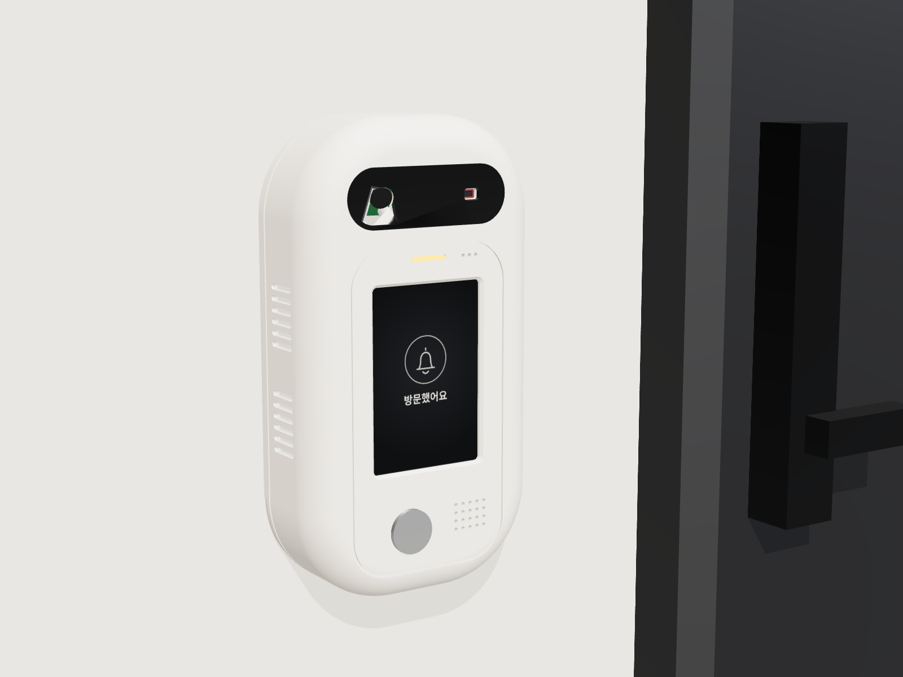
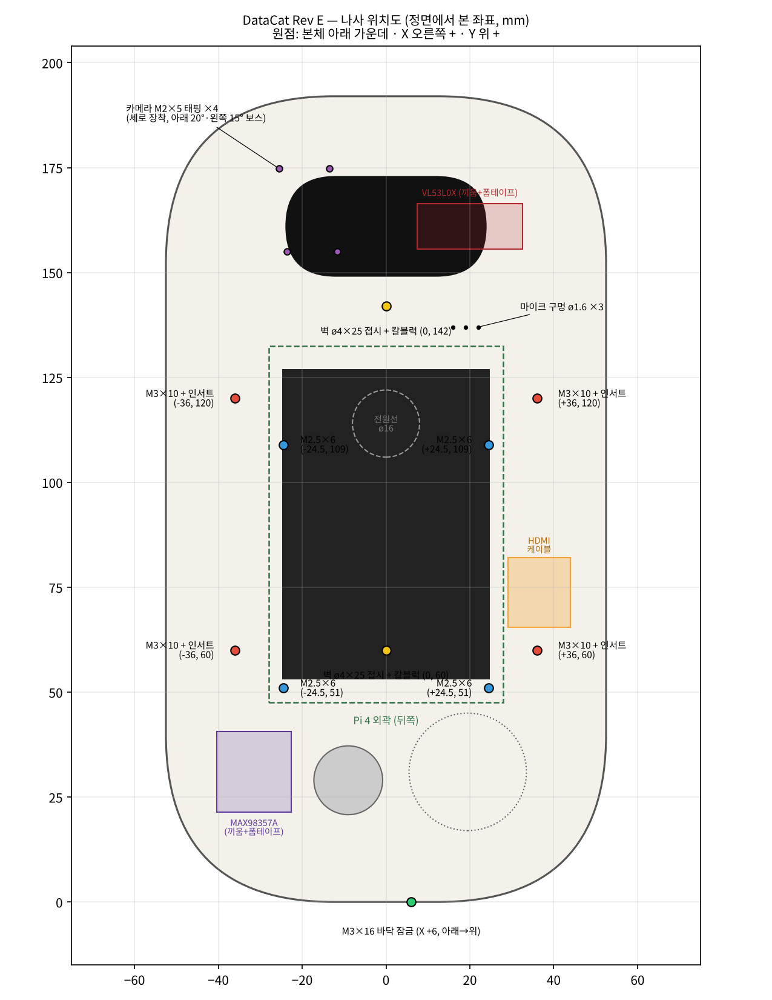
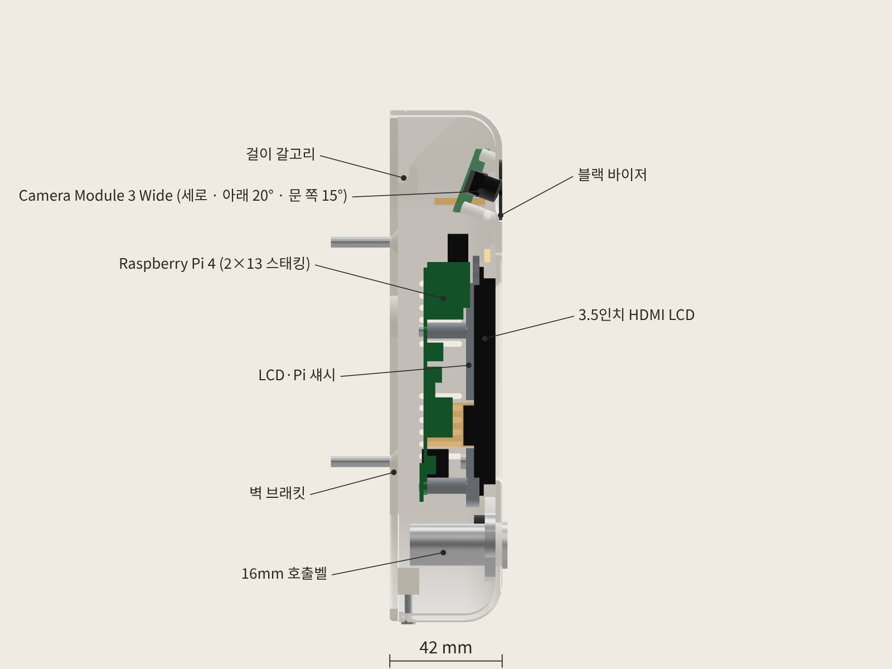

# DataCat 무인현관 초인종 외함 Rev E

2026-10-28 하드웨어 구성(Pi 4, VL53L0X, USB 핀마이크, MAX98357A)에 맞춘 버전입니다. 알약형 + 블랙 바이저 디자인은 Rev D와 같고, 세로만 215 → **192 mm**로 23 mm 줄였습니다(Rev E.1). 이번 버전은 3D 프린터로 바로 뽑을 수 있게 다듬었고, 나사 구멍도 실제 나사 규격에 맞췄습니다.



## 한눈에

| 항목 | 값 |
|---|---|
| 외형 | **105 × 192 × 42 mm** (가로 × 세로 × 벽에서 앞면까지). Rev D는 105 × 215 × 42 |
| 출력 부품 | 5개: 전면 쉘, LCD·Pi 섀시, 벽 브래킷, 블랙 바이저, LED 라이트파이프 |
| 부품끼리 겹침 | 0 mm³ (출력 부품 5개 + 실제 부품·나사·배선 공간 19개 전부 검사) |
| 벽에 걸고 내리는 경로 | 전 구간 충돌 0 |
| 카메라 | 찍어야 하는 지점(얼굴, 문 앞 바닥 등) 6곳 모두 가림 없음 |
| ToF 화각 25° | 가림 0 |
| STL | 5개 모두 닫힌 단일 덩어리 (슬라이서 경고 없음) |
| 출력 크기 | 가장 큰 쉘이 105 × 192 × 42 → 220 × 220 베드(Ender-3급)에 여유 있게 들어감 |

자세한 수치는 `validation.json`(간섭·나사 물림)과 `printcheck.json`(출력 방향별 서포트 필요 면적)에 있습니다.

## Rev D → Rev E 바뀐 점

| 부분 | Rev D | Rev E |
|---|---|---|
| 세로 길이 | 215 mm | **192 mm**. 바이저를 Pi USB 포트 앞쪽으로 16 mm 내리고, 버튼·스피커 줄과 화면 사이 빈 공간을 줄임 |
| 거리 센서 | VL53L5CX Qwiic Mini (12.7 × 25.4) | **VL53L0X V2 보드 (25 × 10.7)**. 바이저 오른쪽 끼움 홈, 창은 화각 25°에 맞춤 |
| 카메라 | Camera Module 3 Wide, 가로, 아래 10° | 같은 카메라를 **세로로**, 아래 20°, 문 쪽(정면에서 왼쪽) 15°. 세로 화각 102°로 얼굴과 문 앞 바닥을 한 장에 담음 |
| 스피커 | USB 스피커 (USB3 포트) | **MAX98357A 앰프 + ø28 스피커**. 앰프는 버튼 왼쪽 끼움 홈 |
| 마이크 | USB 마이크 동글 | USB 핀마이크(JMTek), 자리는 같음 (USB2 위쪽 포트) |
| 스피커 보드 선반 | 옆벽에서 나온 판 (출력할 때 서포트 필요) | 삭제 |
| 섀시 나사 | M3 × 8 | **M3 × 10** + 인서트 L4 (나사가 인서트 끝까지 4 mm 물림) |
| 바닥 잠금 나사 | M3 × 20 (보스 구멍 끝을 뚫고 나감) | **M3 × 16** (6.9 mm 물림, 끝 여유 2.5 mm) |
| 벽 브래킷 갈고리 | 지붕 6 mm가 허공에 뜸 | 지붕 밑 45° 모따기 → 서포트 없이 출력 |
| 갈고리 혀(쉘 안쪽) | 24 mm가 허공에 뜸 | 45° 받침 추가 → 6 mm만 뜸 |
| 섀시 가로바 | 52 mm 브리지 2개 | 아래 바는 기둥으로 채움, 위 바는 43 mm 브리지 1개 |
| 마이크 구멍 | ø1.4 | ø1.6 (FDM으로 막히지 않는 최소 크기) |
| 버튼 구멍 | ø16.3 | ø16.4 (PETG 수축 감안) |

## 들어가는 부품

| 부품 | 모델에 쓴 치수 | 위치 · 고정 |
|---|---|---|
| Raspberry Pi 4 | 85 × 56, M2.5 구멍 58 × 49 | 화면 뒤 세로, USB/LAN 위쪽. M2.5 × 6 태핑 4개 |
| Waveshare 3.5inch HDMI LCD | 85.5 × 56, 유리 4.4 | 화면 창 바로 뒤. 섀시가 눌러 잡음 (나사 없음) |
| Camera Module 3 Wide | 25 × 24 × 12.4, 구멍 ø2.2 | 바이저 왼쪽, 세로·아래 20°·왼쪽 15°. M2 × 5 태핑 4개 |
| VL53L0X V2 보드 | 25 × 10.7 × 1.6, 센서 4.4 × 2.4 | 바이저 오른쪽 끼움 홈. 양면 폼테이프 |
| USB 핀마이크 | 18.3 × 7.7, 포트 밖 10.5 | Pi USB 2.0 위쪽 포트. 소리 구멍 ø1.6 × 3 |
| MAX98357A 앰프 | 17.8 × 19.1 × 1.6, 단자대 7.6 × 7 × 8.5 | 버튼 왼쪽 끼움 홈, 부품면이 뒤로. 양면 폼테이프 |
| 스피커 ø28 (4~8 Ω, 2~3 W) | ø28 × 8 | 그릴 뒤 링. 핫멜트 |
| 16 mm 메탈 LED 버튼 | 구멍 ø16.4, 너트 24 | 화면 아래 왼쪽. 버튼 너트 |
| 상태 LED 3 mm | | 화면 위 라이트파이프 뒤 |

## 나사 · 인서트 (사야 할 것)

| 규격 | 수량 | 들어가는 곳 | 물림 길이 |
|---|---|---|---|
| **M3 황동 열압입 인서트** 외경 4.5 · 길이 4 | 4 (+여분 2) | 쉘 안쪽 보스. 구멍 ø4.0 × 깊이 5.5 | |
| **M3 × 10 냄비머리 기계나사** | 4 | 섀시 귀(ø3.4) → 인서트 (뒤에서 앞으로) | 4.0 mm, 끝 여유 0.5 mm |
| **M2.5 × 6 냄비머리 태핑나사** | 4 | Pi 뒷면 → 섀시 스탠드오프(ø2.2) | 4.6 mm |
| **M2 × 5 냄비머리 태핑나사** | 4 | 카메라 뒷면 → 쉘 보스(ø1.8) | 4.0 mm |
| **M3 × 16 냄비머리 기계나사** | 1 | 쉘 바닥(ø3.4, 머리 자리 ø6.2) → 벽 브래킷 보스(ø2.5, 나사산이 직접 생김) | 6.9 mm |
| **ø4 × 25 접시머리 나사 + 6 mm 칼블럭** | 2 | 벽 브래킷 → 벽 (구멍 ø4.6, 90° 접시 자리 ø9.4) | |
| 양면 폼테이프 (1 mm) | 조금 | ToF 보드, 앰프 보드 | |
| 핫멜트 / 순간접착제 | 조금 | 스피커, 블랙 바이저, 라이트파이프 | |

- 인서트는 "M3 열압입 인서트(heat-set insert) 외경 4.5 길이 4"로 찾으면 됩니다. 외경이 4.2나 5.0인 제품이면 `model.py`의 `FASTENERS["m3_insert"]["hole"]`을 외경 − 0.5로 고칩니다.
- 태핑나사는 끝이 뾰족한 "PT 태핑"이나 "셀프태핑"이면 됩니다. 기계나사를 써도 구멍에 나사산을 내며 들어가지만, 너무 세게 조이면 플라스틱 나사산이 뭉개집니다.
- 나사 위치는 `images/screw_map.png`에 좌표와 함께 있습니다.



### 인서트 넣는 법

1. 인두를 220~240 ℃(PETG) 또는 200 ℃(PLA)로 맞춥니다. 인서트용 팁이 있으면 좋습니다.
2. 쉘을 앞면이 아래로 가게 놓고, 인서트를 보스 구멍 위에 세웁니다. 구멍 입구가 0.5 mm 모따기라 똑바로 섭니다.
3. 인두로 천천히 눌러 인서트 윗면이 보스 면과 같아질 때까지 넣습니다. 구멍이 1.5 mm 더 깊어서 녹은 플라스틱이 아래로 빠집니다.
4. 식기 전에 M3 나사를 잠깐 꽂아 수직을 맞춥니다.

## 출력

| 파일 | 재질 | 방향 (`stl_print`는 이미 맞춰 둠) | 서포트 |
|---|---|---|---|
| `01_front_shell` | PETG 흰색 (실내면 PLA도 됨) | 앞면이 베드 쪽 | **빌드 플레이트에서만**. 앞 테두리 R14 아래쪽과 바이저 홈(1.2 mm)에만 생김. 안쪽 보스·리브는 서포트 없음 |
| `02_lcd_pi_chassis` | PETG / PLA | LCD 닿는 면이 베드 | 없음. 43 mm 브리지 1곳 → 브리지 속도 20~25 mm/s, 팬 100% |
| `03_wall_plate` | PETG / PLA | 벽 쪽 면이 베드 | 없음 |
| `04_black_visor` | 검정 PETG (광택이면 더 좋음) | 바깥면이 베드 | 없음 |
| `05_led_light_pipe` | 투명 PETG / 레진 | 플랜지가 베드 | 없음 (생략 가능) |

권장 설정: 노즐 0.4, 레이어 0.2, 벽 3줄(1.2 mm), 위아래 4겹, 인필 20% 자이로이드, 첫 레이어 수평 확장 −0.2(코끼리 발 방지).

- 쉘 안쪽 갈고리 혀 끝 6 mm는 서포트 없이 뜹니다. 아래로 처지면 혀 앞면(벽 반대쪽)을 사포로 0.3 mm 정도 다듬어 브래킷에 부드럽게 들어가게 합니다.
- 프린터마다 구멍 크기가 ±0.1 mm 다릅니다. 쉘을 뽑기 전에 섀시만 먼저 뽑아 Pi 나사와 M3 귀 구멍을 맞춰 보세요.

## 배선 (Pi 물리 핀 번호)

LCD가 2 × 13 스태킹 헤더로 1~26번 핀을 덮습니다. 그래서 1~26번에 연결할 것은 Pi **뒷면** 납땜 끝에 전선을 납땜합니다. 27~40번은 ㄱ자 듀폰으로 꽂습니다.

| 부품 | 핀 | 연결 |
|---|---|---|
| VL53L0X | VIN → 1 (3.3 V), GND → 9, SDA → 3 (GPIO2), SCL → 5 (GPIO3) | Pi 뒷면 납땜 |
| MAX98357A | VIN → 4 (5 V), GND → 14, BCLK → 12 (GPIO18) | Pi 뒷면 납땜 |
| MAX98357A | LRC → 35 (GPIO19), DIN → 40 (GPIO21), SD·GAIN은 비워 둠 | ㄱ자 듀폰 |
| 호출벨 버튼 | 29 (GPIO5), GND 30 | ㄱ자 듀폰, 내부 풀업 |
| 버튼 LED 링 | 31 (GPIO6), GND 34 | ㄱ자 듀폰 |
| 상태 LED (선택) | 33 (GPIO13) → 330 Ω → LED → 39 (GND) | ㄱ자 듀폰 |

- 이전 HC-SR04 핀(16, 18번)은 이제 쓰지 않아서 겹치는 핀이 없습니다.
- MAX98357A는 Ubuntu 22.04 기준 `/boot/firmware/config.txt`에 `dtoverlay=max98357a`를 넣고 재부팅하면 소리 장치로 잡힙니다.
- 앰프가 오기 전 임시로 쓰는 3.5 mm 이어폰은 Pi 오른쪽 오디오 잭에 꽂습니다. 옆 공간이 약 20 mm라 ㄱ자 플러그만 들어갑니다.

## 조립 순서

1. 쉘을 앞면이 아래로 가게 놓고 M3 인서트 4개를 넣습니다. 블랙 바이저와 라이트파이프를 붙입니다.
2. 버튼을 앞에서 끼우고 너트를 조입니다. 스피커를 그릴 뒤 링에 핫멜트로 붙입니다.
3. VL53L0X를 바이저 오른쪽 홈에 센서가 창을 향하게 밀어 넣고, 뒤에 폼테이프를 붙입니다.
4. MAX98357A를 버튼 왼쪽 홈에 부품면이 뒤로 가게 넣고 폼테이프로 고정합니다. 스피커 선을 단자대에 연결합니다.
5. 카메라에 CSI 케이블(300 mm)을 꽂고, 커넥터가 가운데 쪽을 향하게(세로) 기울어진 보스에 M2 × 5로 고정합니다.
6. Pi 뒷면에 ToF 4가닥, 앰프 3가닥을 납땜합니다. Pi를 섀시 스탠드오프에 M2.5 × 6 4개로 고정합니다.
7. Pi GPIO 1~26에 2 × 13 스태킹 헤더를 꽂고, HDMI FPC 케이블의 micro-HDMI 쪽을 HDMI0(USB-C 바로 옆)에 꽂습니다.
8. LCD를 쉘 창에 넣고, 섀시+Pi를 덮으면서 스태킹 헤더를 LCD 헤더에 맞춰 누릅니다. 섀시를 M3 × 10 4개로 조입니다.
9. FPC 케이블 HDMI 쪽을 LCD에 꽂고, USB 핀마이크를 USB 2.0 위쪽 포트에, 카메라 케이블을 Pi CSI 포트에 꽂습니다. 버튼·LED·앰프 듀폰을 꽂습니다.
10. 벽 브래킷을 벽에 ø4 × 25 나사 2개로 고정하고, 쉘을 7.4 mm 올린 상태로 벽에 대고 내려 겁니다. 바닥에서 M3 × 16으로 잠급니다.



## 부품 도착하면 잴 것 (`model.py` 맨 위 값만 고치면 됨)

| 잴 것 | 바꿀 값 | 왜 |
|---|---|---|
| 문이 초인종의 어느 쪽에 있는지 | `CAM["yaw"]` (왼쪽 −15, 오른쪽 +15) | 카메라가 문 앞 바닥을 보도록 |
| VL53L0X 보드 크기 (판매처마다 24.6~25 × 10.7~12) | `TOF["w"]`, `TOF["h"]` | 끼움 홈 크기 |
| MAX98357A 보드 크기 (Adafruit형 17.8 × 19.1, 보라색 보드는 조금 다름) | `AMP` | 끼움 홈 크기 |
| 스피커 지름 | `SPEAKER["dia"]` | 링 크기 |
| 스태킹 헤더로 꽂았을 때 Pi 윗면 ~ LCD 뒷면 거리 | `STACK` (지금 19.5) | 모든 깊이 값이 여기서 나옴 |

고친 뒤 다시 만들기:

```bash
pip install cadquery trimesh
python export_final.py      # step/, stl_print/, validation.json, printcheck.json 다시 생성 + 검증
pip install bpy && python export_blender.py   # blender/ 다시 생성
```

## 남은 것

- 실내 복도용입니다(통풍구·케이블 홈 때문에 방수 아님).
- VL53L0X 보드의 귀 구멍 간격이 판매처마다 달라서 나사 대신 끼움 홈 + 폼테이프로 잡았습니다. 실물 구멍 간격을 알려 주면 M2 보스로 바꿀 수 있습니다.
- 모델의 주황 반투명 박스(HDMI 케이블, GPIO 27~40 배선, ToF 핀헤더·듀폰)는 출력물이 아니라 비워 둔 공간 표시입니다.
