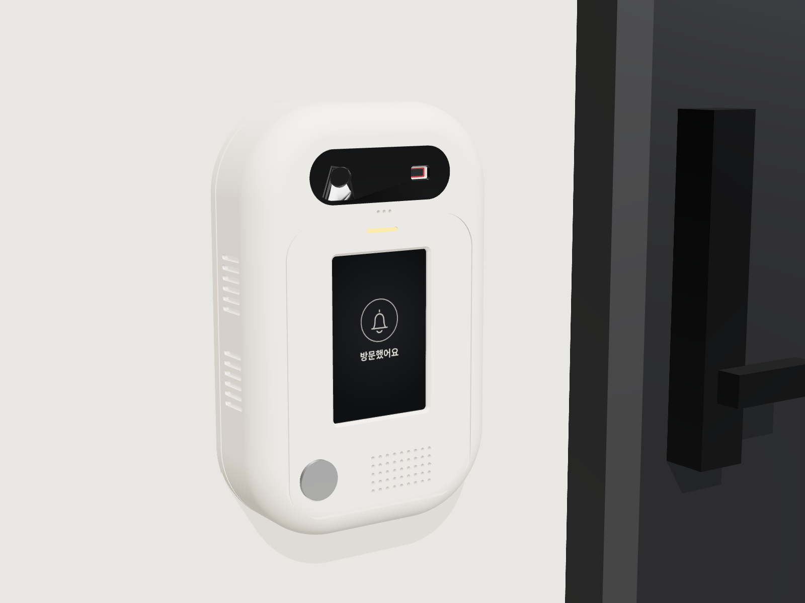
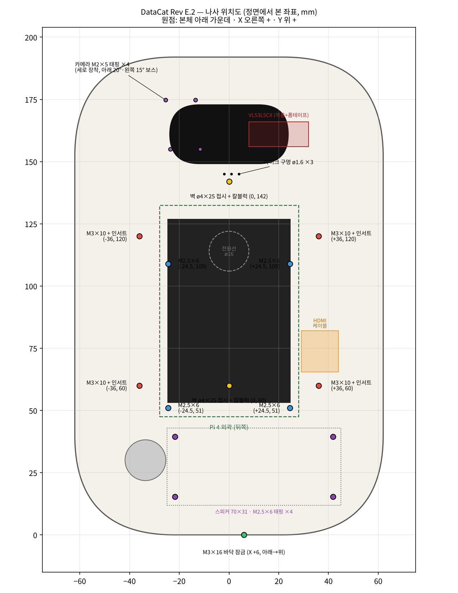
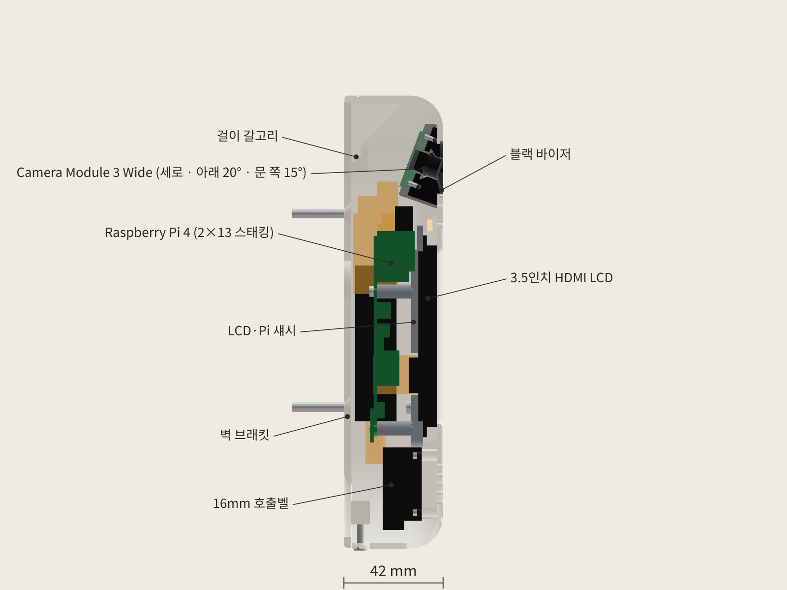

# DataCat 무인현관 초인종 외함 Rev E.2 (고정형)

10/31에 실제로 산 부품(VL53L5CX V2 ToF, 상자형 스피커 70 × 31, USB 사운드카드 스틱)에 맞춘 버전입니다. 디자인(알약형 + 블랙 바이저)과 세로 192 mm는 Rev E.1과 같고, 상자형 스피커를 버튼 옆에 나란히 넣으려고 **가로만 105 → 124 mm**로 늘렸습니다. 카메라 각도를 모터로 바꾸는 버전은 Rev F.2입니다.



## 한눈에

| 항목 | 값 |
|---|---|
| 외형 | **124 × 192 × 42 mm** (Rev E.1은 105 × 192 × 42) |
| 출력 부품 | 6개: 전면 쉘, LCD·Pi 섀시, 벽 브래킷, 블랙 바이저, LED 라이트파이프, **카메라 홀더(검정)** |
| 부품끼리 겹침 | 0 mm³ (출력 부품 + 실제 부품·나사·선 자리 전부 검사) |
| 벽에 걸고 내리는 경로 | 전 구간 충돌 0 |
| 카메라 | 찍어야 하는 지점 가림 없음 (Rev E.1과 같은 위치·각도) |
| ToF 화각 45° × 45° | 가림 0 |
| STL | 6개 모두 닫힌 단일 덩어리 |
| 출력 크기 | 가장 큰 쉘 124 × 192 → 220 × 220 베드에 들어감 |

자세한 수치는 `validation.json`(간섭·나사 물림·카메라 광선)과 `printcheck.json`(서포트 필요 면적)에 있습니다.

## Rev E.1 → Rev E.2 바뀐 점

| 부분 | Rev E.1 | Rev E.2 |
|---|---|---|
| 가로 | 105 mm | **124 mm** |
| 거리 센서 | VL53L0X (25 × 10.7), 창 25° | **VL53L5CX V2 (24.1 × 10)**, 창 45° × 45°. 같은 바이저 오른쪽 홈 |
| 소리 | MAX98357A 앰프 + ø28 스피커 | **USB 사운드카드 스틱 + 상자형 스피커 70 × 31 (4 Ω 3 W)**. 앰프 홈 삭제 |
| 스피커 고정 | 링 + 핫멜트 | **쉘 보스 4개 + M2.5 × 6 태핑**. 그릴 → 스피커 앞판 사이를 사각 테두리로 막아 소리가 안으로 새지 않게 함 |
| 그릴 | 원형 | 9 × 5 구멍 (ø1.8) |
| 버튼 | 화면 아래 왼쪽 | 왼쪽 아래 (x −33.6, y 30). 너트 자리 평면 처리 |
| 마이크 | USB 2.0 위쪽 포트 | **USB 3.0 위쪽 포트** (구멍 위치 같음) |
| 사운드카드 스틱 | 없음 | **USB 연장선으로 빼서 오른쪽 옆벽 안쪽에 세워 붙임** (아래 설명) |
| 옆 통풍구 | 양쪽 | 왼쪽만. 오른쪽은 스틱이 막아서 대신 **바닥에 슬롯 5개** |
| ToF 연결 | 일자 핀헤더 + 듀폰 | **선을 보드에 바로 납땜** (뒤로 핀헤더 꽂을 자리가 없음) |
| 카메라 고정 | 쉘 안쪽 흰 보스 4개 | **검은 카메라 홀더(06)** 에 고정. 렌즈 구멍으로 기판·보스·흰 벽이 안 보임 |

### 렌즈 구멍 안쪽이 안 보이게 (카메라 홀더)

카메라가 아래 20°, 왼쪽 15°로 기울어져 있고 화각이 세로 102°라서, 렌즈 구멍이 아래·왼쪽으로 길게 열립니다. 전에는 그 틈으로 초록 기판, 흰 나사 보스, 쉘 안쪽 벽이 보였습니다.

- 쉘의 카메라 보스를 없애고, 카메라는 **검은 카메라 홀더**에 M2 × 5 4개로 고정합니다.
- 홀더는 카메라 기판 앞면부터 앞벽까지를 검게 채우고, 앞부분은 쉘 창에 끼워 바이저 바로 밑까지 올라옵니다. 화각 모양만 파내서 밖에서는 검은 면과 렌즈만 보입니다.
- 쉘 창 테두리는 바이저가 1.5 mm 덮어서 흰 단면도 안 보입니다.
- 화각은 그대로입니다. 얼굴·문 앞 바닥 광선 6개 모두 가림 0.

### 사운드카드 스틱을 왜 옆벽에 붙였나

Pi USB 포트에 스틱을 바로 꽂으면 스틱 끝이 윗벽 안쪽에서 3 mm밖에 안 남습니다. 스틱 끝에 있는 3.5 mm 잭에 스피커 플러그를 꽂을 자리가 없습니다. 그래서 짧은 USB 연장선으로 빼서 오른쪽 옆벽 안쪽(화면 오른쪽 뒤)에 세워 붙였습니다. 잭은 아래(스피커 쪽)를 보게 해서 스피커 선이 짧아집니다.

- 스틱 자리: x 50.5~58.5, y 54~120, z 4.5~22.5 (18 mm 면이 깊이 방향)
- 주황 반투명 박스 `USB 연장선(공간)`, `3.5mm 플러그(공간)`은 출력물이 아니라 비워 둔 자리 표시입니다.

## 들어가는 부품

| 부품 | 모델에 쓴 치수 | 위치 · 고정 |
|---|---|---|
| Raspberry Pi 4 | 85 × 56, M2.5 구멍 58 × 49 | 화면 뒤 세로. M2.5 × 6 태핑 4개 |
| Waveshare 3.5inch HDMI LCD | 85.5 × 56, 유리 4.4 | 화면 창 뒤. 섀시가 눌러 잡음 |
| Camera Module 3 Wide | 25 × 24 × 12.4 | 바이저 왼쪽, 세로·아래 20°·왼쪽 15°. 카메라 홀더에 M2 × 5 태핑 4개 |
| **VL53L5CX V2 보드** | 24.1 × 10 × 1.6, 센서 6.4 × 3.0 | 바이저 오른쪽 끼움 홈. 양면 폼테이프 |
| USB 핀마이크 | 18.3 × 7.7, 포트 밖 10.5 | **USB 3.0 위쪽 포트**. 소리 구멍 ø1.6 × 3 |
| **USB 사운드카드 스틱** | 66 × 18 × 8 (두께는 가정) | 연장선 끝에 꽂아 오른쪽 옆벽 안쪽에 폼테이프 |
| **상자형 스피커 4 Ω 3 W** | 앞판 69.9 × 31, 깊이 16.5, 구멍 63.6 × 24 (ø3) | 그릴 뒤 6.5 mm. **M2.5 × 6 태핑 4개** |
| 16 mm 메탈 LED 버튼 | 구멍 ø16.4, 너트 24 | 왼쪽 아래. 버튼 너트 |
| 상태 LED 3 mm | | 화면 위 라이트파이프 뒤 |

## 나사 · 인서트 · 선 (사야 할 것)

| 규격 | 수량 | 들어가는 곳 | 물림 길이 |
|---|---|---|---|
| M3 황동 열압입 인서트 외경 4.5 · 길이 4 | 4 (+여분 2) | 쉘 안쪽 보스 (구멍 ø4.0 × 5.5) | |
| M3 × 10 냄비머리 기계나사 | 4 | 섀시 귀 → 인서트 | 4.0 mm |
| **M2.5 × 6 냄비머리 태핑나사** | **8** | Pi 4개 (섀시 ø2.2) + **스피커 4개** (쉘 보스 ø2.2) | 4.6 / 4.0 mm |
| M2 × 5 냄비머리 태핑나사 | 4 | 카메라 기판 뒤 → 카메라 홀더(ø1.8) | 4.0 mm |
| M3 × 16 냄비머리 기계나사 | 1 | 쉘 바닥 → 벽 브래킷 보스(ø2.5) | 6.9 mm |
| ø4 × 25 접시머리 나사 + 6 mm 칼블럭 | 2 | 벽 브래킷 → 벽 | |
| **USB 연장선 A수–A암 15~20 cm** | 1 | Pi USB 2.0 아래 포트 → 스틱. 암 단자가 18 × 9 mm 안쪽인 얇은 것 | |
| **3.5 mm 스테레오 케이블 (ㄱ자 플러그)** | 1 | 스틱 이어폰 잭 → 스피커. 한쪽을 잘라 L(팁)과 GND(슬리브)를 스피커 선에 연결 | |
| 양면 폼테이프 (1 mm) | 조금 | ToF 보드, 사운드카드 스틱 | |
| 순간접착제 | 조금 | 카메라 홀더 → 쉘, 블랙 바이저 | |

- 스피커 나사는 스피커 앞판 구멍(ø3)을 지나 쉘 보스에 박힙니다. 앞판 두께를 2 mm로 잡았고, 더 두꺼우면 M2.5 × 8을 씁니다.
- 스피커에 PH2.0 같은 작은 커넥터가 달려 있으면 그대로 잘라서 3.5 mm 케이블에 납땜하거나, 커넥터 짝을 사서 연결합니다.
- 나사 위치는 `images/screw_map.png`에 좌표와 함께 있습니다.



## 출력

| 파일 | 재질 | 방향 (`stl_print`는 이미 맞춰 둠) | 서포트 |
|---|---|---|---|
| `01_front_shell` | PETG 흰색 | 앞면이 베드 쪽 | 빌드 플레이트에서만 (앞 테두리 곡면과 바이저 홈) |
| `02_lcd_pi_chassis` | PETG / PLA | LCD 닿는 면이 베드 | 없음. 43 mm 브리지 1곳 |
| `03_wall_plate` | PETG / PLA | 벽 쪽 면이 베드 | 없음 |
| `04_black_visor` | 검정 PETG | 바깥면이 베드 | 없음 |
| `05_led_light_pipe` | 투명 PETG | 플랜지가 베드 | 없음 (생략 가능) |
| `06_camera_holder` | **검정 PETG (무광 권장)** | 카메라 기판 닿는 면이 베드 | 없음 |

권장 설정은 Rev E와 같습니다: 노즐 0.4, 레이어 0.2, 벽 3줄, 인필 20%, 첫 레이어 수평 확장 −0.2. 쉘이 124 mm로 넓어져서 첫 레이어가 잘 붙는지 먼저 확인하세요.

## 배선 (Pi 물리 핀 번호)

LCD가 2 × 13 스태킹 헤더로 1~26번 핀을 덮습니다. 1~26번에 연결할 것은 Pi 뒷면 납땜 끝에 전선을 납땜하고, 27~40번은 ㄱ자 듀폰으로 꽂습니다.

| 부품 | 핀 | 연결 |
|---|---|---|
| VL53L5CX | VIN → 1 (3.3 V), GND → 9, SDA → 3 (GPIO2), SCL → 5 (GPIO3) | 양쪽 다 납땜 |
| VL53L5CX | LPn → 3.3 V (보드에 풀업이 있으면 비워 둠). INT·I2C_RST는 안 씀 | |
| USB 사운드카드 스틱 | USB 2.0 아래 포트 (연장선) | |
| USB 핀마이크 | USB 3.0 위 포트 | |
| 호출벨 버튼 | 29 (GPIO5), GND 30 | ㄱ자 듀폰, 내부 풀업 |
| 버튼 LED 링 | 31 (GPIO6), GND 34 | ㄱ자 듀폰 |
| 상태 LED (선택) | 33 (GPIO13) → 330 Ω → LED → 39 (GND) | ㄱ자 듀폰 |

- MAX98357A를 안 써서 12, 35, 40번 핀이 비었습니다. `config.txt`의 `dtoverlay=max98357a`도 지웁니다.
- 사운드카드 스틱은 꽂기만 하면 소리 장치로 잡힙니다. `aplay -l`로 카드 번호를 확인하고 기본 출력으로 지정합니다.
- VL53L5CX는 켤 때마다 펌웨어(약 84 KB)를 I2C로 올립니다. I2C 속도를 400 kHz로 올려 두면 시작이 빨라집니다 (`dtparam=i2c_arm_baudrate=400000`).
- 사운드카드 스틱의 이어폰 출력은 힘이 약해서 4 Ω 스피커 소리가 작을 수 있습니다. 시험해 보고 부족하면 5 V로 도는 작은 앰프 보드(PAM8302 등)를 스틱과 스피커 사이에 넣습니다.

## 조립 순서

1. 쉘을 앞면이 아래로 가게 놓고 M3 인서트 4개를 넣습니다. 라이트파이프를 붙입니다. 블랙 바이저는 5번(카메라 홀더) 다음에 붙입니다.
2. 버튼을 앞에서 끼우고 너트를 조입니다.
3. 스피커를 그릴 뒤 사각 테두리에 맞춰 대고 M2.5 × 6 4개로 고정합니다. 스피커 선은 오른쪽으로 뺍니다.
4. VL53L5CX에 4~5가닥 선을 납땜한 뒤, 바이저 오른쪽 홈에 센서가 창을 향하게 밀어 넣고 폼테이프로 고정합니다.
5. 카메라에 CSI 케이블을 꽂고 카메라 홀더에 기판 뒤에서 M2 × 5 4개로 고정합니다. 홀더 앞부분을 쉘 안쪽에서 카메라 창에 끼우고(바이저 붙이기 전에 앞에서 보며 맞춤) 테두리에 순간접착제를 조금 바릅니다.
6. Pi 뒷면에 ToF 선을 납땜하고, Pi를 섀시에 M2.5 × 6 4개로 고정합니다.
7. 스태킹 헤더, HDMI FPC 케이블을 꽂고 LCD를 쉘 창에 넣은 뒤 섀시+Pi를 덮어 M3 × 10 4개로 조입니다.
8. USB 핀마이크를 USB 3.0 위 포트에, 연장선을 USB 2.0 아래 포트에 꽂습니다. 연장선 끝에 사운드카드 스틱을 꽂고, 잭이 아래를 보게 해서 오른쪽 옆벽 안쪽에 폼테이프로 붙입니다.
9. 3.5 mm 플러그를 스틱 이어폰 잭에 꽂습니다. 버튼·LED 듀폰과 카메라 케이블을 꽂습니다.
10. 벽 브래킷을 벽에 고정하고, 쉘을 7.4 mm 올린 상태로 대고 내려 겁니다. 바닥에서 M3 × 16으로 잠급니다.



## 부품 받으면 잴 것 (`model.py` 맨 위 값만 고치면 됨)

| 잴 것 | 바꿀 값 | 왜 |
|---|---|---|
| 사운드카드 스틱 두께, 잭이 끝에 있는지 옆에 있는지 | `USB_SND` | 옆벽 자리. 지금은 두께 8 mm, 잭이 끝에 있다고 가정 |
| 연장선 암 단자 크기 | `USB 연장선(공간)` | 18 × 9 mm보다 크면 옆벽 자리를 넓혀야 함 |
| 스피커 앞판 두께 | 나사 길이 | 2 mm보다 두꺼우면 M2.5 × 8 |
| VL53L5CX 보드 크기 | `TOF["w"]`, `TOF["h"]` | 끼움 홈 크기 |
| 문이 초인종의 어느 쪽에 있는지 | `CAM["yaw"]` | 카메라가 문 앞 바닥을 보도록 |

다시 만들기:

```bash
pip install cadquery trimesh scipy
python export_final.py      # step/, stl_print/, validation.json, printcheck.json
pip install bpy && python export_blender.py
```

## 남은 것

- 실내 복도용입니다(방수 아님).
- 오른쪽 옆 통풍구를 없애고 바닥 슬롯으로 바꿨습니다. 오래 켜 두고 Pi 온도(`vcgencmd measure_temp`)가 70 ℃를 넘으면 알려 주세요. 왼쪽 통풍구를 늘리겠습니다.
- 카메라 홀더는 기판 앞면에 바로 닿습니다. 기판 앞쪽 작은 부품에 걸려 들뜨면 홀더 바닥을 사포로 조금 갈아 냅니다.
- 모터형(Rev F.2)과 크기·아래쪽 배치가 같습니다.
