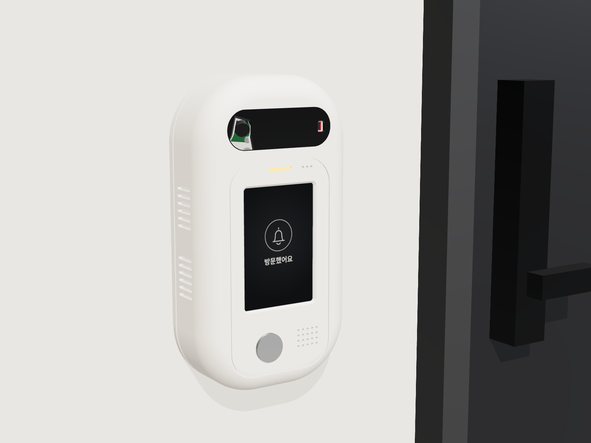
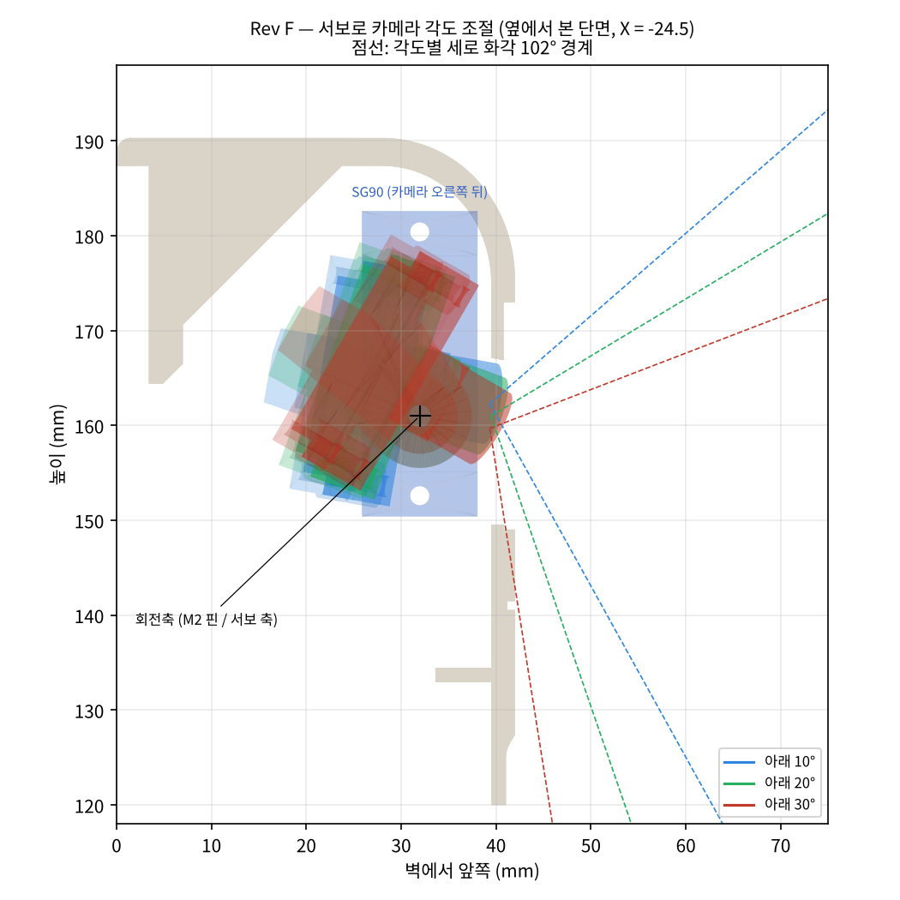
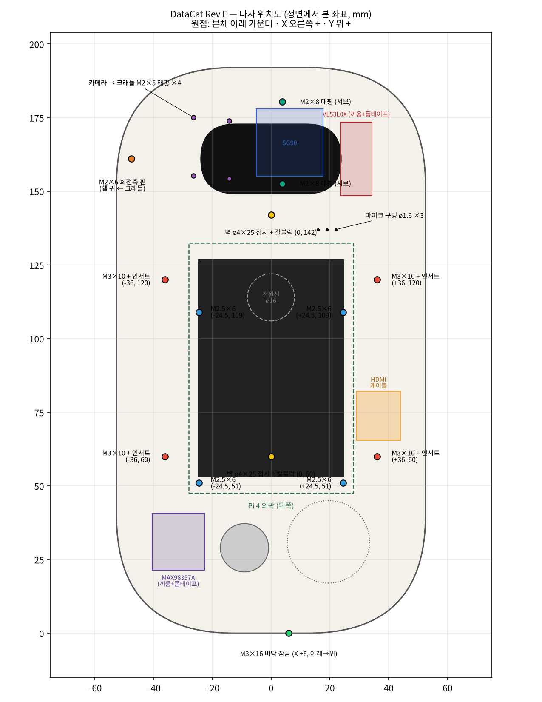

# DataCat 무인현관 초인종 외함 Rev F (카메라 각도 모터 조절형)

Rev E.1(105 × 192 × 42 mm)을 바탕으로, 카메라를 **SG90 서보로 아래 10~30° 사이에서 기울일 수 있게** 바꾼 버전입니다. 외형과 크기는 Rev E.1과 같습니다. Rev E(고정형) 파일은 그대로 두었습니다.



## 한눈에

| 항목 | 값 |
|---|---|
| 외형 | **105 × 192 × 42 mm** (Rev E.1과 같음) |
| 출력 부품 | 6개: 전면 쉘, LCD·Pi 섀시, 벽 브래킷, 블랙 바이저, LED 라이트파이프, **카메라 크래들(새로 추가)** |
| 카메라 각도 | 아래 10° ~ 30° (서보 가운데 = 20°) |
| 서보 | SG90 (9 g) 1개 |
| 부품끼리 겹침 | 0 mm³ |
| 10 · 15 · 20 · 25 · 30°로 돌릴 때 | 크래들·카메라·혼이 어디에도 닿지 않음 |
| 벽에 걸고 내리는 경로 | 전 구간 충돌 0 |
| STL | 6개 모두 닫힌 단일 덩어리. 크래들은 서포트 없이 출력 |

자세한 수치는 `validation.json`(간섭·각도별 충돌·나사 물림·카메라 광선)과 `printcheck.json`(서포트 필요 면적)에 있습니다.



## 동작 방식

- 카메라는 **크래들**(검은색 출력 부품)에 M2 × 5 태핑 4개로 고정됩니다. 크래들이 렌즈 앞면 7.5 mm 뒤를 지나는 가로축을 중심으로 돕니다.
- **왼쪽**은 쉘 안쪽 귀에 M2 × 6 나사를 핀처럼 끼워 회전축으로 씁니다. 크래들 구멍은 ø2.3이라 헐겁게 돌고, 쉘 귀 구멍은 ø1.8이라 나사가 고정됩니다.
- **오른쪽**은 SG90 혼에 크래들을 붙여서, 서보가 직접 돌립니다. 링크나 막대는 없습니다.
- 축이 렌즈 바로 뒤에 있어서, 각도를 바꿔도 렌즈는 거의 제자리(±1.3 mm)에서 고개만 숙입니다. 바이저 구멍은 10~30° 전체 화각을 합친 모양으로 뚫었습니다.

| 각도 | 잘 보이는 것 |
|---|---|
| 10° | 얼굴과 정수리까지. 문 앞 바닥은 0.8 m보다 먼 곳만 |
| 20° (기본) | 얼굴 + 문 앞 바닥(옆 0.6~0.9 m) |
| 30° | 문 바로 앞 바닥(0.5 m) + 얼굴 |

평소에는 20°로 두고, 택배를 확인할 때 30°, 키 큰 방문객 얼굴이 잘릴 때 10°로 돌리는 식으로 쓰면 됩니다.

## Rev E.1 → Rev F 바뀐 점

| 부분 | Rev E.1 | Rev F |
|---|---|---|
| 카메라 고정 | 쉘 보스 4개에 고정 (아래 20°) | 크래들에 고정, 서보로 10~30° |
| 카메라 위치 | x −20 | x −24.5 (서보 자리를 만들려고 왼쪽으로) |
| 카메라 리본 커넥터 | 가운데 쪽 | 왼쪽 (서보와 안 겹치게 반대로 돌림) |
| ToF (VL53L0X) | 가로, x +20 | **세로로 세움**, x +29 |
| 쉘 안쪽 | 카메라 보스 4개 | 왼쪽 회전축 귀 1개 + 서보 고정 기둥 2개 |
| 출력 부품 | 5개 | 6개 (`06_camera_cradle` 추가) |

## 사야 할 것 (Rev E.1 목록에 추가)

| 규격 | 수량 | 들어가는 곳 | 물림 길이 |
|---|---|---|---|
| **SG90 마이크로 서보** (혼·나사 포함) | 1 | 카메라 오른쪽 뒤 | |
| **M2 × 8 냄비머리 태핑나사** | 2 | 서보 날개 → 쉘 기둥(ø1.8) | 5.5 mm |
| **M2 × 6 냄비머리 기계나사** | 1 | 크래들 왼쪽 허브(ø2.3) → 쉘 귀(ø1.8), 회전축 핀 | 3.2 mm |
| M2 × 5 냄비머리 태핑나사 | 4 | 카메라 앞 → 크래들 받침(ø1.8). Rev E와 같은 나사, 들어가는 곳만 바뀜 | 4.0 mm |
| 전해 콘덴서 470 µF 10 V 이상 | 1 | 서보 전원선 5 V–GND 사이 | |

- 서보 혼 가운데 나사와 날개 고정용 작은 나사는 SG90 봉투에 들어 있는 것을 씁니다. 크래들 오른쪽 팔에 가운데 구멍 ø2.4, 날개 구멍 ø1.2 × 2개가 있습니다.
- 나머지 나사·인서트(M3 × 10, M3 인서트, M2.5 × 6, M3 × 16, ø4 × 25 + 칼블럭)는 Rev E와 같습니다.



## 출력

| 파일 | 재질 | 방향 (`stl_print`는 이미 맞춰 둠) | 서포트 |
|---|---|---|---|
| `01_front_shell` | PETG 흰색 | 앞면이 베드 쪽 | 빌드 플레이트에서만 (앞 테두리 곡면과 바이저 홈) |
| `02_lcd_pi_chassis` | PETG / PLA | LCD 닿는 면이 베드 | 없음. 43 mm 브리지 1곳 |
| `03_wall_plate` | PETG / PLA | 벽 쪽 면이 베드 | 없음 |
| `04_black_visor` | 검정 PETG | 바깥면이 베드 | 없음 |
| `05_led_light_pipe` | 투명 PETG | 플랜지가 베드 | 없음 |
| **`06_camera_cradle`** | **PETG (검정 권장)** | **카메라 받침 뒷면이 베드** | **없음** |

권장 설정은 Rev E와 같습니다: 노즐 0.4, 레이어 0.2, 벽 3줄, 인필 20%, 첫 레이어 수평 확장 −0.2. 크래들은 작은 부품이라 인필 40% 이상으로 뽑으면 단단합니다.

- 블랙 바이저의 렌즈 구멍이 왼쪽 끝 가장자리에 0.5 mm만 남깁니다. 바이저를 떼어 낼 때 그 부분이 휘지 않게 조심하세요.

## 배선 (서보 추가분)

| 서보 선 | Pi 물리 핀 | 연결 |
|---|---|---|
| 주황 (신호) | 32 (GPIO12, 하드웨어 PWM0) | ㄱ자 듀폰 |
| 빨강 (5 V) | 2 (5 V) | Pi 뒷면 납땜 (LCD 헤더에 가려진 핀) |
| 갈색 (GND) | 6 (GND) | Pi 뒷면 납땜 |

- 5 V와 GND 사이에 470 µF 콘덴서를 달아 둡니다. 서보가 움직이는 순간 전류가 커서 Pi가 재부팅되는 것을 막아 줍니다.
- 떨림 없이 돌리려면 `pigpio`(하드웨어 PWM)를 씁니다. 서보 가운데(1.5 ms 펄스)를 20°로 맞추고, 각도 1°마다 펄스가 약 11 µs 바뀝니다. 10°는 약 1.39 ms, 30°는 약 1.61 ms입니다. 실제 값은 조립 후 사진을 보면서 맞춥니다.
- 서보는 녹음 중에는 움직이지 않게 합니다. 모터 소리가 마이크에 들어갑니다.
- 나머지 배선(VL53L0X, MAX98357A, 버튼, LED)은 Rev E와 같습니다.

## 조립 순서 (카메라 부분만, 나머지는 Rev E와 같음)

1. SG90을 축이 왼쪽(카메라 쪽)을 향하게 눕혀, 날개를 쉘 기둥 2개에 M2 × 8 태핑으로 고정합니다. 카메라를 넣기 전에 해야 드라이버가 들어갑니다.
2. 서보를 가운데(1.5 ms)로 맞춘 상태에서 한쪽 날개 혼을 끼웁니다.
3. 카메라를 크래들 받침에 앞에서 M2 × 5 4개로 고정합니다. 리본 커넥터가 왼쪽에 옵니다.
4. 크래들 오른쪽 팔을 혼에 대고 혼 가운데 나사로 조인 다음, 날개 작은 나사 2개로 고정합니다.
5. 크래들 왼쪽 허브를 쉘 귀에 맞추고, 안쪽에서 M2 × 6 나사를 허브 → 귀 순서로 끼워 조입니다. 크래들이 손으로 부드럽게 돌아야 합니다.
6. 카메라 리본을 크래들 왼쪽으로 빼서 아래로 내린 뒤 Pi CSI 포트에 꽂습니다. 10~30° 움직일 만큼 여유를 남깁니다.

## 남은 것

- SG90은 제품마다 크기가 ±0.5 mm 다릅니다. 받으면 몸통과 날개 구멍 간격을 재서 `model.py`의 `SERVO`를 고칩니다.
- 혼 모양이 다르면(십자형, 원형) 크래들 오른쪽 팔의 작은 구멍 위치(`_horn_point`)만 맞추면 됩니다.
- 움직이는 부품이라 고장 위험이 있습니다. 문제가 생기면 같은 크기의 Rev E.1(고정형)로 바로 돌아갈 수 있습니다.

다시 만들기:

```bash
pip install cadquery trimesh scipy
python export_final.py      # step/, stl_print/, validation.json, printcheck.json
python tiltview.py          # images/tilt_range.png (각도별 옆모습)
pip install bpy && python export_blender.py
```
