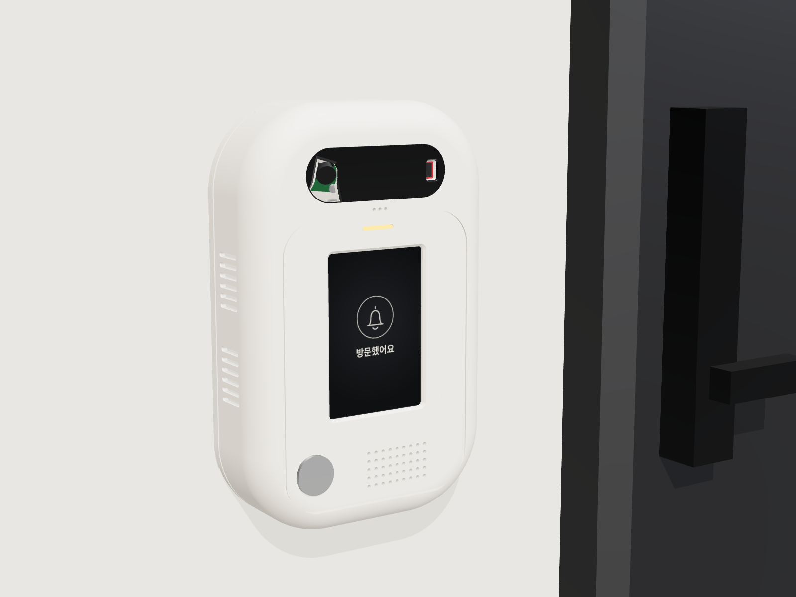
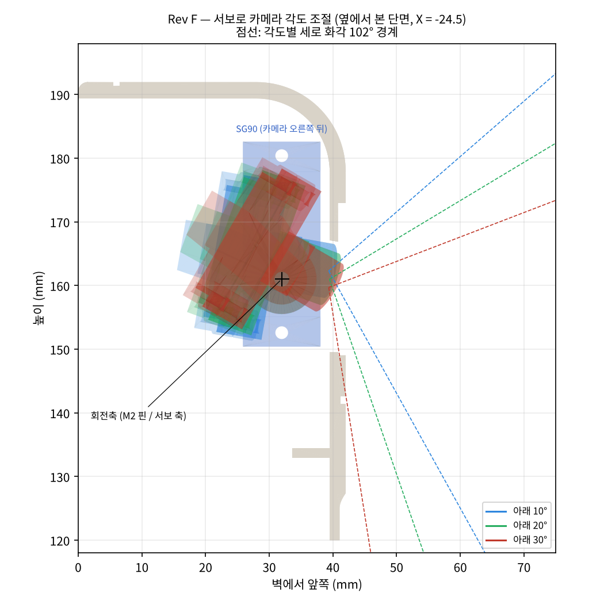
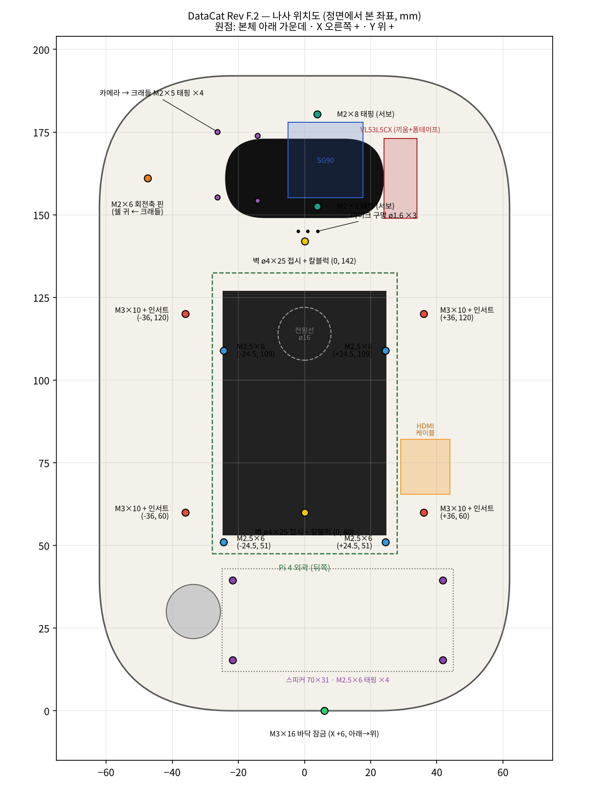
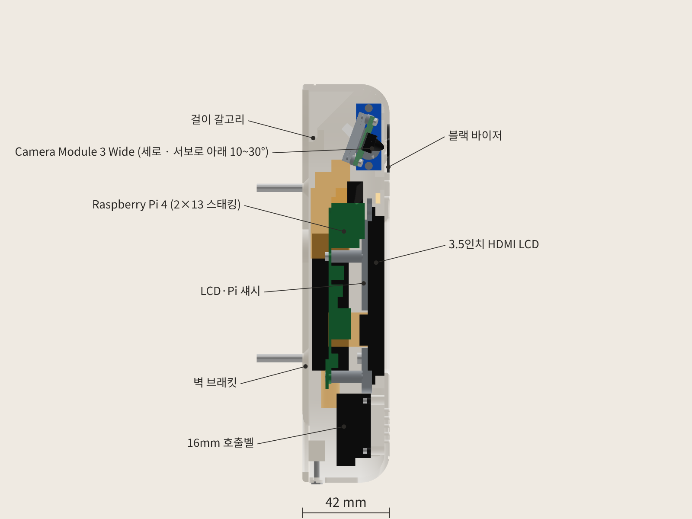

# DataCat 무인현관 초인종 외함 Rev F.2 (카메라 각도 모터 조절형)

Rev F(모터형)를 10/31에 실제로 산 부품(VL53L5CX V2 ToF, 상자형 스피커 70 × 31, USB 사운드카드 스틱)에 맞춘 버전입니다. 고정형 Rev E.2와 크기·아래쪽 배치가 같고, 카메라 부분만 다릅니다.



## 한눈에

| 항목 | 값 |
|---|---|
| 외형 | **124 × 192 × 42 mm** (Rev F는 105 × 192 × 42) |
| 출력 부품 | 6개: 전면 쉘, LCD·Pi 섀시, 벽 브래킷, 블랙 바이저, LED 라이트파이프, 카메라 크래들 |
| 카메라 각도 | 아래 10° ~ 30° (서보 가운데 = 20°) |
| 부품끼리 겹침 | 0 mm³ |
| 10 · 15 · 20 · 25 · 30°로 돌릴 때 | 크래들·카메라·혼이 어디에도 닿지 않음 |
| 벽에 걸고 내리는 경로 | 전 구간 충돌 0 |
| ToF 화각 45° × 45° | 가림 0 |
| STL | 6개 모두 닫힌 단일 덩어리. 크래들은 서포트 없이 출력 |

자세한 수치는 `validation.json`과 `printcheck.json`에 있습니다.



## Rev F → Rev F.2 바뀐 점

| 부분 | Rev F | Rev F.2 |
|---|---|---|
| 가로 | 105 mm | **124 mm** |
| 거리 센서 | VL53L0X, 세로로 세움 x +29 | **VL53L5CX V2 (24.1 × 10)**, 세로로 세움 x +29, 창 45° × 45° |
| 소리 | MAX98357A 앰프 + ø28 스피커 | **USB 사운드카드 스틱 + 상자형 스피커 70 × 31 (4 Ω 3 W)** |
| 스피커 고정 | 링 + 핫멜트 | **쉘 보스 4개 + M2.5 × 6 태핑**, 그릴과 스피커 사이 사각 테두리 |
| 버튼 | 화면 아래 왼쪽 | 왼쪽 아래 (x −33.6, y 30) |
| 마이크 | USB 2.0 위쪽 포트 | **USB 3.0 위쪽 포트** |
| 사운드카드 스틱 | 없음 | **USB 연장선으로 빼서 오른쪽 옆벽 안쪽에 세워 붙임** |
| 옆 통풍구 | 양쪽 | 왼쪽만 + **바닥 슬롯 5개** |
| ToF 연결 | 핀헤더 + 듀폰 | **선을 보드에 바로 납땜** |

카메라, 서보, 크래들, 회전축은 Rev F와 같습니다.

### 사운드카드 스틱을 왜 옆벽에 붙였나

Pi USB 포트에 스틱을 바로 꽂으면 스틱 끝이 윗벽 안쪽에서 3 mm밖에 안 남아서 3.5 mm 플러그를 꽂을 수 없습니다. 짧은 USB 연장선으로 빼서 오른쪽 옆벽 안쪽에 세워 붙이고, 잭은 아래(스피커 쪽)를 보게 했습니다. 서보는 바이저 높이(카메라 오른쪽 뒤)에 있어서 화면 옆의 스틱·연장선과 떨어져 있습니다.

## 동작 방식 (Rev F와 같음)

- 카메라는 크래들에 M2 × 5 태핑 4개로 고정됩니다. 크래들은 렌즈 앞면 7.5 mm 뒤를 지나는 가로축을 중심으로 돕니다.
- 왼쪽은 쉘 안쪽 귀에 M2 × 6 나사를 핀처럼 끼워 회전축으로 쓰고, 오른쪽은 SG90 혼에 크래들을 붙여 서보가 직접 돌립니다.
- 바이저 구멍은 10~30° 전체 화각을 합친 모양으로 뚫었습니다.

| 각도 | 잘 보이는 것 |
|---|---|
| 10° | 얼굴과 정수리까지. 문 앞 바닥은 0.8 m보다 먼 곳만 |
| 20° (기본) | 얼굴 + 문 앞 바닥(옆 0.6~0.9 m) |
| 30° | 문 바로 앞 바닥(0.5 m) + 얼굴 |

## 사야 할 것

| 규격 | 수량 | 들어가는 곳 | 물림 길이 |
|---|---|---|---|
| M3 황동 열압입 인서트 외경 4.5 · 길이 4 | 4 (+여분 2) | 쉘 안쪽 보스 | |
| M3 × 10 냄비머리 기계나사 | 4 | 섀시 귀 → 인서트 | 4.0 mm |
| **M2.5 × 6 냄비머리 태핑나사** | **8** | Pi 4개 + **스피커 4개** (쉘 보스 ø2.2) | 4.6 / 4.0 mm |
| M2 × 5 냄비머리 태핑나사 | 4 | 카메라 → 크래들 받침(ø1.8) | 4.0 mm |
| M3 × 16 냄비머리 기계나사 | 1 | 쉘 바닥 → 벽 브래킷 보스 | 6.9 mm |
| ø4 × 25 접시머리 나사 + 6 mm 칼블럭 | 2 | 벽 브래킷 → 벽 | |
| SG90 마이크로 서보 (혼·나사 포함) | 1 | 카메라 오른쪽 뒤 | |
| M2 × 8 냄비머리 태핑나사 | 2 | 서보 날개 → 쉘 기둥(ø1.8) | 5.5 mm |
| M2 × 6 냄비머리 기계나사 | 1 | 크래들 왼쪽 허브 → 쉘 귀, 회전축 핀 | 3.2 mm |
| 전해 콘덴서 470 µF 10 V 이상 | 1 | 서보 전원선 5 V–GND 사이 | |
| **USB 연장선 A수–A암 15~20 cm** | 1 | Pi USB 2.0 아래 포트 → 스틱. 암 단자가 18 × 9 mm 안쪽인 얇은 것 | |
| **3.5 mm 스테레오 케이블 (ㄱ자 플러그)** | 1 | 스틱 이어폰 잭 → 스피커. 한쪽을 잘라 L(팁)·GND(슬리브)를 스피커 선에 연결 | |
| 양면 폼테이프 (1 mm) | 조금 | ToF 보드, 사운드카드 스틱 | |



## 출력

| 파일 | 재질 | 방향 (`stl_print`는 이미 맞춰 둠) | 서포트 |
|---|---|---|---|
| `01_front_shell` | PETG 흰색 | 앞면이 베드 쪽 | 빌드 플레이트에서만 |
| `02_lcd_pi_chassis` | PETG / PLA | LCD 닿는 면이 베드 | 없음. 43 mm 브리지 1곳 |
| `03_wall_plate` | PETG / PLA | 벽 쪽 면이 베드 | 없음 |
| `04_black_visor` | 검정 PETG | 바깥면이 베드 | 없음 |
| `05_led_light_pipe` | 투명 PETG | 플랜지가 베드 | 없음 |
| `06_camera_cradle` | PETG (검정 권장) | 카메라 받침 뒷면이 베드 | 없음 |

권장 설정: 노즐 0.4, 레이어 0.2, 벽 3줄, 인필 20% (크래들은 40% 이상), 첫 레이어 수평 확장 −0.2.

## 배선 (Pi 물리 핀 번호)

| 부품 | 핀 | 연결 |
|---|---|---|
| VL53L5CX | VIN → 1 (3.3 V), GND → 9, SDA → 3 (GPIO2), SCL → 5 (GPIO3) | 양쪽 다 납땜 |
| VL53L5CX | LPn → 3.3 V (보드에 풀업이 있으면 비워 둠). INT·I2C_RST는 안 씀 | |
| 서보 주황 (신호) | 32 (GPIO12, 하드웨어 PWM0) | ㄱ자 듀폰 |
| 서보 빨강 (5 V) / 갈색 (GND) | 2 (5 V) / 6 (GND) | Pi 뒷면 납땜 + 470 µF |
| USB 사운드카드 스틱 | USB 2.0 아래 포트 (연장선) | |
| USB 핀마이크 | USB 3.0 위 포트 | |
| 호출벨 버튼 | 29 (GPIO5), GND 30 | ㄱ자 듀폰 |
| 버튼 LED 링 | 31 (GPIO6), GND 34 | ㄱ자 듀폰 |
| 상태 LED (선택) | 33 (GPIO13) → 330 Ω → LED → 39 (GND) | ㄱ자 듀폰 |

- 서보는 `pigpio`로 돌립니다. 1.5 ms 펄스 = 20°, 1°마다 약 11 µs (10° ≈ 1.39 ms, 30° ≈ 1.61 ms). 녹음 중에는 움직이지 않게 합니다.
- MAX98357A를 안 써서 `config.txt`의 `dtoverlay=max98357a`는 지웁니다. 사운드카드 스틱은 꽂으면 바로 소리 장치로 잡힙니다(`aplay -l`).
- VL53L5CX는 켤 때마다 펌웨어(약 84 KB)를 I2C로 올립니다. `dtparam=i2c_arm_baudrate=400000`으로 올려 두면 시작이 빨라집니다.
- 스틱의 이어폰 출력은 힘이 약해서 4 Ω 스피커 소리가 작을 수 있습니다. 부족하면 5 V 작은 앰프 보드(PAM8302 등)를 사이에 넣습니다.

## 조립 순서

1. 쉘에 M3 인서트 4개를 넣고, 블랙 바이저와 라이트파이프를 붙입니다.
2. 버튼을 끼우고 너트를 조입니다. 스피커를 그릴 뒤 사각 테두리에 맞춰 M2.5 × 6 4개로 고정합니다.
3. VL53L5CX에 선을 납땜하고, 바이저 오른쪽 세로 홈에 밀어 넣어 폼테이프로 고정합니다.
4. SG90을 쉘 기둥 2개에 M2 × 8로 고정하고, 가운데(1.5 ms)로 맞춘 뒤 혼을 끼웁니다.
5. 카메라를 크래들에 M2 × 5 4개로 고정하고, 크래들 오른쪽 팔을 혼에, 왼쪽 허브를 쉘 귀에 M2 × 6으로 연결합니다. 손으로 부드럽게 돌아야 합니다.
6. Pi 뒷면에 ToF·서보 전원선을 납땜하고, Pi를 섀시에 고정합니다. 스태킹 헤더와 HDMI FPC를 꽂고 LCD·섀시를 덮어 M3 × 10으로 조입니다.
7. USB 핀마이크를 USB 3.0 위 포트에, 연장선을 USB 2.0 아래 포트에 꽂습니다. 스틱을 연장선에 꽂아 잭이 아래를 보게 오른쪽 옆벽 안쪽에 붙이고, 3.5 mm 플러그를 꽂습니다.
8. 카메라 리본은 크래들 왼쪽으로 빼서 10~30° 움직일 여유를 두고 Pi CSI 포트에 꽂습니다.
9. 벽 브래킷을 벽에 고정하고 쉘을 걸어 바닥에서 M3 × 16으로 잠급니다.



## 부품 받으면 잴 것

| 잴 것 | 바꿀 값 |
|---|---|
| 사운드카드 스틱 두께(지금 8 mm 가정), 잭 위치 | `USB_SND` |
| 연장선 암 단자 크기 (18 × 9 mm 안쪽이어야 함) | `USB 연장선(공간)` |
| 스피커 앞판 두께 (2 mm보다 두꺼우면 M2.5 × 8) | 나사 길이 |
| VL53L5CX 보드 크기 | `TOF` |
| SG90 몸통·날개 구멍 간격 (제품마다 ±0.5 mm) | `SERVO` |

다시 만들기:

```bash
pip install cadquery trimesh scipy
python export_final.py      # step/, stl_print/, validation.json, printcheck.json
python tiltview.py          # images/tilt_range.png
pip install bpy && python export_blender.py
```

## 남은 것

- 오른쪽 옆 통풍구 대신 바닥 슬롯을 넣었습니다. Pi 온도가 70 ℃를 넘으면 왼쪽 통풍구를 늘리겠습니다.
- 움직이는 부품이라 고장 위험이 있습니다. 문제가 생기면 같은 크기의 Rev E.2(고정형)의 전면 쉘과 바이저만 다시 뽑으면 됩니다. 나머지 부품은 같습니다.
